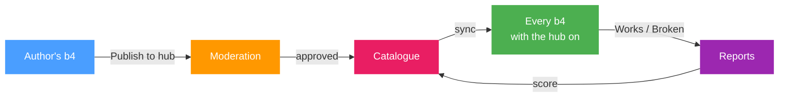

The **Community** page lists sets that other b4 users published, with reports on whether they work, and turns one into a local set in one step. The page is in the menu while the Community Hub is on, see [Switching it on](#switching-it-on).

- [Finding a community set](./browsing.md)
- [Applying a community set](./applying.md)
- [Reports and complaints](./feedback.md)
- [Publishing a set](./publishing.md) and [Sharing a set](../sets/sharing.md)

## The catalogue

The Community Hub at `https://hub.b4core.app` keeps the catalogue: the newest approved version of every published set, with the reports on it. A moderator approves every version before it is listed. The catalogue is signed with the hub's key, which is built into b4, and a list signed with another key is refused.

The router keeps a copy of the catalogue. It syncs the copy every hour, again 5 minutes after a sync that no hub answered, and at once on **Sync now**. The search runs on this copy, so a domain typed into it is not sent to the hub.

The copy expires when no hub has answered for two weeks. The page then shows a warning above the last catalogue received. Applied sets are ordinary sets in the configuration and keep working.

Reports count per strategy, not per set. Two sets with the same strategy share one score, and a new version that changes only the targets keeps the score of the previous one.

## What leaves the router {#what-leaves-the-router}

| Action | What the hub receives |
| --- | --- |
| Sync | A request for the catalogue. The hub sees the router's public address and b4 version, and answers with the network it sees the router on: ASN, country and ISP. |
| **Works** or **Broken** | The set and version, the kind of report, the domain the list was filtered by, if any, the router's ASN and country, its capture engine and b4 version. |
| Complaint | The set and version, and the reason typed in. |
| Publication | The [shared set](../sets/sharing.md). |

The names and targets of other sets, and the devices behind the router, are never sent. Every record is signed with the router's [author key](./publishing.md#author-identity). The hub knows a router by this key, not by an account.

## Status line

The line at the top of the page shows the catalogue date, the number of sets, the last sync, the network the hub sees the router on and the number of reports waiting to be sent. **Sync now** fetches the catalogue and sends the waiting reports.

| Message | Meaning |
| --- | --- |
| **The Community Hub is off.** | **Enable Community Hub** is off, and the list is hidden. |
| **No trusted hub key is available, so the catalogue cannot be verified.** | **Hub public key** holds a key that cannot be read, and the list is hidden. [Pointing a router at it](./hosting.md#pointing-a-router-at-it) describes where the key comes from. |
| **The catalogue expired on ...** | No hub has answered for two weeks. The last catalogue received stays listed. |
| **Last sync error: ...** | The last sync failed, for the reason the message names. The next successful sync clears it. |

## Search

The **Domain** field narrows the list to the sets that cover a domain. A pasted URL is reduced to its host name. A set covers a domain through a domain entry, a `regexp:` entry or a geosite category, and the card names the entry it matched through.

Categories are looked up in the geosite database of this router. A category named after the domain, such as `youtube` for `www.youtube.com`, matches without a database.

The closest match comes first: an exact domain, then a parent domain, a `regexp:` entry, a category. Among equal matches, the order is the nearest network with reports, the higher score, the more reports, then the newer update. With the field empty, the whole catalogue is listed, best rated first.

## Set card

The header shows the title, the author label, the version, the technique family, the b4 version the set needs and the targets. The strategy summary below says what the set does to packets, in the same form as a Discovery result. **Reports** on the right shows the score, see [Reading the score](./browsing.md#reading-the-score).

| Badge | Meaning |
| --- | --- |
| **Applied** | A local set was created from this one, and its strategy is unchanged. A click opens the local set. |
| **Applied, edited** | The strategy of the local set was changed after it was applied. |
| **needs payload** | The fake packets use a captured ClientHello. Applying fetches the file from the hub. |
| **block** | A [block set](../sets/blocking.md). |
| **pins** | The set pins domains to fixed addresses, listed under **Details**. |
| **blanket** | The set targets geosite categories only. |
| **catch-all** | At least one domain entry is a `regexp:` pattern. |

| Button | What it does |
| --- | --- |
| **Apply** | Creates a local set from this one, see [Applying a community set](./applying.md). On an applied set it reads **Applied**, and **Open set** opens the local set. |
| **Update to version N**, **Reapply** | Replace the local set with the published version, see [Updating and reapplying](./applying.md#updating-and-reapplying). |
| **Details** | Shows everything the catalogue holds about the set: all targets, the strategy, the payload files, the dates, the fingerprint and the set JSON. |
| **Report** | Sends a complaint to the moderators, see [Complaints](./feedback.md#complaints). |
| **Works**, **Broken** | Shown on an applied set. They report whether the set works on this network, see [Reports and complaints](./feedback.md). Disabled while the local strategy is edited. |
| **Test** | Shown on an applied set. Fetches a domain through b4 and around it, see [Testing an applied set](./applying.md#testing-an-applied-set). |

A link to a set that is not in the local catalogue, such as one still waiting for a moderator, opens **Set details** with a note saying so.

## Switching it on {#switching-it-on}

The connection to the hub is set under **Settings > Integrations > Community Hub**.

| Field | What it does | Default |
| --- | --- | --- |
| **Enable Community Hub** | Adds **Community** to the menu, starts the sync and shows the **Share with other b4 users** section in the set editor. A shared set pasted into **Import** is accepted with the switch off as well. | Off |
| **Hub mirrors** | Other addresses of the same hub, one per line, tried in order until one answers. Mirrors the hub approved are learned from it and added automatically, see [A mirror of another hub](./hosting.md#a-mirror-of-another-hub). | Empty, which means `https://hub.b4core.app` |
| **Hub public key** | Only for a [hub of one's own](./hosting.md#a-hub-of-its-own), together with its address in **Hub mirrors**. The key of `hub.b4core.app` is built in. | Empty |

**Hub status** shows the catalogue and when it expires (**Fresh until**), the last sync and its error, the key the catalogue was verified with (**Signed by**), the network the hub sees the router on, and **Unsent reports**, kept for 30 days. **Hub** lists the addresses in the order they are tried: the ones entered by hand, the built-in one, then learned mirrors. **Author identity** next to it shows the router's [author key](./publishing.md#author-identity).

b4's own requests to the hub pass through its packet processing like any other traffic. A set that matches everything, such as one with a `regexp:.*` entry, applies its strategy to them as well and is listed under **Matched by set**. A set for the hub addresses with no strategy, placed before it, keeps the hub out of that strategy. When such a strategy stalls the sync, b4 syncs over a connection its own rules leave alone and shows **Own traffic**. The sync keeps working, but a set or rule on this router breaks b4's own connections.

## Applied sets on the Sets page

A set applied from the Community page is an ordinary set with a **Community set** chip on its card. The chip opens the set on the Community page. Once the strategy differs from the published one, the chip reads **Community set, edited**, see [Applied and edited](./applying.md#applied-and-edited).
