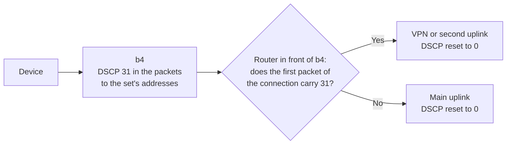

A set can write a DSCP value of its own into the packets sent to the set's addresses. DSCP is a field of the IP header, so the value leaves the host with the packet. The router in front of b4 tells the set's traffic apart by it and sends it, after b4 has processed it, through a route of its own, such as a VPN or a second uplink. b4 itself does not route by the value.



## Requirements

- A router in front of b4 that can match DSCP and route by a connection mark, such as Linux with nftables or RouterOS.
- b4 installs its firewall rules: **Skip IPTables/NFTables Setup** under **Settings > Core > Firewall** is off. With iptables, the `ipset` command and the `xt_set` and `xt_DSCP` kernel modules are present; on OpenWrt `xt_DSCP` comes with `kmod-ipt-ipopt` and `iptables-mod-ipopt`.
- A set with routing off or in **Network interface** mode, with no source devices and no source interfaces. [When the value is not written](../sets/routing.md#dscp-modes) lists every case.
- **Device Filtering** under **Settings > Core > Devices** off, or on with no device selected. While it has a device selected, in either mode, no set writes its value; **Set DSCP** still applies.

## Setup

1. Open **Sets**, open the set, then **DNS & Routing > Traffic Routing**.
2. In the **DSCP** block at the bottom, turn on **Enable per-set DSCP**. b4 fills in **DSCP value** with the first of `7`, `31`, `6` and `25` that no other set and no **Set DSCP** uses.
3. Click **Save Changes**.
4. Optionally, turn on **Set DSCP** under **Settings > Core > Firewall**. It writes its own value into every other packet, so no device whose traffic passes through b4 can pick the set's route by writing the set's value itself.

Each route needs a value of its own. The field is described under [DSCP](../sets/routing.md#dscp).

## Choosing the value {#choosing-the-value}

Every device on the path sees the value until something resets it, and some act on it. Linux Wi-Fi drivers, and access points that follow the same mapping, pick the WMM queue from it:

| Values | Wi-Fi queue |
| --- | --- |
| `7`, `31`, `6`, `25` | Best effort, as for traffic without a value |
| `8` and several other values below `24` | Background |
| `32`-`63`, and from Linux 6.8 on `24`, `26`, `28` and `30` | Video and voice |

`7`, `31`, `6` and `25` keep normal priority in cake and pfifo_fast as well. The hint under **DSCP value** lists where the other values land, and [Choosing the value](../sets/routing.md#dscp-values) gives the values for pfSense.

## Reading the value on the next router {#reading-the-value-on-the-next-router}

The router in front of b4 has to:

1. **Decide on the first packet of a connection and keep the decision**, with a connection mark. Routing each packet by its own field moves a connection to another route when the value appears in the middle of it, and behind NAT that breaks the connection. With flow offloading on b4's host, such as an nftables flowtable, `FLOWOFFLOAD` or hardware NAT, only the first packets of a connection carry the value.
2. **Compare the whole field.** nftables `ip dscp` and RouterOS `dscp=` compare all six bits. The `tos` selector of `ip rule` compares only some of them for IPv4: to it, `7`, `15`, `31` and `63` look the same.
3. **Reset the field on the internet uplink and on the tunnel**, so the provider and the far end of the tunnel do not see it. A reset in the forwarding path misses the packets that FastTrack, an nftables flowtable or hardware NAT carries past it.
4. **Accept the value only from b4**, by its address or MAC address. Devices whose traffic passes through b4 are kept out only by **Set DSCP** on b4.
5. **Let in the replies of the second route.** Strict reverse-path filtering, Linux `rp_filter` `1` or RouterOS `rp-filter=strict`, drops them.

While b4 is stopped, restarting or running without its packet engine, new connections carry no value and take the main route. A router that uses the **Set DSCP** value to keep b4's traffic out of a route leading to b4 sends that traffic back to b4 meanwhile; a match on the interface or the MAC address does not depend on b4 running.

### Linux with nftables {#linux-with-nftables}

One nftables table reads the value. In the example the router reaches b4 through `br-lan`, the main uplink is `wan`, the second route is the uplink `wanb`, and the set's value is `31`. The table goes into a file such as `/etc/dscp_route.nft`, loaded with `nft -f /etc/dscp_route.nft`; loading it again replaces the table.

```text
table inet dscp_route
delete table inet dscp_route
table inet dscp_route {
    chain prerouting {
        type filter hook prerouting priority mangle; policy accept;
        iifname "br-lan" ip saddr 192.168.50.2 ct state new ct status & confirmed == 0 ip dscp 31 ct mark set ct mark | 0x01000000
        iifname "br-lan" ip6 saddr { fd50::2, fd10::/64 } ct state new ct status & confirmed == 0 ip6 dscp 31 ct mark set ct mark | 0x01000000
        iifname "br-lan" ct mark & 0x01000000 == 0x01000000 meta mark set meta mark | 0x01000000
    }
    chain postrouting {
        type filter hook postrouting priority mangle; policy accept;
        oifname { "wan", "wanb" } ip dscp != 0 ip dscp set 0
        oifname { "wan", "wanb" } ip6 dscp != 0 ip6 dscp set 0
    }
    chain srcnat {
        type nat hook postrouting priority srcnat; policy accept;
        oifname { "wan", "wanb" } masquerade
    }
}
```

The marked connections take routing table `100`, whose default route leads out of `wanb`:

```sh
ip rule add fwmark 0x1000000/0x1000000 iif br-lan lookup 100 priority 1000
ip route add default via 100.64.2.1 dev wanb table 100
ip -6 rule add fwmark 0x1000000/0x1000000 iif br-lan lookup 100 priority 1000
ip -6 route add default via 2001:db8:b::1 dev wanb table 100
```

The `ip` applet of busybox 1.37 takes the same lines. Neither the table nor these commands survive a reboot by themselves; they belong in the router's startup scripts.

| In the example | Stands for |
| --- | --- |
| `br-lan` | The kernel device name of the interface toward b4, not OpenWrt's interface name |
| `192.168.50.2` | b4's IPv4 address, best fixed with a static lease. Forwarded IPv4 traffic carries it only while **Enable NAT Masquerade** is on in b4 ([NAT Masquerade](../settings/core.md#nat-masquerade)); without it, the subnet behind b4 joins it: `ip saddr { 192.168.50.2, <subnet> }` |
| `fd50::2`, `fd10::/64` | b4's own IPv6 address and the IPv6 prefix of the devices behind b4. The line is left out when no IPv6 passes through b4 |
| `31` | The set's value. Each further value needs its own pair of marking lines |
| `0x01000000` | A bit of the connection mark and the packet mark that nothing else on the router uses. A further route takes another bit and another table |
| `100`, `1000` | The table of the second uplink, and a free rule priority below the main table's `32766` and ahead of other policy rules |
| `100.64.2.1`, `2001:db8:b::1` | The gateways of the second uplink |
| Chain `srcnat` | Masquerading on both uplinks, which the router's own firewall may already do |

`ct status & confirmed == 0` matches only the packet that creates the connection; `ct state new` alone also matches a repeated SYN and moves the connection in the middle. nft 1.0.2 and later print it as `ct status ! confirmed`, which nft 0.9.8 does not accept. The marking lines change only their own bit, so programs that change only their own bits of the connection mark coexist with the table; a program that overwrites the whole connection mark breaks it. The reset keeps the two ECN bits and also clears the values LAN devices write for themselves.

With b4 on the same Ethernet segment, its MAC address can replace its addresses, for both families and with NAT Masquerade on or off: `iifname "br-lan" ether saddr 02:00:00:00:00:b4 ct state new ...` in both marking lines.

With software flow offloading, a flowtable takes over a connection and its packets skip the reset in `postrouting`. Two more rules and a table that resets the field on the way out of the uplinks fix that:

```sh
ip rule add oif wanb lookup 100 priority 1001
ip -6 rule add oif wanb lookup 100 priority 1001
```

```text
table netdev dscp_wash
delete table netdev dscp_wash
table netdev dscp_wash {
    chain egress {
        type filter hook egress devices = { "wan", "wanb" } priority 0; policy accept;
        ip dscp != 0 ip dscp set 0
        ip6 dscp != 0 ip6 dscp set 0
    }
}
```

The `egress` hook needs Linux 5.16 or later; nft 1.0.2 and later load the table, nft 0.9.8 does not. Instead of the table, cake with `wash` on both uplinks resets the field: `tc qdisc add dev wan root cake wash`, and the same for `wanb`. Without the `oif` rules every offloaded UDP flow through `wanb` loses a datagram, and without `iif br-lan` in the `fwmark` rules offloaded IPv6 replies go back out through `wanb` and the connections fail. The example was tested outside OpenWrt's firewall4 and without hardware flow offloading.

With `net.netfilter.nf_conntrack_checksum` at the kernel default `1`, fakes with a broken TCP checksum, such as those of the **TCP Check** strategy, are not tied to their connection: on the second route they leave through the main uplink with b4's address. OpenWrt sets the value to `0`, and the fakes follow their connection.

### RouterOS

RouterOS reads the value with mangle rules. [Routing a set's traffic by its DSCP value](../install/mikrotik.md#routing-by-dscp) gives them with the names of the container setup.

## Checking the result

- The **DSCP** block of the set shows no reason under the switch.
- **System Info** on **Settings > System > Service** shows a `Per-set DSCP` group under **Firewall**, with `applied` for the set and the number of addresses written for it.
- With `ipinfo.io` added to the set's domains, `https://ipinfo.io/ip` on a device shows the address of the second route.

## When it does not work

- **The first connection to a site takes the main route.** b4 had not learned the address yet. IP, CIDR, GeoIP and ASN targets carry the value from the first packet. See [The first connection](../sets/routing.md#dscp-first-connection).
- **The value does not arrive through a tunnel.** With a WireGuard output interface on b4, the router in front sees only the tunnel's packets, and WireGuard writes 0 into their DSCP field.
- **IPv4 connections over the second uplink fail.** Strict reverse-path filtering drops the replies. The kernel takes the larger of `net.ipv4.conf.all.rp_filter` and the interface's own value, here `net.ipv4.conf.wanb.rp_filter`; `2` or `0` lets the replies in.
- **The provider sees the value.** A flowtable or hardware NAT carries packets past the reset; see the flow offloading part of [Linux with nftables](#linux-with-nftables).
