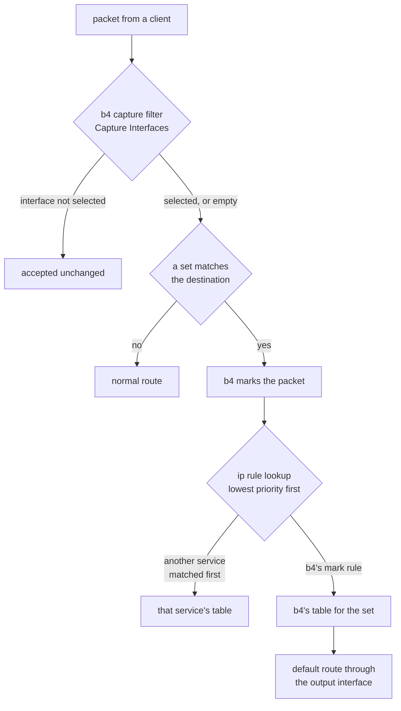

Xray with a TUN inbound and a b4 set in **Network interface** mode both put a route in front of the kernel's normal one. Run together, they meet in three places, and b4's web interface shows only one of them. The same applies to any service that terminates connections behind a TUN device: sing-box, a `tun2socks` client, or Xray run by hand instead of by [XrayUI](https://daniellavrushin.github.io/asuswrt-merlin-xrayui/en/install).

## What each service does

Xray's TUN inbound creates a network device, `xray0` below, and reads packets from it. It does not forward them: it terminates each connection, opens its own to the same destination from the same host, and copies bytes between the two.

```json
{
  "protocol": "tun",
  "tag": "ibd-tun",
  "settings": { "name": "xray0", "address": ["192.168.10.1/24"] },
  "sniffing": { "enabled": true, "routeOnly": true, "destOverride": ["http", "tls", "quic"] }
}
```

The device carries nothing by itself. Traffic reaches it through an `ip rule` and a routing table. XrayUI installs its own, and b4 installs its own for a set in **Network interface** mode. The rule priority decides which one applies, not the order in which the services were set up.

## The three layers



1. **b4's capture filter.** For forwarded traffic, **Capture Interfaces** under **Settings > Core > Packet Engine** compares the interface a packet leaves by. Once anything routes into the tunnel, that is `xray0`, so a list naming the uplink excludes everything the tunnel carries. See [Which interface is which](./interfaces.md).
2. **b4's marking.** A set with routing on marks the packets to its addresses. This is the part the web interface shows.
3. **The `ip rule` list.** The kernel walks the rules from the lowest priority number up and stops at the first one that gives a route. b4's rule has priority `10000 + table number`. XrayUI in TUN mode adds one at priority 51 for the whole local subnet:

   ```text
   51:    from 192.168.1.0/24 lookup 250
   10169: from all fwmark 0x4d05/0x27fff lookup 169
   ```

   Table 250 has a default route, so every packet from the local network ends there, and b4's rule is never reached, whatever mark the packet carries. b4's interface reports nothing, because b4's own rules are correct.

:::warning
Two services that both do policy routing do not merge. The one with the lower priority number takes every packet its selector matches. `ip rule` on the router shows the real order; neither web interface does.
:::

Every mark and `ip rule` of b4, and the values of Xray, XKeen and XrayUI, are in [Packet marks](./marks.md).

## Choosing which service routes

Both arrangements below work. A mixture of the two gives a set that marks traffic and changes nothing.

### Xray routes everything, b4 only bypasses DPI

XrayUI's rule for the subnet stays. Every client's traffic goes through the tunnel, and b4 handles the DPI bypass of whatever still goes out directly.

- **Capture Interfaces** under **Settings > Core > Packet Engine**: none selected. The uplink there switches b4 off for the whole local network, because none of that traffic leaves by the uplink any more.
- **Enable Routing** on b4's sets: off. Its rule would never be reached.

### b4 decides what goes into the tunnel

b4's sets pick the destinations, and the tunnel carries only those.

- The rule for the subnet on the Xray side goes: in XrayUI by turning off its transparent routing for the subnet, by hand by not adding a `from <subnet> lookup <table>` rule. Left in place, it takes every client's traffic before b4.
- **Capture Interfaces** under **Settings > Core > Packet Engine**: none selected.
- On the set, **DNS & Routing > Traffic Routing**: **Output Interface** `xray0`, **Source Interfaces** none selected unless the set covers one segment, and **Router's own traffic** at **Automatic**.

Xray still needs a route to its own server that does not lead back into the tunnel: the `/32` exception XrayUI writes into its table, which both arrangements keep.

**Automatic** keeps the router's own connections out of the tunnel, because Xray opens its own connection to each destination from the router, and routing it back into `xray0` loops. **Route it too** is safe only when Xray sends none of the set's destinations to a `freedom` or `direct` outbound. See [Router's own traffic](../sets/routing.md#routers-own-traffic).

## Packet manipulation with a tunnel egress

A set routed into a TUN, TAP or WireGuard interface does not run its bypass strategy: the segment b4 would change is the inner one, which never reaches the network as b4 wrote it. Its connections end with `[routed->xray0]` on the **Logs** page, and `flags:routed` finds them on the **Traffic** page. The strategy tabs keep their settings, which do not apply while the set routes into the tunnel. In NFQUEUE mode, a connection that another service sends into such an interface gets no strategy either; see [Packets that leave by another route](../internals/capture.md#tunnel-egress).

## XrayUI's TPROXY rule and connections b4 diverts

Each time xray starts, XrayUI adds this rule to the top of mangle PREROUTING:

```sh
iptables -t mangle -I PREROUTING 1 -p tcp -m socket --transparent -j DIVERT
```

`DIVERT` marks the packet `0x10000` and accepts it. The rule matches every packet addressed to a local transparent socket, which includes the connections b4 diverts to its own listeners: sets in the **Upstream SOCKS5 proxy** and **Telegram over WebSocket (built-in)** modes, and the Telegram over WebSocket switch. A packet the rule accepts never reaches b4's rule, and where no `ip rule` sends mark `0x10000` to the router itself, it leaves by the default route. The client's connection then never completes its handshake with b4's listener.

On iptables b4 keeps its routing jumps above every rule in mangle PREROUTING that matches local sockets. When such a rule appears above them, the next firewall check moves b4's jumps back and logs a warning naming the rule. The check runs at the **Firewall Monitor Interval (seconds)** under **Settings > Core > Firewall**, 10 seconds by default. Until then the Telegram over WebSocket card reads **Not working** and names the rule, and **Check again** on the card moves the jumps back at once. With the monitor off, at interval `0` or with **Skip IPTables/NFTables Setup** on, only **Check again** or saving the settings restores the order.

```sh
iptables -t mangle -L PREROUTING -n --line-numbers
```

The order is right when every `b4r_*_pre` line comes before `DIVERT`.

## Checking the result

Each command runs on the router and answers for one layer:

```sh
# 3. which table decides, for a client address
ip rule
ip route get 1.1.1.1 from 192.168.1.100 iif br0

# 2. whether b4 marks anything: packet counters on the set's chain
iptables -t mangle -L -n -v | grep b4r_
nft list table inet b4_route

# 1. whether b4 sees the clients at all: the Traffic page
```

`ip route get` follows the real rules. A destination that comes back with a table b4 did not create does not reach b4's rule. A destination outside every set that still goes to the tunnel device is routed by another service, and a test of b4 against it measures that service.
