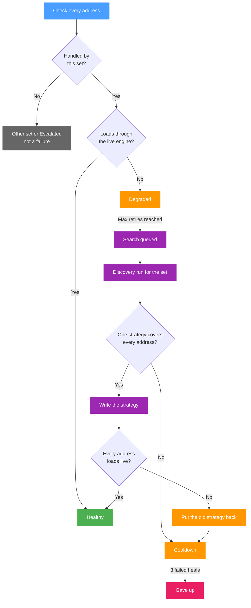

A [Discovery](../discovery.md) run applies b4's built-in strategy presets one after another on a capture queue of its own, fetches every site through each, and keeps the presets that made the page load. The configured sets keep working during a run: only the run's own fetches go through the strategy under test. The [watchdog](../watchdog.md) heals a set with the same kind of run.

## The phases of a run

| Phase | What happens |
| --- | --- |
| **DNS** | Each site is resolved and the answers are checked, unless **Check DNS for tampering** is off. Alternative addresses are searched here too. A pinned name skips this phase. |
| **Without bypass** | Each site is fetched with no strategy. A site that loads through an honest answer needs no bypass and leaves the search, though it is still fetched through every preset for comparison. A site that loads only with a corrected DNS answer, an alternative address or without ECH is reported as found, with a set that changes no packets. A link answered with HTTP 400 leaves the search too. |
| **Strategies** | The remembered winners, then community sets when that option is on, then the 18 built-in opening presets are applied one at a time, and every site is fetched through each. |
| **Tuning** | For every technique family that produced a working preset, its parameters are varied on the site that responded best, and the result is checked against all sites. |
| **Combining** | When two or more families worked, presets that combine them are tried. |
| **Confirming** | The winner of every site is rebuilt exactly as it would be saved as a set and fetched three more times. A winner that fails any of those fetches gives way to the next candidate. A DNS answer the DNS phase left undecided is checked last, see [The DNS check](#the-dns-check). |

During the search, a preset has to pass as many fetches in a row as **Confirm each strategy** says. The confirmation phase is separate and always fetches the winner three times. **Stop and confirm** skips the remaining phases and goes straight to the confirmation, so the result is confirmed but not tuned.

### Timings and speeds

**Discovery Timeout** limits one fetch of a site through one of its addresses, from the connection to the end of the read, and each address a fetch tries gets the whole limit. The DNS phase bases its limits on the same value. **Config Propagation Delay** is the pause between switching the run's capture queue to a new preset and the first fetch through it. The confirmation fetches wait the same pause.

Each speed in the results comes from one fetch of at most 100 KB, timed from the start of the request, connection and TLS handshake included. The figures compare strategies on the same site, not the throughput of the connection.

### Which strategy a card offers

A card groups the sites that one strategy loaded. The strategy that loaded the most sites gets one card for all of them, and the remaining sites are grouped the same way. Among strategies that loaded as many sites, the first in this order wins:

1. a result that changes no packets: a DNS fix, an alternative address or removed ECH keys;
2. a remembered winner, the one that has worked most often in earlier runs first, then community sets and the set's own strategy;
3. the opening presets, in their built-in order;
4. tuned presets, then combined ones.

Speed does not decide. During the run, the row of a site shows its fastest strategy as **Fastest so far**, which can differ from the strategy its card offers. The confirmation covers both.

A card lists up to twelve other strategies that loaded every site on it, fastest first, by each strategy's lowest speed across those sites. The history entry of each of its sites stores the same list.

### One run at a time

Only one run is in progress at a time, and the watchdog shares it. A heal that comes due during a run started by hand waits for it, and a run cannot start by hand during a heal. A firewall refresh started during a run waits for the run to finish. A rewrite of b4's DSCP rules does not wait and stops the run, see [DSCP rules](./dscp.md#discovery). After a run, its capture queue and firewall rules are released, which takes a few seconds.

Discovery's own fetches skip the sets, so its verdict on an address is the raw one. Another tool run on a machine where b4 works goes through b4's sets, and a TLS check that passes there measures the bypass, not the network. Local and private destinations, and names or redirects that lead to them, are never fetched.

## A run for a set

A run for a set tests at most five addresses as one group and ends with one verdict for the set.

- **The set's own strategy goes first.** Right after the fetch without bypass, every address is fetched through the set's current TCP, fragmentation and fake packet settings, tested alone.
- **Confirmation is joint.** While **Stop at the first strategy that works for every address** is on, a strategy that loaded every address is rebuilt as the set would carry it, and each address is fetched three times through it in one configuration. When every fetch passes, the search stops there. After three strategies have failed this confirmation, the run no longer stops early. With the option off, the run completes and then confirms up to three strategies the same way. The first to pass decides the verdict.
- **A missing DNS part counts.** When the set's strategy loads every address only with a DNS redirect or a pin the set lacks, the verdict is **one strategy covers every address**, so applying it writes that DNS part into the set.
- **The set's DSCP value goes along.** The probes of a set with its own [DSCP value](./dscp.md#discovery) carry it, so the router in front of b4 routes them as the set's traffic.

A name the set pins is tested through the set's pins, unless the name is given under **Pinned addresses**. When none of them accepts a connection and the DNS check is on, the name is checked as if it had no pins. Applying the result keeps the set's pins unless the run found other addresses for that name.

## The DNS check

The DNS check compares each site's address from the system resolver with a reference: the trusted DNS server when one is set, otherwise the public resolvers built into b4, DNS over HTTPS first, then plain DNS.

A trusted DNS server is the only reference. Its answers are taken as the correct addresses and its NXDOMAIN as a name that does not exist. Before a run, it is asked about one of the run's names. When no answer comes back or the server refuses, the run stops with an error. An error answer such as SERVFAIL does not stop it. A server that stops answering later leaves the site it was asked about without a DNS comparison.

An address serves the site when it completes a TLS handshake with the site's name, with no strategy. The system resolver's answer is honest when one of its addresses serves the site, or when it shares a network with the reference: the same /24, or the same first 48 bits for IPv6. When the reference's addresses accept connections, the answer is wrong in these cases:

- the system resolver gives no address while the reference does;
- only a reference address serves the site;
- the answer holds a private or reserved address;
- [the first hop](#gateway-interception) in front of this host answers part of its addresses, but not all.

For a site blocked by its name, the addresses accept connections, but none completes the handshake without a strategy, the reference's included. When none of the cases above applies to such an answer, the verdict waits for the end of the run, and the search runs with the DNS fix, as for a wrong answer. During **Confirming**, the first two addresses of the system answer are fetched through the strategy the result offers. It is built as the set would carry it, without the DNS fix, and each address gets up to two tries.

- When every address loads the page, and the certificate of its first answer, before any redirect, is valid for the site, the answer is honest. The set gets no DNS fix, unless another site on the same card needs one. It does not pin the reference's addresses either, and [alternative addresses](#alternative-addresses) stay pinned.
- When an address fails, the answer is wrong, and the set keeps the DNS fix.
- When the check cannot run, the set keeps the DNS fix it was tested with. That is the case when the result changes no packets, when the site's link starts with `http://` and so shows no certificate, or when **Stop now** ended the run.

The certificate is verified against the same root certificates as in the [watchdog's checks](#how-the-watchdog-checks-a-set). A router without root certificates checks only the name in it.

When the system resolver gives a site a wrong address, the proposed set gets the first DNS fix that works:

1. the trusted server itself, when a set can use it: a public IP address on port 53 that answered over UDP and is not one of this host's own, or an `https://` URL;
2. a built-in DNS-over-HTTPS server that returns the correct address;
3. a built-in plain DNS server that does so, asked plainly and then with the query fragmented;
4. the addresses DNS over HTTPS or the trusted server gave, pinned in the set. An answer from the built-in plain DNS servers is never pinned, since it can be forged on the way.

A trusted server a set cannot use, such as a local proxy on another port, a resolver on the local network or a `tcp://` server, still decides which addresses are correct. The run log says why it did not go into the set. A resolver on the local network stays out because a set's DNS redirect hands that resolver's own queries back to it, unless they come from the exact address the set names.

### When a name does not resolve

**does not resolve** needs the fetch without bypass to fail on the lookup of the name, and the system resolver, asked again, to answer that the name has no IPv4 or IPv6 address. When that second lookup fails instead, the verdict also needs the DNS check on and no address from any source of the DNS phase. A name the DNS phase found an address for never gets this verdict.

An NXDOMAIN from DNS over HTTPS or the trusted server is reported as a name that does not exist, and no alternative addresses are searched for it. For an internationalized name, such as a `.рф` domain, only the system resolver's answer for its ASCII form (`xn--...`) counts.

## Alternative addresses

The search starts when every known address of a site fails, or when the reference answers fail the TLS handshake. The DNS phase then asks a public resolver, through EDNS Client Subnet, how clients in some five hundred other /16 networks are answered for the name. The addresses that come back are checked for a TCP connection, then the fastest for a TLS handshake with the site's name.

An address that completes the handshake is one the block does not cover. The site is fetched through it, and the set pins the name to it, up to three addresses. An address that accepts the connection but not the handshake is filtered by name like any other. It becomes the probe target only when the site's own addresses refuse connections outright, and the strategies are searched on it.

A set with pins, or one built for a site whose addresses were blocked, gets IP block detection on its TCP tab. A pinned address that stops answering is left out of DNS answers, and when all of them are gone the query goes to the resolver. A run for a set searches again once none of its pinned addresses accepts a connection.

## Gateway interception

The DNS phase also sends a SYN to the site's addresses with a hop limit of one, which nothing beyond the first hop can answer. A reply means a transparent proxy on the first hop carries the connection, and no strategy from this host reaches past it. The run stops after the DNS phase when every address is served that way, unless another region's DNS answer gives an address that routes normally.

## ECH

After the DNS phase, Discovery asks the router's resolver for the HTTPS record of every site with an `https://` link. For a site whose record carries an ECH key, every fetch sends Encrypted ClientHello. The outer ClientHello then names the key's public name, such as `cloudflare-ech.com` for every Cloudflare site, and every set the run builds for the site targets that name too. When the server has changed its key, the fetch is repeated with the key the server sends back. When the server declines ECH, the fetch is repeated without it, as browsers do. A key for an exchange other than X25519 counts as no key, and a run limited to TLS 1.2 looks up no keys.

When the fetch without bypass fails with ECH, the same fetch without ECH loads the site, and two more fetches with ECH fail, DPI drops ClientHellos that carry ECH. The result is **ECH keys removed**, a set that also lists the public name and so removes the keys of every site whose key names it. The confirmation fetches without ECH, as a browser behind that set connects.

The record lookup skips the sets too. When `/etc/resolv.conf` names a local cache, such as dnsmasq on the router, the cache's upstream answers pass through b4. Where a set removes ECH keys for every device, the cache holds answers without the key, and the probes send ordinary ClientHellos, like the browsers behind the router.

## A finished run

A finished run stays in memory for 30 minutes, or until b4 restarts. A later run started the same way replaces it when that later run ends. Runs from the Discovery page, over MCP and by the watchdog each replace only their own kind. When the last run to end was started from the Discovery page, reloading the page or opening it again within that time shows its results, in any browser. **New search** hides them in the browser where it is clicked. A run the watchdog or an MCP client started is not shown again after a reload. Its results are in the history.

## History storage

The history keeps the last hundred results, one entry per site. An entry stores the set the run built, the set of the site's fastest strategy and the sets of the other strategies its card listed, up to twelve. Those sets take most of the space: a site with many working strategies costs tens of kilobytes. The history also keeps the last run of each set, for up to 64 sets, and the log of the last run survives a restart.

## How the watchdog checks a set

First, the engine is asked which set it uses for each address's host name, from the router's view. An address handled by another set, by none, or sent elsewhere by an escalation is not a failure. Then each address this set handles is fetched through the live engine, the way a device behind the router reaches it:

| Rule | Result |
| --- | --- |
| The certificate is verified against the system root certificates and those Entware installs under `/opt/etc/ssl` | A certificate error makes the address **Unusable**. A router with no root certificates skips the check. |
| The server requires a client certificate | **Unusable**. |
| A private or local destination, on any hop | **Unusable**. |
| More than 3 redirects, or a redirect to a known block page | Fails. |
| HTTP 400, 451 and any 5xx | Fails. |
| A block page in the first 4 KB, or fewer than 1 KB read | Fails. At most 100 KB is read. |
| A body cut off before its end: less than 90% of the announced length without a closing `</html>`, or a read error | Fails. |

IPv6 is used only while the capture engine handles it. **Check Timeout** limits the whole fetch. An **Unusable** address is never healed.

## How a heal runs

After **Max Retries** failed checks in a row, the set is queued. Heals run one at a time, in order. A set edited while it waits is taken out of the queue and checked again first.

A heal is a run for the set on the addresses the set handles and can use. The DNS check is skipped, the current strategy goes first, each strategy has to pass three fetches in a row, and the search stops at the first strategy confirmed on every address. After 15 minutes the search is stopped and what was found is confirmed. After 20 minutes the run is canceled, and the heal fails.

Only **one strategy covers every address** is written, by the rules of writing into an existing set from the Discovery page. IP block detection stays as it was, unless the result turns it on. Nothing is written when the set was edited during the heal, or when the set's traffic no longer takes the DSCP path the heal's probes took, see [DSCP rules](./dscp.md#discovery).

After the write, b4 clears the escalations it holds for the set's hosts, waits for **Config Propagation Delay**, and fetches every address the heal ran on, up to two tries each. When all load, the heal is done. Otherwise the set's TCP, UDP, fragmentation, fake packet and DNS settings are put back. The put-back is skipped when the set was edited after the write, so a hand edit is never overwritten. No other set is touched.

The fetches in a row during a heal (3) and the tries per address after a write (2) can be changed only in the [configuration file](../advanced/config.md). The global switch takes effect within 10 seconds, and turning it off cancels a heal in progress. A check or a cooldown already scheduled keeps its time when the timings change.

Settings pages and the set editor send the revision they loaded with every save. When a heal has changed the configuration since then, the save is refused with an offer to reload.

### The older per-domain list

An entry of the older list is checked on its own. After **Max Retries** failed checks, Discovery runs for the domain with the DNS check skipped. A confirmed result for a domain that needs a bypass goes into the first enabled set without routing whose domain list holds the domain or a parent of it. A GeoSite match does not count. Without such a set, a new set `watchdog-<domain>` is created at the top of the list. A matched parent gets the domain itself added, and the firewall rules are refreshed when the write changes the intercepted ports.

The run for a domain carries the DSCP value of the set that handles the domain at that moment. Domains whose sets carry another value get a run of their own right after it, if they still fail. A result goes into a set only when that set's traffic takes the path the probes took.

The watchdog's reactive approach is inspired by the [belotserkovtsev/ladon](https://github.com/belotserkovtsev/ladon) project.

## How the DPI Detector fetches

The [DPI Detector](../detector.md) fetches every site twice: directly, with b4's processing bypassed, and through b4 with the sets in effect. A check made only through b4 would hide the block it is meant to show. The through-b4 fetch takes its address the way a client of the matching set would: a pinned address first, then the set's DoH or DNS server when it has a DNS redirect, then the system resolver. Up to three addresses are tried on each side, since a site is often blocked on only some of them.

The direct fetch uses the first three nameservers in `/etc/resolv.conf` of b4's host, or 127.0.0.1 and ::1 when it lists none. On a container install, that is the container's own DNS setting. A name this resolver gives no address for, while DoH does, is asked once more, one name at a time. After three retries in a row time out, the remaining names keep their first answer.

In the DNS scope, an identity query to each resolver over UDP shows which network answers port 53. A redirect to a known public resolver is not marked: a router that forwards port 53 to AdGuard Home with Google upstream shows Google. When at least five public resolvers answered and all of them from one network, the summary reports that port 53 is redirected.
