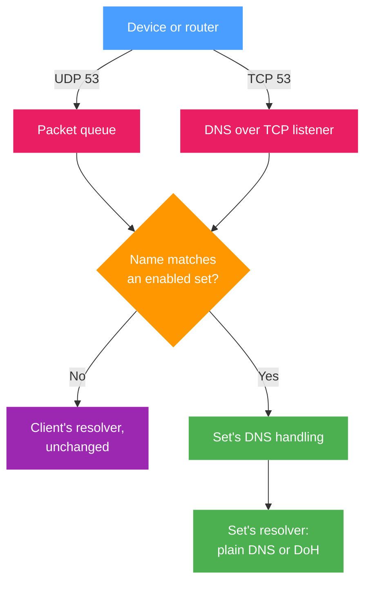

b4 intercepts DNS on port 53 and answers the names its sets target. The options and how to check them are in [DNS for sets](../dns.md). What follows is the mechanism behind them, for integrators and for debugging.

## What b4 intercepts {#what-b4-intercepts}

| Transport | How it reaches b4 | When |
| --- | --- | --- |
| UDP port 53 | Queue rules in `PREROUTING` and `OUTPUT`: requests (`dport 53`) from the raw table, ahead of conntrack (priority -300 on nftables), and replies (`sport 53`) from the mangle table. The exceptions are under [Requests and conntrack](#requests-and-conntrack) | Always, while b4 is running |
| TCP port 53 | A `nat` `REDIRECT` to a local listener, **Listener port** 5453 by default | While an enabled set has a DNS server, a DoH URL or **Remove ECH keys from DNS answers** on, and **Intercept DNS over TCP** is on |

Both cover traffic forwarded from the network and the queries the router makes for itself. The queries b4 sends on a client's behalf, and its lookups through a set's resolver, carry the [queue mark](../guides/marks.md#the-queue-mark). The rules skip packets that carry it, so such a query never re-enters the queue. Lookups b4 makes through the router's own resolver carry no mark.

TCP interception needs `REDIRECT` in the `nat` table. Where the kernel does not provide it, b4 logs a warning, and DNS over TCP stays with the client's resolver for that address family.

In TUN mode, requests to port 53 are captured, but replies are seen only when b4 carries the whole default route. Redirects and pins work either way, since b4 produces those answers itself. When b4 cannot install its NOTRACK rule, TUN captures only the device's own traffic, and the DNS of other hosts reaches b4 only when a resolver on this device handles it, see [Forwarded traffic and the raw table](./capture.md#tun-forwarded).

### Requests and conntrack {#requests-and-conntrack}

A device usually asks for a name's IPv4 and IPv6 addresses at the same moment from one socket. A request held in the queue after conntrack has seen it carries a connection entry the kernel has not confirmed yet, so the second request gets an entry of its own. Kernels before 4.18, and 4.14 before 4.14.173, drop it when the two entries clash; the table below calls them older kernels. Queued from the raw table, the requests reach conntrack one after the other, once b4 has released them. KeeneticOS runs its raw table after conntrack, and b4 does not use it there.

Where b4 takes the requests therefore depends on the firewall, the kernel and the firmware:

| Firewall and system | DNS requests |
| --- | --- |
| nftables | Queued at raw priority. Where that chain cannot be created, queued in `prerouting` and `output` with a warning |
| iptables elsewhere, newer kernel | Queued from the raw table. Where the raw table cannot queue packets, queued in mangle with a warning, and System Info shows **DNS queries queued before conntrack (raw)** as unavailable |
| iptables elsewhere, older kernel | Queued from the raw table. Where it cannot queue packets, [copied](#copied-requests) with NFLOG, and held in mangle with a warning where neither works |
| iptables on KeeneticOS, newer kernel | Queued in mangle |
| iptables on KeeneticOS, older kernel | Copied with NFLOG. Where NFLOG is missing, held in mangle with a warning |

Wherever requests are held in mangle on an older kernel, the second of two simultaneous requests can be lost as described above.

## How a set handles a query {#how-a-set-handles-a-query}

The query name is matched against the set targets exactly like an SNI is, so a domain entry covers its subdomains and `regexp:` entries are supported. Literal entries are tried before regular expressions: a domain listed in one set is not taken over by a `regexp:.*` catch-all in another.

For a matched query, b4 works through these steps in order:

1. **Blocking.** In a [block set](../sets/blocking.md), the query is answered with NXDOMAIN or dropped, according to the block action.
2. **Pinned addresses.** If the name has a pin, b4 answers from the pin and stops, whether or not the redirect is enabled.
3. **Resolver.** If the redirect is enabled and a resolver is configured, b4 resolves the name itself and answers the client directly. Otherwise the query is forwarded unchanged.
4. **The answer.** Addresses from the answer are remembered for the client, and written into the set's IP set when [routing](../sets/routing.md) is on. An answer, forwarded or pinned, that brings addresses b4 has not written to the set recently is held until b4 has updated the set, at most 250 ms each time b4 sees the answer, so the connection that follows usually takes the set's route. With the TUN engine the answer is not held. Before the answer reaches the device, b4 can rewrite it: it removes [ECH keys](#ech-keys), removes IPv6 addresses for [the IPv4 fallback](../dns.md#the-ipv4-fallback), and removes or replaces unreachable addresses when the set's IP block detection has **Heal DNS answers** on.

With [copied requests](#copied-requests), each answer in these steps takes the place of the resolver's reply, and a dropped query is a dropped reply.

### The set's resolver {#the-sets-resolver}

With a plain DNS server, b4 sends the query to that IP itself, as IP fragments when **Fragment DNS Queries** is on. With a DoH URL, it sends the query as an HTTPS request, POST first and GET if the server rejects POST. When both are filled, the DoH URL is used.

At most 64 UDP queries are resolved through the sets' resolvers at a time. A further query goes on to the client's resolver unchanged and is logged as `dns-overload`.

A resolver that times out or errors does not end the lookup. b4 answers from the last good reply it holds for that name, and when it holds none, it puts the query to the resolver the client was addressing. Three failures in a row take the configured resolver out of the path for 30 seconds, so a resolver that has gone away costs one timeout rather than one per query. With **Fail closed when the resolver is unreachable** on, the client gets SERVFAIL instead, and b4 does not fall back.

### Queries from the set's resolver {#queries-from-the-sets-resolver}

A query that comes from the address of the set's own resolver is forwarded unchanged rather than handed back to it, unless b4 blocks the query or answers it from a pin. So a resolver elsewhere on the network can ask its upstream over plain DNS through the router. Any other query from that address is forwarded unchanged as well, including those of containers or VPN clients behind NAT on the resolver's host. A DoH URL is compared the same way when it names its server by IP address.

Only the address the set names is compared: a query the resolver sends from another of its addresses, such as an IPv4 query from a resolver the set names by its IPv6 address, is still handed back to it. The comparison is not made for a resolver on the router itself, so that the router's own lookups go to it. Such a resolver, and the router's resolver whenever a resolver on the network uses it as its upstream, has to reach its own upstream over a transport b4 does not intercept, such as DNS over HTTPS or TLS.

### Pins {#pins}

- The pin list is the whole address answer for the name. A and AAAA queries are answered with the pinned addresses of the matching family. An AAAA query for a name pinned to IPv4 only, and the CNAME, SVCB, HTTPS and ANY queries, get an empty answer rather than the resolver's, which would carry the site's CNAME past the pins.
- An A query for a name pinned to IPv6 only still goes to the resolver, and so do the other record types, MX, TXT or SRV among them.
- Pinned answers have a 60 second TTL.
- In a set without routing, b4 connects to every pin on TCP port 443 when it starts, when a set is saved and at the **Retest interval (seconds)** of IP block detection, and leaves out of the answer the addresses that do not answer. The pins of a set with routing are not checked, since the check connects straight from the router while the set's connections leave through its route.
- When every pin of a family fails the check, the pins are answered anyway, so a pinned host that does not listen on port 443 keeps its pin. When the set's IP block detection has marked every pin of the family unreachable, the query goes to the resolver instead.

### ECH keys {#ech-keys}

**Remove ECH keys from DNS answers** acts on HTTPS and SVCB answers: forwarded ones, answers from the set's own resolver and DNS over TCP.

- Only the `ech` parameter goes, together with its entry in `mandatory`, and `mandatory` itself when nothing is left in it. The ALPN list, the address hints and the TTL stay as they were.
- The RRSIG records over the changed records are dropped and the AD flag is cleared, since the changed records no longer match their signatures.
- Listing `cloudflare-ech.com` in a set also makes the set match, by server name, the ECH ClientHellos of clients that kept the key, and its TCP and UDP settings apply to them. A set made only to remove keys changes no packets, so those ClientHellos pass unchanged.

## Lookups b4 makes itself {#lookups-b4-makes-itself}

b4 also resolves some of a set's names on its own behalf. It pre-resolves the domains of a set with [routing](../sets/routing.md) on. For a set that writes its own [DSCP value](../sets/routing.md#dscp-addresses), it looks up the first 256 entries of the domain list that are not `regexp:` entries. For a set in proxy mode, it looks a name up when a client of b4's SOCKS5 proxy asks for it with **Send domain name to upstream** off, when the upstream refuses the name, and when the connection falls back to direct. With the redirect enabled and a resolver configured, these lookups go to that resolver, not to the router's own. A change to the resolver settings resolves the domains of a set with routing, or with its own DSCP value, again.

An answer from the set's resolver is final whatever it says: a name that does not exist, no address, SERVFAIL or REFUSED. A resolver that does not answer in time or cannot be reached is followed by the router's resolver, and with **Fail closed when the resolver is unreachable** on, the lookup fails instead. These lookups share the redirect's count of failures: after three in a row the resolver is skipped for 30 seconds, the lookups go straight to the router's resolver, and a set with fail closed on does not pre-resolve its domains in that time. The last good reply is not used for them, and plain DNS is sent unfragmented.

## Copied requests {#copied-requests}

Where the [table above](#requests-and-conntrack) says so, b4 holds no DNS request. A rule at the top of mangle `INPUT`, `FORWARD` and `OUTPUT` sends b4 a copy of each request with NFLOG, to the group numbered like the first queue, 537 by default, and the request goes on to its resolver at once. b4 runs the copy through the same set handling as a request in its queue, and the Traffic page and the log record the same results. The resolver's reply reaches the queue as before, and b4 settles it by what the set did with the copy:

| The set | The resolver's reply |
| --- | --- |
| Blocks the name with the **Reject (fail fast)** action | Replaced with NXDOMAIN |
| Blocks the name with the **Drop (silent blackhole)** action | Dropped |
| Pins the name | Replaced with the pinned answer |
| Resolves the name through the set's resolver | Held until b4 has its answer, from that resolver or from a fallback, then replaced with it. A reply held for twice the query timeout plus 2 seconds passes unchanged |
| Forwards the name unchanged, or does not match it | Handled like any other reply, the removal of ECH keys included |

When the device asked a resolver on the router itself, b4 also sends its answer on its own once 20 ms have passed without a reply and the answer is ready. A reply that comes later is still replaced with the same answer, and the device then receives it twice.

- **The resolver still sees the name.** The resolver the device asked receives every request and, unless it holds the answer, asks its own upstream, also for a name a set resolves over DoH. The lookup the router's resolver sends upstream while b4 still owes a device the answer for the same name passes unchanged, and that resolver caches the real answer, ECH key included.
- **A resolver outside the router has to reply.** A device that asks a resolver outside the router gets b4's answer only in place of that resolver's reply, and no answer at all while that resolver does not reply. A reply from such a resolver that arrives while b4 already holds 512 replies passes unchanged.
- **Port-changing `nat` rules are not supported.** When a `nat` rule moves DNS requests to another port, such as a `REDIRECT` to a local resolver on port 5353, the replies come back from that port and b4 cannot act on them. The sets do not answer, block or redirect the names asked through such a rule, and b4 logs a warning that names it.
- **A request that NAT moves to another source port is not acted on.** b4 matches the resolver's reply to the copy by the port the device sent the request from, and the reply reaches b4 before NAT restores that port. The device then gets the resolver's answer, while the Traffic page and the log record what the set did with the copy. Masquerading keeps the port unless another connection to the same resolver already holds it. KeeneticOS before 3.5, MAP-T with a shared IPv4 address and NAT rules with `--random` or `--random-fully` change the port of nearly every request.
- **Requests sent from port 53 are not acted on.** A resolver or device that sends its requests from UDP port 53 gets the replies on port 53, and such replies do not reach the queue. b4 ignores the copies of these requests, their replies pass unchanged, and the Traffic page and the log record nothing about them. For a resolver on the router, this concerns only the requests it sends upstream.
- **After a lost copy, the device gets the resolver's answer.** When copies arrive faster than b4 reads them, the kernel discards the excess, and the replies to those requests are handled like any other reply.

System Info shows the row **DNS queries copied, not held (NFLOG)** under **Kernel Capabilities** on these routers. It is available while b4 copies the requests, and unavailable while b4 holds some of them after conntrack, with the missing modules, or while the listener that receives the copies is stopped, with its error. On KeeneticOS the row **DNS queries queued before conntrack (raw)** is not shown, and an unavailable row names the firmware component to enable instead of packages. **Copy JSON** in System Info gives the counts of copies, of lost and ignored copies, and of replaced, dropped and unchanged replies under `firewall.dns_query_copy`.

## Log lines {#log-lines}

b4 logs these lines about copied requests:

| Log line | Meaning |
| --- | --- |
| `IPTABLES[iptables]: KeeneticOS runs its raw table after conntrack (kernel ...), so b4 copies DNS queries with NFLOG (group 537) instead of holding them in its queue` | b4 copies the requests of that binary, `iptables` or `ip6tables`. Outside KeeneticOS the line starts with the reason the raw table cannot queue them. Logged once |
| `IPTABLES[iptables]: b4 cannot copy DNS queries with NFLOG (...)` | Copying failed for the reason in the brackets, and b4 holds requests after conntrack. Outside KeeneticOS the line starts with the reason the raw table cannot queue them and reads `cannot copy DNS queries with NFLOG either`. Logged once |
| `DNS: the NFLOG copy of DNS queries stopped (...)` | The listener that receives the copies stopped, and replies are not replaced with b4's answer until it runs again. At its next check the firewall monitor starts it again or holds requests in the queue. With **Firewall Monitor Interval (seconds)** at `0` there is no such check, and the listener starts again only at a restart or at a save that rebuilds the firewall rules |
| `DNS: N copies of DNS queries were lost; ...` | Copies the kernel discarded, at most one such line every 5 minutes |
| `DNS: b4 already has 8192 DNS answers to deliver, ...` | b4 was already acting on 8192 requests, its limit, and the replies to the requests copied after that were not replaced with its answer |
| `DNS: b4 already has 64 DNS answers to deliver for the A query for ... with ID ...` | b4 was already acting on 64 copies of one request, with the same name, type and ID but sent from different sockets or devices, and the replies to further copies were not replaced. At most one such line a minute |
| `IPTABLES[iptables]: the nat rule "..." moves DNS queries to port ...` | A `nat` rule that changes the port, see above |

The decisions about each query appear in the log as `dns-` results, such as `dns-doh->`, `dns-pin` or `dns-ipv6-stripped`. The Traffic page shows them as the labels listed under [Checking the result](../dns.md#reading-the-result).
