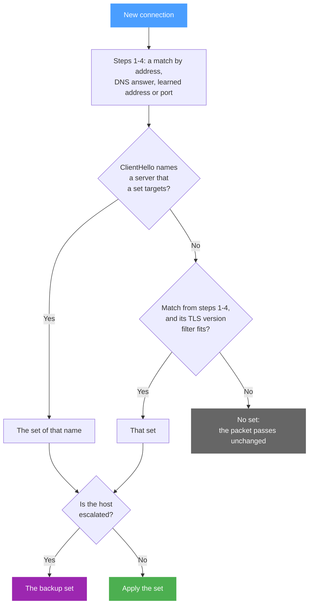

b4 decides for each connection which set, if any, takes it. The decision follows a fixed order of checks, prefers the most specific of several matching sets, and uses addresses learned from earlier connections and DNS answers. ASN targets add prefixes that b4 fetches and refreshes itself. What a set targets is set on the [Targets](../sets/targets.md) tab.

## The order of checks

b4 checks each new TCP connection in the order below. A later step can replace the result of an earlier one, and every step also needs the set's port filter to allow the destination port.

| Step | Check | Result |
| --- | --- | --- |
| 1 | The destination address is in a set's IP addresses, GeoIP categories or ASN prefixes | Address match |
| 2 | No address match, and the same device resolved one of a set's domains to this address in the last two minutes | DNS match |
| 3 | No DNS match, and the address was learned from a server name match | Learned match. It replaces an address match |
| 4 | Still no match, and a set has a port filter and no destination targets at all | Port match |
| 5 | The ClientHello names a server that a set targets | Name match. It replaces any match above, and b4 learns the address |
| 6 | A match from steps 1-4 whose [TLS version filter](../sets/targets.md#domains) does not fit the ClientHello | The match is dropped |
| 7 | The host is escalated to a backup set | The backup set takes over, see [Escalation](../sets/escalation.md) |

QUIC is matched by the server name in its Initial packet, which b4 reads whatever the set's **QUIC Matching** setting is. UDP to port 53 is DNS and goes to b4's [DNS handling](../dns.md) instead.

b4 does not inspect TCP and UDP, apart from DNS, to private addresses: `10.0.0.0/8`, `172.16.0.0/12`, `192.168.0.0/16`, `127.0.0.0/8`, and IPv6 unique local (`fc00::/7`), link-local (`fe80::/10`) and loopback addresses. TCP to such an address is the exception when a set's **Bypass IPs** cover it and the set takes the port: that set handles the connection as usual. No set's strategy applies to any other such connection, and it does not show on the Traffic page. b4 does not learn its address from the server name either. Routing and the sets' own DSCP values still apply to these addresses and learn them from DNS answers. A connection from the internet to a server behind a port forward is one of these. A server on the local network with a public IPv4 or IPv6 address is not, and a set that matches its connections from the internet applies its strategy toward that server.

## Choosing between sets

Several sets can target the same domain or address. b4 then picks the most specific match, not the first set in the list. The list order decides only between matches that are equally specific.

**Domains.** A domain entry covers the name and its subdomains, and the most specific entry wins: `www.example.com` in one set before `example.com` in another. Literal entries come before `regexp:` entries, so a `regexp:.*` catch-all takes only the names that no other set lists. Among the sets that list the same entry, b4 takes the first of:

1. a set limited to source devices that include the sender, with fitting TLS and IP version filters;
2. a set without source devices, with fitting version filters;
3. the same two again, with the version filters ignored.

**Addresses.** Among the sets whose IP addresses, GeoIP categories or ASN prefixes cover the destination, a set limited to source devices that include the sender comes first, then the longest prefix. The list order breaks ties between prefixes of the same length.

[Routing](../sets/routing.md) chooses differently, because firewall rules decide it, see [How routing sets work](./routing.md):

| Path | Which set takes the connection |
| --- | --- |
| DPI bypass | As in the table above |
| Routing | Prefix length plays no part. Sets limited to selected devices or source interfaces are evaluated before the others, and among sets of the same kind the one higher in the list claims the connection |

A routing set for one service therefore keeps its traffic away from a routing set over a whole network only when it sits above it in the list.

## Learned addresses and DNS answers

When a server name matches a set, b4 remembers the destination address with the name and the set. A connection to that address then takes the same set before its ClientHello arrives, and so does a connection that carries no server name. The entry lasts 10 minutes after its last use. b4 learns no private address this way.

When a DNS answer for a set's domain passes through b4, it notes the answered addresses for the device that asked. For two minutes, a connection from that device to one of those addresses takes the set when no address target matches.

A set with **Domain-only matching** on neither learns addresses nor uses DNS answers. It matches its domains by the server name alone.

## What happens on a match

For a TCP connection that a set takes, b4 holds the packet and sends a modified version instead, with the techniques the set's [TCP](../sets/tcp/index.md) tab turns on: SACK removal, ClientHello mutation, desync packets, window manipulation, fake packets and splitting. [Packet duplication](../sets/tcp/general.md#packet-duplication) replaces all of them for a connection the set takes before its ClientHello, by address, DNS answer, learned address or port. For UDP, the set's [action mode](../sets/udp.md#how-to-handle-matched-traffic) decides. A set that routes through a proxy, or through a tunnel interface that is up, leaves the packets alone. A packet that no set takes passes unchanged.

## ASN targets {#asn-targets}

### Where the prefixes come from

b4 fetches the prefixes itself from [RIPEstat](https://stat.ripe.net/), the RIPE NCC data service: the prefixes the ASN originates as seen by the RIS route collectors, without announcements that only a few collectors see. Private, reserved and documentation ranges and default routes are dropped, a prefix inside a wider one is dropped, and two adjacent halves of a larger prefix are merged into it. The browser never contacts RIPEstat.

The result is kept in `asn_cache.json` in the directory of the configuration file. Every set that names the ASN and every browser share the file, and the ASN labels on the [Traffic](../connections.md) page come from it. A file that is not valid JSON at start is moved aside to `asn_cache.json.corrupt`, and the ASNs the sets reference are fetched again.

### Refresh

| Event | What happens |
| --- | --- |
| b4 starts | `asn_cache.json` loads without a network request, and the sets use its prefixes however old they are. After a reboot without internet access, the sets keep matching the last known prefixes |
| Right after start, then every hour | A background check fetches each ASN that any set references, enabled or not, whose entry is missing or older than 20 hours. ASNs are fetched one at a time |
| A set gains an ASN without prefixes | The check runs at once |
| A fetch fails | The last good copy stays in use. The next attempt follows after 30 seconds, and the wait doubles with each further failure, up to one hour |
| The prefixes change | Every set that references the ASN is expanded again, and the firewall rules are refreshed |

An answer without prefixes is refused. An answer that covers less than half the address space known before, counted in IPv4 addresses or in IPv6 /64 networks, is held back. It is taken only after three fetches in a row, an hour apart, return the same shrink. Until then the previous list stays in use, so a gap in the RIPEstat data does not empty a set. **Refresh from RIPEstat** in the set editor follows the same rule: it keeps the previous list and reports the shrink, and only the background check can accept it.

### Before the first fetch

An ASN without cached prefixes contributes no addresses, and the set does not match that network's traffic until the first fetch succeeds. The set editor and the set card show it as unresolved. A set whose domains, addresses, categories and ASNs all resolve to nothing matches nothing: it does not act on every connection to its ports, its MSS clamp is not installed, and its routing rules appear once a target resolves.

### How the prefixes join a set

The prefixes join the set's address list after the GeoIP categories and before the addresses entered by hand. The set's **IP Version Filter** applies to them strictly: with **IPv4** only the IPv4 prefixes are loaded, with **IPv6** only the IPv6 ones.

From there an ASN behaves like the same prefixes entered as IP addresses: the DPI bypass, routing, blocking, packet duplication and the MSS clamp all use them, and an ASN counts as an IP target for the scope of the [MSS clamp](../sets/tcp/general.md#mss-clamping). A set with ASN targets and no domains cannot be kept working by the [watchdog](../watchdog.md), which confirms the set that handles a site by its host name.

### Size

No size limit is enforced. A large network expands into thousands of prefixes. Each prefix is an element of the firewall sets that routing, packet duplication and the MSS clamp build, and an entry in b4's address matcher. On a small router this costs memory and load time. The **ASN** tab warns above 2,000 prefixes or 16,777,216 IPv4 addresses.
