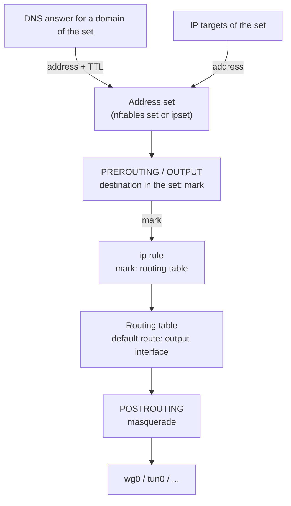

A set with **Enable Routing** on steers its traffic with firewall rules, packet marks and policy routing. The fields are described on [DNS & Routing](../sets/routing.md). Every mark bit, `ip rule` priority and table of b4 is listed in [Packet marks](../guides/marks.md).



## How a set collects addresses {#collecting-addresses}

Every rule b4 installs for a set matches the destination address. Source interfaces and source devices only narrow whose traffic reaches the rule, so a set with no domain or IP target gets no rule, and the log says so.

| Source | How the address enters the set |
| --- | --- |
| IP, CIDR, GeoIP and ASN targets | Written on every configuration sync, removed when they leave the targets |
| DNS answers for the set's domains | Forwarded or pinned answers that b4 sees, and the answers of the set's DNS redirect. Kept for **Resolved IP TTL (seconds)** |
| b4's own lookups | The set's domains, resolved when routing is turned on, through the set's resolver when it has one. See [Lookups b4 makes itself](../dns.md#lookups-b4-makes-itself) |
| TLS and QUIC names | The destination of a connection whose ClientHello or QUIC Initial names a domain of the set. That connection has already left by the normal route; later ones follow the set. A subdomain matched this way is resolved in full. Not in **Block (blackhole)** mode, which blocks such a connection by its name instead |

With the NFQUEUE engine, a forwarded or pinned answer that brings new addresses is held until they are written to the set, at most 250 ms each time b4 sees it, so the connection that follows usually takes the set's route. An answer from the set's DNS redirect goes out after the addresses are written, without the limit. With the TUN engine the answer is not held, and the first connection to a new address can leave before the address is in the set.

## Network interface mode {#interface-mode}

1. **Marking.** The set's chain in **PREROUTING**, `b4r_<set>_pre`, marks forwarded traffic to the set's addresses, only from the source interfaces when the set has them. Its chain in **OUTPUT**, `b4r_<set>_out`, gives the mark to the packets b4 injects for the set's destinations, which would otherwise leave by the normal uplink, and to the router's own traffic unless **Router's own traffic** keeps it out.
2. **Policy routing.** An `ip rule` sends the mark to the set's routing table, whose default route points at the output interface, or at the set's [gateway](#gateway) on it.
3. **Masquerade.** **POSTROUTING** masquerades the set's traffic leaving through the output interface, so the replies return through it. An egress IP replaces it with SNAT.

### Marks and routing tables {#marks-and-tables}

Each set gets a mark from a hash in `0x100`-`0x7EFF`, counted up from `0x66` when every hashed value is taken, and a table in `100`-`249`. Both come from the interface name, the egress IP, the gateway and the kill switch, and stay the same across restarts. Sets that agree on all four share them.

b4 skips a table that holds routes it did not add, as the VPN clients of Asuswrt-Merlin do in this range, a table named in an `rt_tables` file (`/etc/iproute2/rt_tables`, `rt_tables.d/*.conf`, and the same under `/opt/etc/iproute2`, `/usr/share/iproute2` and `/usr/lib/iproute2`), and one that another service's `ip rule` looks up. It logs the move to the next candidate.

`routing.fwmark` and `routing.table` in the configuration file pin both values when both are set, the mark lies within `0x27FFF`, is not `0x24BAB` (Telegram over WebSocket), does not contain every bit of the [queue mark](../guides/marks.md#the-queue-mark) and does not equal its bits under `0x27FFF`.

### Tunnels and the bypass strategy {#tunnel-hand-off}

When the output interface is a tunnel that is up, a TUN or TAP device or WireGuard, b4 leaves the set's packets alone, as in proxy mode: no faking, fragmentation or desync, no SYN health check, dead-IP escalation, IP block detection or TCP duplication. The segment it would change is the inner one, which the router wraps or terminates. The connection is logged with `routed-><iface>`.

A set routed to a plain interface, a set whose output interface exists but is down, and a domain-only set with no IP targets keep the strategy. A set limited to source interfaces or source devices hands off like any other: the packet engine matches on the destination alone.

### The router's own traffic {#router-traffic}

A proxy with a TUN inbound, such as Xray, sing-box or a `tun2socks` client, terminates each connection and opens its own to the destination from the router. With the router's traffic routed, b4 marks that connection and sends it back into the TUN the proxy reads. Every turn has a fresh source port, so the kernel sees no repeat, and each turn costs the proxy another socket until memory runs out.

**Automatic** leaves the router's own traffic on the normal route when the output interface is a TUN or TAP device. b4 recognises one by `/sys/class/net/<iface>/tun_flags`, which the kernel creates for every device opened through `/dev/net/tun`. WireGuard, PPP, VLANs and physical interfaces cannot re-dial a connection, and **Automatic** routes the router's traffic into them. A proxy that reaches some of the set's destinations directly (a `freedom` or `direct` outbound, a bypass rule, its own DNS) loops the same way.

**Route it too** on a TUN device logs a warning and puts a rate limit ahead of the marking: 200 new router connections per second per destination list, counting only connections to the set's addresses. The limit goes on TUN and TAP devices and on interfaces that do not exist yet when the rules are built, never on a plain interface or WireGuard. On iptables it needs `xt_hashlimit`, which b4 loads, and warns about when missing.

A set with a source interface or included source devices never routes the router's own traffic. An exclude list does not scope the set that way.

### Kill switch {#kill-switch}

When the output interface disappears, the kernel removes the default route of the set's table. The mark rule finds an empty table, the lookup falls through to the main table, and the set's traffic leaves through the normal uplink. The rules still look correct.

The kill switch adds `blackhole default metric 4096` behind the real route. When the interface goes away, the blackhole drops the set's traffic; when it returns, b4 puts the real route back. A set with the kill switch on gets a table of its own, so it does not blackhole its neighbours. Two sets pinned to the same `routing.table` still share it, and the switch is then on for both if it is on for either.

### Egress IP {#egress-ip}

An egress IP replaces the set's masquerade with `SNAT --to-source`, pinned to the output interface so a multi-WAN failover cannot send the packets out another uplink with this source. The device upstream routes by that source; b4's host needs no tunnel and no extra table.

- b4 adds the address to the output interface, puts it back when the interface loses it, for example on a DHCP renewal, and removes it when no set uses it. It sends an ARP probe first. When another host answers, or the address cannot be added, b4 logs a warning and keeps masquerading. An address configured by hand is used as it is and never removed.
- The upstream device routes that source, for example with `ip rule add from 192.168.1.51 lookup 100` on Linux, or a `mangle` rule with `src-address` and `action=mark-routing` on RouterOS.
- A router upstream with strict `rp_filter` and no route back for that address drops the packets before any policy rule. This is the usual reason a correct-looking setup moves no traffic.

An IPv4 egress IP rewrites IPv4 only. With **Enable IPv6 Support** on, the set's IPv6 traffic still leaves through the output interface, masqueraded; an IPv6 address in its place moves the rewrite to IPv6. With IPv6 support off, the set has no IPv6 rules, and its IPv6 traffic takes the normal route. With the TUN engine on the whole default route the setting has no effect.

### Gateway {#gateway}

**Gateway (optional)** gives the set's table `default via <gateway> dev <interface>` in the gateway's address family. Without a gateway, the default route goes via the gateway b4 finds on the interface, or is `default dev <interface>` when there is none. The other family keeps that route: with an IPv4 gateway, the set's IPv6 route is the one it has without a gateway, and the other way round. A gateway in a family whose support is off is ignored, and b4 logs a warning.

A save checks only the form of the address: one IPv4 or IPv6 address without brackets or a prefix length, a `%zone` only when it names the set's output interface, and not an unspecified, loopback or multicast address, `255.255.255.255` or the set's own egress IP.

When b4 installs the set's rules, it checks the gateway against the router's addresses and its main routing table:

| A gateway is refused when it is | Reason in the log |
| --- | --- |
| One of the router's own addresses. A link-local gateway is compared only with the output interface's own addresses | `is one of this router's own addresses` |
| Not on a network the output interface reaches directly | `is not on a network <interface> reaches directly` |
| The network or broadcast address of an IPv4 network up to /30, or the network address of an IPv6 network shorter than /127 | `is the network address of <prefix>`, `is the broadcast address of <prefix>` |

The interface reaches a gateway directly when the gateway lies in the prefix of an address on the interface, or under a route of the main table through the interface that has no gateway of its own, host routes included. An IPv6 link-local gateway is also reachable from an interface with a link-local address of its own.

A refused gateway counts as no gateway in its family, for the route and for the guard below. While the interface is up, b4 logs one warning that names the set, the gateway, the interface and the reason. b4 runs the check at start, on every save, when the output interface comes up and when the firewall monitor sees the interface's address change.

A set without a gateway leaves every packet that arrives on its output interface unmarked: devices on that interface's network never follow it. A usable IPv4 gateway changes that for IPv4 when the output interface is of the Ethernet type, as Ethernet ports, bridges, VLANs, Wi-Fi and TAP devices are (`/sys/class/net/<interface>/type` is `1`). Such a set leaves alone packets addressed to the router itself and IPv4 packets from the gateway, and marks the IPv4 traffic of the other devices on that network. With several such sets on one interface, each also leaves alone the IPv4 traffic of the other sets' gateways. IPv6 that arrives on the output interface never follows the set, with an IPv6 gateway as well. On interfaces of other types, such as TUN devices, WireGuard and PPP, the gateway only sets the route. [Sets routed through an interface](../guides/marks.md#sets-routed-through-an-interface) lists the rules.

A set with a usable IPv4 gateway on an Ethernet-type interface also drops the IPv4 ICMP redirects the router sends out of that interface. A redirect would point the devices there at the gateway directly, past b4.

Sets that differ only in the gateway get separate marks and tables. Two sets pinned to one `routing.table` with different gateways overwrite each other's default route, and b4 logs a warning.

A gateway that passes the check but does not forward the traffic, such as a mistyped address of another device on the network, breaks the set: packets leave, no reply comes back, and the rules look correct.

## Upstream SOCKS5 proxy mode {#proxy-mode}

1. **Listener.** b4 opens a transparent listener on a port derived from the set's mark.
2. **Diversion.** TPROXY rules in **PREROUTING** send TCP to the set's addresses, and UDP with **Route UDP through upstream** on, to the listener; an `ip rule` and a local route deliver it locally. The router's own addresses, broadcast and multicast are never diverted, so a set matching every address leaves the router's DNS, DHCP and web interface reachable. Where the kernel rejects the address-type match, b4 lists the router's addresses instead and logs it. While the firewall monitor runs, b4 rebuilds the rules with a new list when those addresses change.
3. **Relay.** For each connection b4 opens a SOCKS5 CONNECT to the upstream and copies bytes both ways.

The router's own connections reach the listener by a loop through `lo`, unless the set is limited to source devices or source interfaces. [Proxy sets and Telegram over WebSocket](../guides/marks.md#proxy-sets-and-telegram-over-websocket) lists the marks, rules and ports.

With **Route UDP through upstream** off, b4 answers the set's UDP to port 443 with ICMP port unreachable, and browsers fall back to TCP. Otherwise a site that advertises HTTP/3 in `alt-svc` would be reached over QUIC directly, and the browser would keep that for the header's lifetime. The refusal is per address family, the IPv6 half only with **Enable IPv6 Support** on. With the option on and an upstream without UDP ASSOCIATE, the set's UDP is dropped, and b4 logs a warning.

### Destination names {#destination-names}

With **Send domain name to upstream** on, the CONNECT carries a host name whenever b4 can tie one to the connection:

- The SNI or `Host` the connection carries is sent only when backed by a DNS answer b4 saw for the address in the last 30 minutes, or by the set's domain list. VLESS Reality, ShadowTLS and Telegram's fake-TLS proxies present an unrelated site's name, and sending it would lead there.
- A connection without a readable name, where the server speaks first (SMTP, IMAP, FTP), takes the device's own DNS answer for the address, then a name learned from a matching ClientHello, then a name b4 resolved for the set. It waits 250 ms for a ClientHello first, unless the device resolved exactly one name for the address or nothing could back a name.
- A name pinned in the set goes by its address. A name the upstream refuses, as a Tor exit does, is repeated with the address. UDP always carries the address.

While some proxy set sends names, b4 records the question name of every A and AAAA answer on UDP port 53 it sees, and of the answers of a set's DNS redirect. The `[proxy]` line in the log carries a name either way; `tls=` appears only when b4 read the ClientHello.

Tor with `SafeSocks 1` refuses connections by address and logs `Your application (using socks5 to port 443) is giving Tor only an IP address`. Connections b4 cannot name, for example from a device with encrypted DNS that opens an address the set matches by IP, still arrive by address. Tor's SOCKS port has no UDP ASSOCIATE.

### The built-in SOCKS5 proxy {#the-built-in-socks5-proxy}

A client of b4's [SOCKS5 proxy](../settings/core.md#socks5-proxy) that asks for a host name a proxy set matches is handed to that set's upstream without the firewall rules. The name follows the rules above; with **Send domain name to upstream** off, b4 resolves it through the set's resolver, or the router's, and sends the address. A `.onion` name is never resolved locally and never goes direct. **Fall back to direct on upstream failure** applies when the upstream cannot be reached, not when it refuses a destination.

This works without a DNS answer, so also in TUN mode and for names that exist only behind the upstream. The first set that matches the name decides. It has to be in proxy mode with its listener running, carry the router's own traffic (no source interfaces, no included source devices) and not use domain-only matching. A request by address, or for a name the deciding set does not cover, is opened by the router like any of its connections.

### A set that covers its own upstream {#own-upstream}

An upstream running on the router connects to its server from the router, so a set whose targets include that server, such as `0.0.0.0/0` or a broad GeoIP category, would loop. b4 recognises such a connection by the process that listens on the upstream's port, and sends it directly. An upstream host given as a name is resolved for this check, and `0.0.0.0` counts as the router.

For an upstream on another device, a connection from that device goes direct when the set targets `0.0.0.0/0` or `::/0`, or when b4 is relaying a connection to the same destination through that upstream at the moment. A server address inside a broad GeoIP set is not recognised; excluding the device under source devices leaves its traffic alone. The log names the set and the process, or the device, the first time.

A mark on the upstream's outbound sockets with any bit under `0x27FFF`, such as Xray's `sockopt.mark` set to `255`, keeps its traffic out of the diversion altogether. See [Next to other services](../guides/marks.md#next-to-other-services).

### When the upstream is down {#upstream-down}

Each diverted connection is accepted, held for the dial timeout and closed. b4 logs it at most once a minute, and once more when the upstream answers again (`reached its upstream ... again after N failed attempts`):

```text
tproxy: set "TMDB" cannot reach its upstream 10.8.0.1:1080 (1 consecutive failures), traffic matched by this set is not getting through: dial upstream: dial tcp 10.8.0.1:1080: i/o timeout
```

**Copy JSON** in **System Info** copies the same state under `upstreams`, with `reachable`, `consecutive_failures` and `last_error`.

## Bridge netfilter {#bridge-netfilter}

With `net.bridge.bridge-nf-call-iptables` at `1`, the kernel runs the IPv4 PREROUTING rules for traffic entering through a network bridge, such as `br-lan` or `docker0`, inside the bridge code, and not again at the IP layer. The TPROXY rule assigns the connection to b4's listener in that pass, and the IP layer drops the assignment. The packet is still delivered locally, but no socket takes it: connections from the devices behind the bridge hang, with no connection line in the log. The router's own connections are diverted as usual. `net.bridge.bridge-nf-call-ip6tables` does the same for IPv6. The per-bridge attributes `nf_call_iptables` and `nf_call_ip6tables` under `/sys/class/net/<bridge>/bridge/` turn the pass on as well: it runs when either the global setting or the attribute is `1`.

This breaks the proxy mode, the Telegram over WebSocket mode and the Telegram over WebSocket switch. While one of them is active and bridge netfilter is on for a bridge with ports, b4 logs a warning naming the bridge, **System Info** shows it in the **Bridge netfilter** row, and the Telegram over WebSocket card warns.

On OpenWrt the `dockerd` package turns both settings on at boot through `/etc/sysctl.d/12-br-netfilter-ip.conf`. They are turned off at runtime, and the same lines in `/etc/sysctl.conf`, applied after `/etc/sysctl.d`, keep them off after a reboot:

```sh
sysctl -w net.bridge.bridge-nf-call-iptables=0
sysctl -w net.bridge.bridge-nf-call-ip6tables=0
printf 'net.bridge.bridge-nf-call-iptables=0\nnet.bridge.bridge-nf-call-ip6tables=0\n' >> /etc/sysctl.conf
```

Two Docker configurations rely on bridge netfilter: a network created with `icc=false`, whose containers are no longer isolated without it, and a disabled userland proxy, where without it a container cannot reach the ports other containers on its network publish. OpenWrt's default Docker configuration uses neither. In either one, dockerd sets the settings back to `1` each time it sets up an affected network, at every start too, so they do not stay off.

## Firewall backend {#firewall-backend}

| Backend | Needs | What b4 creates |
| --- | --- | --- |
| **nftables** | `nft` | The `b4_route` table with `prerouting`, `output` and `postrouting` chains, and address sets with `interval` and `timeout` |
| **iptables + ipset** | `iptables`, `ipset` | Rules in the `mangle` and `nat` tables and an ipset of type `hash:net` per set; `iptables-legacy` is checked too |

Routing uses the backend of [Firewall Engine](../settings/core.md#firewall-rules), on **Auto-detect** the one b4 found for its other rules. Without `ipset` or `iptables`, routing falls back to nftables whenever `nft` is present. With neither backend, or without the `ip` command, b4 logs a warning at each start and save and installs nothing. b4 looks these commands up once per run, so a tool installed later takes effect after a restart. The b4 Docker image carries `nft`, `iptables` and `ipset`.

Nothing is created for routing, not even the `b4_route` table, while no enabled set has routing on and the Telegram over WebSocket switch is off.

## When the rules cannot be installed {#install-failures}

b4 installs the routing rules at start, on every save, and when the firewall monitor finds them missing. When the backend rejects the base of the rules, such as the `b4_route` table, no set is installed:

```text
[ERROR] Routing: failed to ensure base during sync (nftables): ensure table: ..., it will be retried
```

When only some sets fail, each gets a line, `Routing: failed to ensure rule for set '<name>' during sync: ...`, and the others are installed.

b4 retries after 10, 20, 40, 80, 160 and 320 seconds, then every 10 minutes. The retries log at the trace level. At the `info` level a cycle leaves three lines:

| Line | Level | When |
| --- | --- | --- |
| `Routing: failed to ensure base during sync ...` or `Routing: failed to ensure rule for set ...` | ERROR | The first failure of a configuration |
| `Routing: the routing sync keeps failing; b4 retries it every 10m0s ...` | WARN | The sixth retry fails, 10 minutes 30 seconds after the first failure |
| `Routing: the routing sync that failed has been retried successfully` | INFO | A retry succeeds |

A save or a restart starts the cycle over. While a retry after a failure at the base is pending, the firewall monitor leaves the routing rules alone. A kernel without what the backend needs, such as nftables without the `inet` family or iptables without the `ip_set` module, fails every retry until the kernel or the backend changes.

The **Routing Sets** row under **Firewall** in [System Info](../settings/system.md#system-info) shows how many routing sets are installed, and the backend. While installing fails, the rows below give the error of the base or of each set, when the failure began and the next attempt, and the missing tool, usually `ipset`, when its absence makes routing use nftables.

## Cleanup {#cleanup}

When routing is turned off or a set is removed, b4 removes the set's `ip rule`, its routes, the jumps from the base chains, and the chains and address sets it created. When b4 stops, it cleans both backends of leftover rules.

## A set's DSCP value {#dscp}

How a set's own DSCP value is written, which packets carry it and the rules behind it are described in [DSCP rules](./dscp.md).
