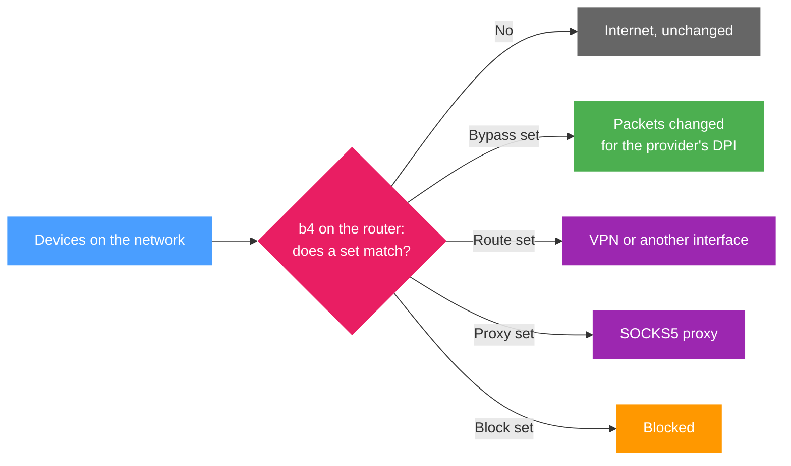

b4 (Bye Bye Big Bro) is a service for Linux routers and computers. It helps open sites that an internet provider blocks with DPI (Deep Packet Inspection), and it can send chosen sites through a VPN or a proxy. It is managed from a web interface in the browser.

Installed on a router, b4 covers every device on the network, with no setup on the devices themselves.

## What b4 does

- **Helps open blocked sites.** A set changes how the packets of chosen sites look to the provider's DPI. The site receives the same data. See [Unblocking a site](guides/unblock.md).
- **Routes chosen sites through a VPN** or another interface. See [Routing sites through a VPN or another interface](guides/vpn.md).
- **Sends chosen sites to a SOCKS5 proxy**, such as Xray or sing-box. See [Sending sites through a SOCKS5 proxy](guides/proxy.md).
- **Blocks ads and unwanted sites** for the whole network. See [Blocking ads and sites](sets/blocking.md).
- **Sends the DNS queries** of chosen domains to another resolver. See [DNS](dns.md).
- **Carries Telegram** through its own proxy or bridge. See [Telegram](telegram/index.md).
- **Limits any of this to chosen devices.** See [Applying b4 to selected devices](guides/devices.md).

## What b4 does not do

- It changes nothing until a set targets sites.
- It does not provide a VPN or an upstream proxy. Route sets use a VPN interface that already exists, and the **Upstream SOCKS5 proxy** mode a proxy that already runs.
- No packet change helps when the provider blocks a site's addresses. Discovery then reports **address blocked**, and only a route or proxy set opens the site.
- It does not see DNS that a device encrypts itself, such as secure DNS in a browser or Android Private DNS. The DNS settings of the sets do not apply to such lookups.
- IPv6 connections skip the sets until **Enable IPv6 Support** is turned on under **Settings > Core > Packet Engine**.

## How it works

b4 checks the first packets of each connection against the sets. A connection that no set matches passes unchanged. A matched connection is handled by the kind of its set:

[Key concepts](concepts.md) explains sets, strategies and the set kinds.

## Main parts

The pages of the web interface, in the order of its menu:

| Page | What it is for |
| --- | --- |
| [Dashboard](dashboard.md) | Whether b4 runs, which sets match traffic, and what needs attention |
| [Sets](sets/index.md) | The list of sets and the set editor |
| [Discovery](discovery.md) | Finds a strategy for sites that do not open and turns it into a set |
| [Community](community/index.md) | Sets that other b4 users published, applied in one step |
| [Watchdog](watchdog.md) | Checks the sites of chosen sets on a schedule and finds a new strategy when they stop opening |
| [DPI Detector](detector.md) | Reports what the provider blocks and how |
| [Traffic](connections.md) | The connections b4 sees, live, with the set each one matched |
| [Logs](logs.md) | The b4 log in real time |
| [Settings](settings/index.md) | The packet engine, devices, firewall, web interface and backups |

## Requirements {#requirements}

| Requirement | Value |
| --- | --- |
| System | Linux on a router, a computer or a server, or Docker. The supported platforms are listed under [Installation](install/index.md) |
| Kernel | 3.13 or newer, with NFQUEUE support (`nfnetlink_queue`). Without it, the TUN engine is the alternative and needs `/dev/net/tun` and `iptables` |
| Memory | 64 MB free |
| Disk | About 30 MB for the binary, plus the configuration and the GeoSite and GeoIP databases |
| Privileges | root |
| Architectures | `amd64`, `386`, `arm64`, `armv5`, `armv6`, `armv7`, `mips`, `mipsle`, `mips_softfloat`, `mipsle_softfloat`, `mips64`, `mips64le`, `loong64`, `ppc64`, `ppc64le`, `riscv64`, `s390x` |
