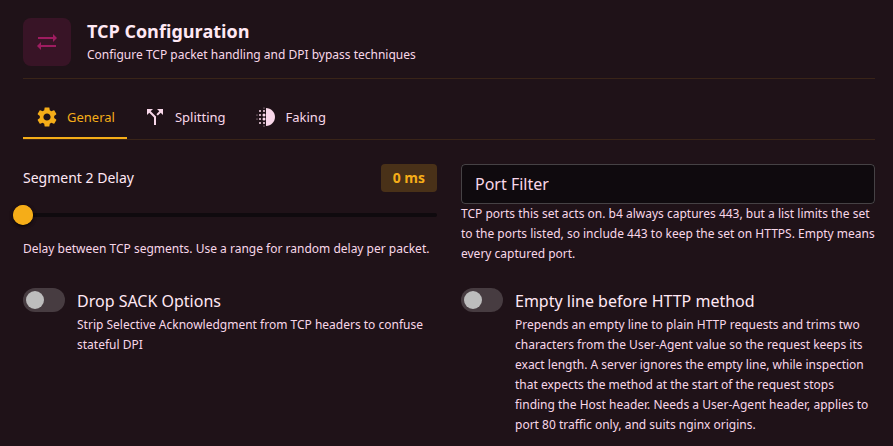
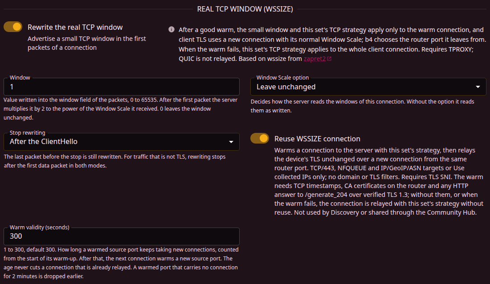
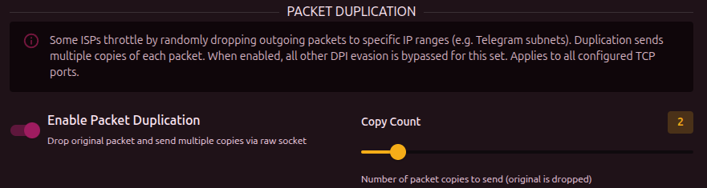
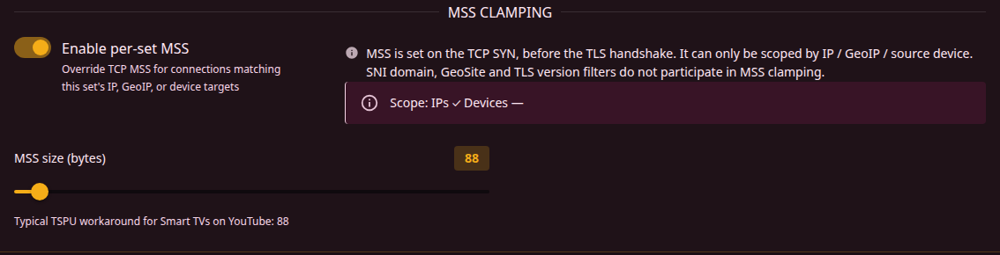

The **General** sub-tab of the [TCP](./index.md) tab holds the settings that apply whatever splitting or faking method the set uses.

## Delay, ports and headers

| Field | What it does | Default |
| --- | --- | --- |
| **Segment 2 Delay** | Delay between the pieces b4 sends, in milliseconds. A range makes each connection pick a random value from it. | `0` |
| **Port Filter** | The TCP ports the set acts on, such as `443` or `80,5222,8000-9000`, and a list without `443` leaves HTTPS out. Empty means every port b4 captures: 443 and the ports any set lists. | Empty |
| **Drop SACK Options** | Removes the Selective Acknowledgment option from TCP headers. Some DPI uses it to put fragments back in order. | Off |
| **Empty line before HTTP method** | For plain HTTP on port 80: puts an empty line before the request and shortens the User-Agent by two characters to keep the length. Inspection that expects the method at the start of the request no longer finds the Host header. Needs a User-Agent header, and suits nginx servers. | Off |

## Real TCP window (wssize) {#wssize}

Makes the set's connections advertise a small TCP window in their first packets, so the server sends the start of its reply in small pieces. Unlike [Window Manipulation](./faking.md#window-manipulation), which adds fake packets, this option changes the connection's own packets. It is based on wssize from [zapret2](https://github.com/bol-van/zapret2).

| Field | What it does | Default |
| --- | --- | --- |
| **Rewrite the real TCP window** | Turns the rewrite on. Nothing changes until **Window** is set or **Window Scale option** is changed. | Off |
| **Window** | The value written into the window field of the packets, 1 to 65535. `0` leaves the window unchanged. | `0` |
| **Window Scale option** | What happens to the Window Scale option in the first packet of a connection, see the table below. | **Leave unchanged** |
| **Window Scale** | Shown with **Lower to a value**. Lowers the option to this value, 1 to 14, and never raises it. | `1` |
| **Stop rewriting** | Shown once **Window** is set. **After the ClientHello** writes the window into every packet of the ClientHello. **After the first data packet** stops at the first packet with data, as zapret2 does. | **After the ClientHello** |
| **Reuse WSSIZE connection** | Applies the small window to a warm-up connection of b4's own, then sends the device's connection unchanged, see [Reuse WSSIZE connection](#warm-connection). | Off |

After the first packet, the server multiplies **Window** by 2 to the power of the Window Scale it received. Without the option it reads **Window** as written. The device's packets after the stop carry its own window again.

| Window Scale option | First piece of the server's reply with **Window** `1` | After the stop |
| --- | --- | --- |
| **Leave unchanged** | 128 bytes with a device scale of 7 | The connection runs as usual. |
| **Lower to a value** | 2 bytes with **Window Scale** `1` | The server reads every later window too small, and downloads on the connection stay slow until it closes. |
| **Remove the option** | 1 byte | The connection runs without window scaling: the server reads later windows as the device sent them, and each direction carries at most 64 KB per round trip to the server and back, about 1.3 MB/s at 50 ms. |

The rewrite starts with the first packet of a connection, before the server name is known. It applies only when the set already takes the connection at that point.

| The set targets | The rewrite applies to |
| --- | --- |
| IP addresses, GeoIP categories or ASNs | Every connection to those addresses |
| Domains | Connections to an address b4 already knows for the domain, from a DNS answer that passed through b4 or from an earlier connection to the site |
| A port filter and nothing else | Every connection to those ports |

The first connection to a domain whose address b4 has not seen yet passes unchanged. With **Domain-only matching** on, the rewrite never applies to the set's domains. The set's **TLS Version Filter** does not limit the rewrite, which starts before the ClientHello shows the TLS version. [Real TCP window rewriting](../../internals/wssize.md) has the details.

The option does not work in a set that also uses [routing](../routing.md) or [Packet Duplication](#packet-duplication). The editor shows a notice, and an enabled set that combines the option with either of them is not saved. With **TUN interface** as the [packet engine](../../settings/core.md#ingestion-mode), the option does nothing.

:::warning
A lowered **Window Scale** stays for the whole connection and keeps its downloads slow. **Remove the option** limits the connection to 64 KB per round trip, uploads included. **Window** alone slows nothing down once the rewrite has stopped.
:::

### Reuse WSSIZE connection {#warm-connection}

With **Reuse WSSIZE connection** on, the set's TCP connections to port 443 go out in two steps. b4 first opens a connection of its own to the server from a router port, the warm, with the set's TCP strategy and the small window, and sends a short HTTPS request over it. After a good warm, b4 sends the device's TLS unchanged over a new connection from the same router port, with its normal window. Other TCP ports of the set get its strategy as usual. QUIC is not relayed, and a connection to port 443 that does not start with a TLS ClientHello naming a server is closed.

| Field | What it does | Default |
| --- | --- | --- |
| **Reuse WSSIZE connection** | Turns reuse on. Shown while **Rewrite the real TCP window** is on, and turned off with it. | Off |
| **Warm validity (seconds)** | How long a warmed router port takes new connections, counted from the start of its warm, 1 to 300. After that, the next connection warms a new port. The validity never cuts a connection that is already relayed. | `300` |

A warmed port that carries no connection for 2 minutes is dropped earlier.

An enabled set with reuse on is saved only when it meets every condition below. The editor names each one the set breaks.

- **Rewrite the real TCP window** is on, with a **Window** above `0`.
- The set has an IP target: **Manual Bypass IPs**, **Bypass GeoIP Categories**, **Networks (ASN)** or **Use collected IPs**.
- The set has no domains or GeoSite categories, and **Domain-only matching** is off.
- **TLS Version Filter** is **Any**.
- The **Port Filter** includes `443` or is empty.
- The set uses no [routing](../routing.md), **Packet Duplication** or [escalation](../escalation.md).

The router needs TPROXY support in its firewall, TCP timestamps (`net.ipv4.tcp_timestamps` not `0`) and root certificates, the system ones or those Entware installs under `/opt/etc/ssl`. b4 logs a warning for each of them the router lacks. Without TPROXY, the set's connections get its usual strategy. The [Packet marks](../../guides/marks.md#reuse-wssize-connection) page lists the firewall modules and rules of reuse. The server has to answer the warm's request over TLS 1.3, with a certificate the router trusts.

Reuse does nothing, and the set's connections get its usual strategy, while one of the following holds. The editor shows a notice then, and b4 logs a warning.

- **TUN interface** is the [packet engine](../../settings/core.md#ingestion-mode), also after NFQUEUE is saved and until the restart that applies it.
- **Skip IPTables/NFTables Setup** is on under [Settings > Core > Firewall](../../settings/core.md#firewall-rules).
- The **Packet Mark** under [Settings > Core > Packet Engine](../../settings/core.md#queue-and-packet-processing) shares bits with `0x240000`.

Discovery runs leave reuse out.

When the warm fails or is skipped, when the relay after a good warm fails, or when no warm slot or port is free, b4 still sends the device's connection: from an ordinary router port, with the set's TCP strategy on the whole connection, as without reuse. The same happens when a device sends only its ClientHello over a warmed port and the server neither answers nor closes the connection within 5 seconds. b4 then sends the ClientHello again from an ordinary router port and stops using the warmed one. Reuse stays on for that server. The [Traffic](../../connections.md) page labels such a connection `fallback`. A warm fails when the server cannot be reached, refuses TLS 1.3, shows a certificate the router does not trust, sends no TCP timestamps or gives no complete answer. It is skipped while the router lacks TCP timestamps or root certificates. It is also skipped for a while after a warm to the same server and site name failed. A saved change to the settings ends that wait, and so does generating, uploading, regenerating or deleting, under [Settings > Payloads](../../settings/payloads.md), a payload that an enabled set uses.

## Packet Duplication {#packet-duplication}

For providers that slow traffic down by dropping some outgoing packets to certain address ranges, such as Telegram's. b4 drops the original packet and sends several copies instead.

| Field | What it does | Default |
| --- | --- | --- |
| **Enable Packet Duplication** | Sends each packet of the set's TCP connections as several copies. The duplicated packets get none of the set's other bypass techniques. | Off |
| **Copy Count** | How many copies to send, 1 to 10. | `3` |

The [Traffic](../../connections.md) page labels duplicated packets `dup`.

## IP Block Detection

Some server addresses are blocked at the IP level. A CDN often answers DNS with several addresses of which only some are blocked, and the site then works or hangs depending on the address a device picked. **Detected IP action** decides what b4 does with the addresses it finds. The other fields appear once detection is on.

| Field | What it does | Default |
| --- | --- | --- |
| **Enable IP Block Detection** | Turns detection on for the set. | Off |
| **Detected IP action** | **Block detected IPs** refuses connections to the blocked addresses it finds, see below. **Collect detected IPs** adds the addresses to the [collected IPs](../targets.md#collected-ips), which other sets can target. | **Block detected IPs** |

### Collect detected IPs {#collect-detected-ips}

**Collect detected IPs** finds addresses where the TLS handshake stalls and adds them to one pool, the [collected IPs](../targets.md#collected-ips). Sets with **Use collected IPs** on take the connections to these addresses, each with its own strategy or route. Unlike **Block detected IPs**, collecting bans no address and changes no DNS answers or QUIC.

An address is collected after two connections to it in a row, on the same port, connect over TCP and then get no answer to the ClientHello within the **Detection Timeout**. The second counts only when it opens after the **Detection Timeout** of the first has run out: connections opened at the same time count once. It must also come within the **Retest interval (seconds)** under [Settings > Core](../../settings/core.md#ip-block-detection). A connection that does not connect over TCP does not count, and a connection the server answers starts the count over.

b4 collects the address only when a set with **Use collected IPs** would take the next connection to it, see [Collected IPs](../targets.md#collected-ips). It then resets the connections still waiting on the address, so that the device's retries reach that set. The [Traffic](../../connections.md) page labels these connections `collect`.

Nothing is collected:

- under the **TUN interface** engine, or with **Skip IPTables/NFTables Setup** on;
- while no enabled set has **Use collected IPs** on;
- by a set that has **Use collected IPs** on itself;
- from the router's own connections, or for private addresses;
- while Discovery runs.

When the set's desync fakes end the router's tracking of the connection before the **Detection Timeout**, the set collects nothing, and the tab warns. **Desync Mode** on **Disabled** or **ACK Packets**, with **Post-ClientHello RST** off, on the [Faking](./faking.md) tab avoids it.

### Block detected IPs

**Block detected IPs** suits addresses where nothing reaches the server and no bypass strategy helps. The [Traffic](../../connections.md) page labels the connections to the addresses **Block detected IPs** finds `ip`. The fields below apply to this action. With **Collect detected IPs**, the tab hides all of them except **Detection Timeout**.

| Field | What it does | Default |
| --- | --- | --- |
| **Heal DNS answers** | Also removes unreachable addresses from DNS answers. When every address is unreachable, the last one that worked for the domain is answered instead. | Off |
| **Detect unanswered SYNs** | Catches blocks at the address level, where the connection never opens. | On |
| **SYN Threshold** | How many unanswered connection attempts before the router tests the address itself. Nothing happens until that test fails too. | `3` |
| **Retransmit Threshold** | How many unanswered copies of the ClientHello, the first one included, mark the destination blocked. This covers a block that lets the connection open and then swallows the handshake. A low value can mistake a slow server for a block. | `3` |
| **Healed Answer TTL** | The TTL written into healed DNS answers, in seconds. A short value lets devices pick up a recovered address quickly. | `60` |
| **Cache Blocked IPs** | Remembers blocked addresses, so new connections to them are reset at once instead of waiting. An address blocked for every site name is [banned](#banned-addresses). | On |
| **Detection Timeout** | How long, in milliseconds, before a repeated and still unanswered SYN or ClientHello counts as reaching its threshold. With **Cache Blocked IPs** on, a server that sends nothing back for this long after the ClientHello on two connections in a row gets its address checked for a [ban](#banned-addresses). | `3000` |

How long an address stays marked is set by **Retest interval (seconds)** under [Settings > Core](../../settings/core.md#ip-block-detection).

### Banned addresses {#banned-addresses}

Some providers block an address for every site name: the connection opens, but no site on that address answers. In a set with **Cache Blocked IPs** on, b4 tests whether an address answers for other site names when:

- IP block detection marks the address blocked (see **Retransmit Threshold** and **Detection Timeout**);
- the server sends nothing back for the **Detection Timeout** after the ClientHello on two connections in a row. A connection the server answers starts the count over, and so does a pause longer than the **Retest interval (seconds)**.

An address that answers none of those names is banned. A connection still waiting on it is then reset. An address that answers them, even with a refusal, is not banned, and neither is one that answers a waiting connection before the test ends. An address that IP block detection marked blocked stays in the cache of blocked addresses all the same. Until the **Retest interval (seconds)** runs out, new connections to it are reset, whatever the site.

On some routers b4 cannot see whether a server has answered while the connection is open. There a silent connection counts only after the device gives up on it, see [Kernel requirements](../../internals/capture.md#kernel-requirements).

While an address is banned:

- New connections to the address and port are reset at once in every set with **Block detected IPs** and **Cache Blocked IPs** on. QUIC to that address and port is refused. A device can then move on to the site's next address, if the site has one.
- A set that routes through a proxy, or through a TUN, TAP or WireGuard interface that is up, leaves its connections to the address alone. A connection that another service sends into a tunnel is left alone too, see [Packets that leave by another route](../../internals/capture.md#tunnel-egress). A set routed to another interface, such as a second uplink, still resets or refuses its connections.
- DNS answers for the domains of every set leave it out. When every address of an answer is banned, b4 answers with an address that worked for the domain before. When it knows none, the answer passes unchanged.
- The [Traffic](../../connections.md) page labels the connections b4 resets or refuses `ban`.

A ban lasts 24 hours by default. An address banned again within 30 days after its previous ban ended is banned for 7 days. b4 tests a banned address again at every **Retest interval (seconds)**: with the other site names, and with the name of the site the ban was made for, sent through the set that handles that site. Three successful tests in a row lift the ban early. Bans stay across restarts and set changes.

The [Banned addresses](../../dashboard.md#banned-addresses) panel on the dashboard lists the bans, and **Unban** lifts one at once. The switch and the ban lengths are on the **IP Block Detection** card under [Settings > Core](../../settings/core.md#ip-block-detection).

When the set's [Escalation](../escalation.md) trigger fires first, the host moves to the backup set, and this set does not check or ban its address. A backup set with IP block detection and **Cache Blocked IPs** on can still ban it.

## RST Injection Protection

| Field | What it does | Default |
| --- | --- | --- |
| **Enable RST Protection** | Drops connection resets that look injected by DPI rather than sent by the server. | Off |
| **TTL Tolerance** | The largest allowed difference between the TTL of a reset and the TTL of the server's replies. | `3` |

[RST Injection Protection](./rst-protection.md) describes the checks.

## MSS Clamping {#mss-clamping}

Limits the TCP maximum segment size (MSS) for the set's connections. A smaller MSS makes the client send its ClientHello in several segments, which some DPI cannot put back together.

| Field | What it does | Default |
| --- | --- | --- |
| **Enable per-set MSS** | Turns the clamp on for the set. Available once the set has an IP, GeoIP, ASN or source device target, or **Use collected IPs** on. | Off |
| **MSS size (bytes)** | The MSS, 10 to 1460. `88` is filled in when the switch is turned on. | `88` |

The MSS is set on the first packet of a connection, before the server name is known. Only IP, GeoIP, ASN and source device targets and collected IPs therefore decide where it applies. Domains, GeoSite categories and the TLS version filter play no part.

| The set targets | The clamp applies to |
| --- | --- |
| IP addresses, GeoIP categories, ASNs or [collected IPs](../targets.md#collected-ips) | Connections to those addresses |
| Source devices only | Every port 443 connection from those devices, wherever it goes |
| Both | Connections from those devices to those addresses |

A set whose IP, GeoIP and ASN targets resolve to no addresses yet installs no clamp until they do. A device added by hand needs a fixed address to scope a clamp.

`88` is the value suggested for smart TVs on YouTube. Every segment then carries at most 88 bytes, so large downloads are slow, and when a connection works but crawls, a larger value is the next step. To slow down one device's HTTPS without a set, the [per-device MSS](../../settings/core.md#device-table) does the same. A per-set MSS overrides the [per-device and global MSS](../../settings/core.md#global-mss-clamping) for the connections it covers.
