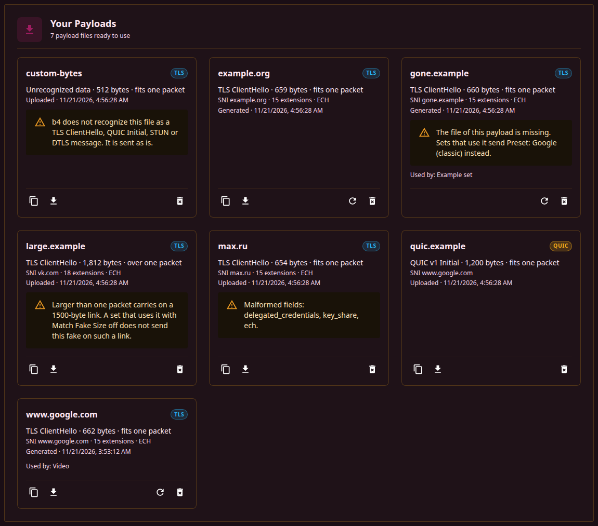
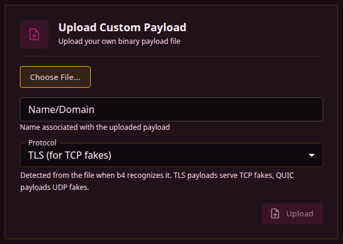
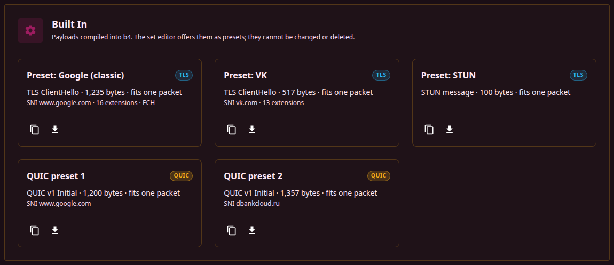

The **Payloads** tab keeps the files that fake packets can carry instead of a built-in payload, and lists the built-in payloads. A payload is generated from a domain name or uploaded as a file. Payloads also arrive with sets: from an [import](../sets/import.md) of a zapret or byedpi command line that carries fake data, and from a [shared set](../sets/sharing.md). Generating, uploading, regenerating and deleting act on the router at once, without **Save Changes**, and the sets that use the payload follow at once.

## What a payload is for {#why-payloads-exist}

Some strategies send a fake packet ahead of the real one. The DPI inspects the fake, and the set's **Fake Strategy** keeps the server from accepting it, see [Faking](../sets/tcp/faking.md). The data the fake carries is the payload. TLS payloads serve the fakes a set sends over TCP, QUIC payloads the fakes it sends over UDP.

## Payload types {#payload-types}

The **Fake Payload Type** field of a set, under **TCP > Faking > Fake SNI Packets**, picks what the fake carries:

| Type | Contents |
| --- | --- |
| **Random** | 1200 random bytes, new for every connection |
| **Preset: Google (classic)** | A recorded TLS ClientHello for `www.google.com`. A new set starts with this type |
| **Preset: VK** | A 517-byte TLS ClientHello for `vk.com` |
| **Preset: STUN** | A STUN Binding Request, with no TLS in it |
| **My own Payload File** | A payload from this tab, picked in the **Generated Payload** field |
| **All Zeros** | 1200 zero bytes |
| **Inverted Original** | The data of the real packet with every bit inverted |
| **Generated from Domain** | A ClientHello built like the ones on this tab, for the name in the set's **Domain** field |
| **Custom** | The text in the set's **Custom Payload** field, byte for byte. Listed only for a set that already has such text |

While **My own Payload File** has no payload picked or its file is missing or empty, and while **Generated from Domain** has no name, the fake carries **Preset: Google (classic)**, and the set editor says so. The payload type of a [Discovery](../discovery.md) result is the one to start from.

## Generate Payload {#generating-a-payload}

The card builds a TLS ClientHello with the name in **Domain** as its server name. Typing a name, such as `youtube.com`, and clicking **Generate** or pressing Enter adds the payload to **Your Payloads**.

The ClientHello is built on the router. No connection is made, and the name is not resolved. A scheme such as `https://`, a path and a port are dropped, and the name is lowercased. An internationalized name is written in its punycode form: `пример.рф` becomes `xn--e1afmkfd.xn--p1ai`. An IP address, or text that is not a host name, is refused.

Each name holds one TLS payload. When the name already has one, the tab keeps it and reports that it exists. A generated ClientHello fits one packet. Its random values are drawn when it is generated and stay the same until **Regenerate** rebuilds it.

## Upload Custom Payload {#uploading-a-payload}

The card adds a payload from a file of up to 64 KB. b4 checks the chosen file before the upload and shows what it found: the kind, the server name and the size.

| Field | What it does |
| --- | --- |
| **Choose File...** | Opens the file picker. The chosen file is checked at once |
| **Name/Domain** | The name the payload is listed under in sets and in Discovery, up to 200 characters. Until a name is typed, choosing a file fills in the server name the file carries, or the file name without its extension when it carries none |
| **Protocol** | **TLS (for TCP fakes)** or **QUIC (for UDP fakes)**. Set from the file when b4 recognizes it |
| **Upload** | Saves the payload. Available once the check is done and a name is set |

Warnings from the check do not stop an upload. They are the warnings a payload card shows, see [Your Payloads](#management). An empty file and a file over 64 KB cannot be uploaded, and the card says why.

An upload under a name and protocol that already exist asks before it replaces that payload, and names the sets that use it. After **Replace**, those sets send the new file at once.

## Your Payloads {#management}

The section lists the payloads saved on the router. Each card describes one payload:

| Part | What it shows |
| --- | --- |
| Name and chip | The payload's name, and **TLS** or **QUIC**: the protocol it is saved under |
| First line | What the file is (TLS ClientHello, QUIC Initial, STUN message, DTLS ClientHello or Unrecognized data), its size, and whether it fits one packet |
| Second line | The server name (SNI) when the file has one. For a TLS ClientHello also the number of extensions, and **ECH** when it carries an ECH extension |
| Third line | Where it came from, **Generated**, **Uploaded** or **Imported with a set**, and when it was saved |
| **Used by** | The sets that use the payload |

A warning on a card names a problem with the payload:

| Warning | What it means |
| --- | --- |
| File missing | The file is gone from the router. Sets that use the payload send **Preset: Google (classic)** over TCP and zeros over UDP until another payload is picked |
| File empty | The same as a missing file |
| Larger than one packet | Over TCP, a set with **Match Fake Size** off does not send this fake on a 1500-byte link. Over UDP, only the start of the file goes out |
| Not recognized | The file is not a TLS ClientHello, QUIC Initial, STUN or DTLS message. It is sent as is |
| Malformed fields | Fields of the ClientHello that a strict parser rejects, listed by name. **Regenerate** writes them correctly in a generated payload |
| Kind and protocol differ | A QUIC Initial, STUN or DTLS file saved as TLS, or a TLS ClientHello saved as QUIC |

The buttons on a card are icons, and the names below are their tooltips:

| Button | What it does |
| --- | --- |
| **View/Copy hex** | Opens **Payload Hex Data** with the payload's bytes in hex. **Copy & Close** copies them to the clipboard |
| **Download .bin** | Saves the payload as a file |
| **Regenerate** | Shown on generated payloads. After a confirmation, builds a new ClientHello under the same name and in the same file, with new random values and any malformed fields written correctly. A generated payload whose file is missing gets its file back |
| **Delete** | Deletes the payload. When sets use it, a confirmation names them first |

A card whose file is missing has no **View/Copy hex** and no **Download .bin**. Two more icons sit next to **Generate**: **Refresh list** reloads the list, and **Delete all payloads** deletes every payload in this section after a confirmation that names the sets using them. The built-in payloads stay.

Deleting, replacing and regenerating reach the sets that use the payload at once. After a delete, those sets send **Preset: Google (classic)** over TCP and zeros over UDP. After a replace or **Regenerate**, they send the new bytes. When b4 cannot reload those sets, a message says so.

## Built In {#built-in}

The section lists the payloads compiled into b4, with the same facts as the cards above. They cannot be changed or deleted. **View/Copy hex** and **Download .bin** work as on the other cards.

| Payload | What it is |
| --- | --- |
| **Preset: Google (classic)** | TLS ClientHello for `www.google.com`, 1,235 bytes |
| **Preset: VK** | TLS ClientHello for `vk.com`, 517 bytes |
| **Preset: STUN** | STUN message, 100 bytes |
| **QUIC preset 1** | QUIC v1 Initial for `www.google.com`, 1,200 bytes |
| **QUIC preset 2** | QUIC v1 Initial for `dbankcloud.ru`, 1,357 bytes |

The UDP options **(auto: QUIC Initial)** and **(auto: STUN request)** build a new payload for every fake and are not listed.

## Using a payload in a set {#using-in-sets}

**TCP fakes.** On the set's **TCP** tab, **Faking** sub-tab, **Fake Payload Type** set to **My own Payload File** shows the **Generated Payload** list. It offers the TLS payloads from this tab whose file is present and not empty, sorted by name, each with a line on its origin, kind, size and the number of malformed fields. [Faking](../sets/tcp/faking.md#fake-payload) describes the list and its warnings.

**UDP fakes.** On the set's **UDP** tab, with **Action Mode** set to **Fake & Fragment**, **Fake Packet Payload** offers the payloads from this tab next to the built-in options, QUIC payloads first. A fake carries **Fake Packet Size** bytes of the payload: a longer one is cut, and a shorter one is padded with zeros. When the size is smaller than the payload, the tab says how many bytes go out and offers **Use the file size**. [UDP](../sets/udp.md#fake-settings) describes the options.

## Using a payload in Discovery {#using-in-discovery}

The **Generated or uploaded ClientHello as the fake payload** field in the **Options** of the [Discovery](../discovery.md) page offers the TLS payloads from this tab whose file is present. Discovery tries the picked payloads before its built-in ones, and a strategy found with one of them uses **My own Payload File** with that payload. A run that finds nothing with the built-in payloads can be repeated with payloads generated for several names.

## Where payloads are stored {#where-payloads-are-stored}

Payloads are files in the `captures` folder next to the [configuration file](../advanced/config.md#where-it-lives). The tab lists only the payloads b4 saved itself: a file copied into that folder by hand does not appear. Uploading the file adds it.
