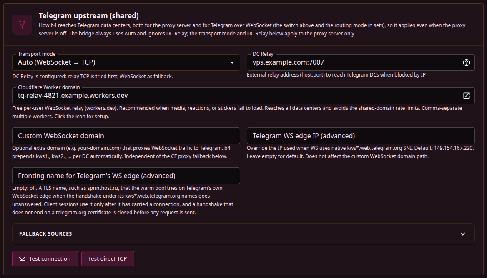

The **Telegram upstream (shared)** card decides how b4 itself reaches Telegram's data centres. The [MTProto proxy](./mtproto-proxy.md) and [Telegram over WebSocket](./websocket-bridge.md) both use it, so it applies even while the proxy server is off. The defaults are **Auto (WebSocket → TCP)** with **CF proxy fallback** on.

## Requirements

- A Cloudflare account, only for a [Cloudflare Worker](./cloudflare-worker.md).
- A VPS outside the censored network, only for a [DC Relay](./dc-relay.md).

## Setup

1. Open **Settings > Telegram** and find the **Telegram upstream (shared)** card.
2. Choose the **Transport mode** for the MTProto proxy. **Direct TCP** suits a host that reaches Telegram's addresses directly, such as a VPS outside the censored network. **Auto (WebSocket → TCP)** is the choice for a censored network.
3. When media, stickers or reactions do not load, enter a **Cloudflare Worker domain**, see [Cloudflare Worker relay](./cloudflare-worker.md).
4. Keep **CF proxy fallback** on, under **Fallback sources**.
5. Click **Save Changes**. A new transport mode, custom WebSocket domain, WS edge IP, fronting name or CF proxy setting restarts the MTProto proxy.

| Transport mode | What it does |
| --- | --- |
| **Direct TCP** | Connects to the data centres directly, or through the DC Relay when one is set. |
| **Auto (WebSocket → TCP)** | Tries the WebSocket routes first, then direct TCP. |
| **WebSocket only** | Uses the WebSocket routes only, with no direct TCP and no DC Relay. |

Telegram over WebSocket always uses **Auto (WebSocket → TCP)** and never the DC Relay, whatever the card says.

## Checking the result

- **Test connection** tries each configured route to data centre 2 and lists the result of each as soon as that route is tested, with its latency or the stage where it failed. Routes the test runs out of time for are listed as not tested.
- **Test direct TCP** tries data centre 2 over direct TCP without the DC Relay. Comparing the two separates a problem of a route from a problem of Telegram.

## When it does not work

| Symptom | Fix |
| --- | --- |
| Media, stickers or reactions do not load | A [Cloudflare Worker domain](./cloudflare-worker.md), with **CF proxy fallback** on |
| The handshake with Telegram's own edge is dropped for its names, while its address is reachable | A [fronting name](#fronting-name-for-the-ws-edge) |
| Telegram's own edge does not answer at its default address | Another address in [Telegram WS edge IP](#telegram-ws-edge-ip) |
| Direct TCP and the WebSocket routes are all blocked | A [DC Relay](./dc-relay.md) |
| The CF proxy domains are blocked, while a set's strategy gets other sites through | A [Telegram set](#telegram-set) with that strategy; in TUN mode, **Let sets process CF proxy connections** with that set covering Cloudflare |

The log lines that identify each case are under [Telegram problems](./troubleshooting.md).

## Other settings on the card

### Telegram set

**Telegram set** names the set that handles b4's own connections to Telegram: the
connections of the MTProto proxy and of Telegram over WebSocket on every route, the CF proxy
pool, a custom WebSocket domain and Cloudflare Workers included, the connection test on this
card, and the downloads of Telegram's address lists. No other set handles these connections,
whatever it targets. The connections Telegram over WebSocket passes on go to a proxy set that
lists them; those it sends directly go through the Telegram set. With **No set**, the default, they are processed as
[DPI processing](./websocket-bridge.md#dpi-processing) describes.

A set without routing applies its strategy to these connections on the ports b4 processes, 443
and those in the sets' TCP port filters, within its own TCP port filter when it has one, so a
DC Relay on other ports gets no strategy. Its other target filters, such as the TLS version
filter, do not apply to these connections. It
applies to the Worker connections only while **Let sets process Worker connections** is on. A set routed through an
interface carries them on that interface's route, and a proxy set through its upstream; neither
applies its strategy to them. With **Send domain name to upstream** on, the default, the upstream
gets the host names; otherwise, and for a name pinned in the set, it gets the address the set's
DNS settings give. The route is installed
for the chosen set even when it has no targets of its own. **Test connection** uses the set
once the choice is saved. Choosing another Telegram set, or changing the chosen set's routing,
closes the open sessions of the MTProto proxy and of Telegram over WebSocket, and the clients reconnect on the
new path.

**Create a Telegram set** adds an enabled set named Telegram, with no targets and routing off,
and selects it. Both are saved with **Save Changes**. The set's strategy is edited on the
**Sets** page like any set's.

On the **Sets** page the chosen set's card carries a **Telegram set** badge, which opens this
card. While the set applies, a Telegram set without targets reads **b4's own Telegram
connections** where other cards list their targets, followed by its port filters when it has
any. The set's **Targets** tab repeats this in a note. Targets are optional:
domains and addresses added to the set make it handle devices' connections to them as well,
like any set, and do not change how it handles b4's own connections. A TCP port filter on a set
without targets also makes it handle devices' TCP connections on those ports that no other set
claims.

The set applies while it is enabled, its routing is complete and b4 runs in NFQUEUE mode. A
block set or a Telegram over WebSocket set cannot be chosen. When one of these does not hold,
the card says why, the badge on the Sets page names the reason, and the connections go as
they would without a set. They do the same while
the set's route is not in place, for example right after a change. Without a set, and in TUN mode, the
Cloudflare routes follow **Let sets process CF proxy connections** and **Let sets process
Worker connections**, see [DPI processing](./websocket-bridge.md#dpi-processing). When the route fails later,
the set's own settings decide: the **Kill switch** of an interface set, **Fall back to direct on
upstream failure** of a proxy set. The connections to the fake SNI website stay outside the set.

With **Telegram over WebSocket** on, the connections that a proxy set's upstream running on
the router opens to Telegram itself would loop back into that upstream. The bridge sends them
out directly instead and logs a warning. The upstream stays out of the bridge when it marks its
own traffic, see [Next to other services](../guides/marks.md#next-to-other-services).

### Custom WebSocket domain

A domain that relays WebSocket traffic to Telegram, for a self-hosted relay next to the shared CF proxy pool. b4 adds `kws1.`, `kws2.` and so on for each data centre, so the names have to resolve for every data centre in use.

### Telegram WS edge IP

Telegram's own WebSocket edge is reached at one address, `149.154.167.220`, for every data centre it serves. **Telegram WS edge IP**, under **Advanced** on the card, replaces that address for a network where the default one does not answer. It takes a host or an IP address without a port. The custom WebSocket domain is not affected.

### Fronting name for the WS edge

Where DPI drops the handshake for the names of Telegram's edge while the edge's address stays reachable, b4 can present another name in the TLS handshake. **Fronting name for Telegram's WS edge**, under **Advanced**, sets that name, such as `sprinthost.ru`, the one tg-ws-proxy uses. The field is empty, and fronting off, by default. b4 tries the name only after a handshake under Telegram's own names went unanswered, and keeps a connection only when it ends on a `telegram.org` certificate.

Fronting does not help when the network blocks the edge's address outright, or when its DPI forwards the connection by the name it sees.

### Fallback sources

- **CF proxy fallback** uses a rotating pool of Cloudflare-proxied domains for the data centres Telegram's own edge does not serve. **CF proxy domain list URL** is where the pool is refreshed from, hourly. The default is tg-ws-proxy's list on GitHub.
- **DC list fallback mirror** fetches Telegram's data-centre list from a mirror when Telegram's own endpoint is unreachable. The default mirror is hosted by the b4 author and receives the requesting IP address, nothing else. **DC list mirror URL** sets another mirror, and turning the switch off removes the fallback.

## How it works

For each data centre, b4 builds a list of routes and tries them in this order:

1. Direct TCP, first, when the mode is **Direct TCP**, or **Auto (WebSocket → TCP)** with a DC Relay set.
2. Telegram's own WebSocket edge, which serves data centres 2 and 4 only.
3. The custom WebSocket domain.
4. The CF proxy pool, while **CF proxy fallback** is on.
5. The Cloudflare Worker domains.
6. Direct TCP, last, in **Auto (WebSocket → TCP)** when it was not placed first.

The routes overlap, and the first one to connect carries the session. A route that keeps failing is skipped by later sessions for a while.

For data centres 1, 3, 5 and 203, WebSocket means the custom domain, the CF proxy pool or a Worker. Media in foreign channels is therefore the first thing to fail when none of them is reachable.

Direct TCP needs a host that reaches Telegram's addresses. Most are in `149.154.0.0/16`, data centre 203 is at `91.105.192.100`, and data centres 4 and 5 are reached in `91.108.4.0/24` and `91.108.56.0/24`. These addresses are built into b4. Refreshing the data-centre list changes how b4 matches an address to a data centre, not where it connects.
