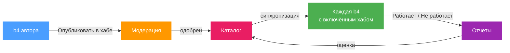

Страница **Сообщество** показывает сеты, опубликованные другими пользователями b4, с отчётами о том, работают ли они, и одним действием превращает выбранный сет в локальный. Страница есть в меню, пока включён хаб сообщества, см. [Включение](#включение).

- [Поиск сета сообщества](./browsing.md)
- [Применение сета сообщества](./applying.md)
- [Отчёты и жалобы](./feedback.md)
- [Публикация сета](./publishing.md) и [Передача сета](../sets/sharing.md)

## Каталог

Каталог хранит хаб сообщества `https://hub.b4core.app`: новейшую одобренную версию каждого опубликованного сета и отчёты по ней. Каждую версию перед публикацией одобряет модератор. Каталог подписан ключом хаба, который встроен в b4, а список с чужой подписью отклоняется.

Роутер хранит копию каталога. Он синхронизирует её каждый час, повторно через 5 минут, если ни один хаб не ответил, и сразу по кнопке **Синхронизировать**. Поиск идёт по этой копии, поэтому введённый домен в хаб не отправляется.

Если ни один хаб не отвечает две недели, копия истекает. Тогда страница показывает предупреждение над последним полученным каталогом. Применённые сеты - обычные сеты в конфигурации и продолжают работать.

Отчёты считаются по стратегии, а не по сету. Два сета с одной стратегией делят одну оценку, а новая версия, в которой изменились только цели, сохраняет оценку прежней.

## Что покидает роутер

| Действие | Что получает хаб |
| --- | --- |
| Синхронизация | Запрос каталога. Хаб видит публичный адрес роутера и версию b4 и отвечает сетью, в которой видит роутер: ASN, страна и провайдер. |
| **Работает** или **Не работает** | Сет и версия, вид отчёта, домен, по которому был отфильтрован список (если был), ASN и страна роутера, его движок захвата и версия b4. |
| Жалоба | Сет и версия, введённая причина. |
| Публикация | [Общий сет](../sets/sharing.md). |

Имена и цели других сетов и устройства за роутером не отправляются никогда. Каждая запись подписана [авторским ключом](./publishing.md#авторский-ключ) роутера. Хаб знает роутер по этому ключу, а не по учётной записи.

## Строка состояния

Строка вверху страницы показывает дату каталога, число сетов, время последней синхронизации, сеть, в которой хаб видит роутер, и число отчётов, ждущих отправки. **Синхронизировать** загружает каталог и отправляет ждущие отчёты.

| Сообщение | Значение |
| --- | --- |
| **Хаб сообщества выключен.** | Переключатель **Включить хаб сообщества** выключен, список скрыт. |
| **Нет доверенного ключа хаба, поэтому каталог невозможно проверить.** | В поле **Публичный ключ хаба** записан ключ, который не читается, список скрыт. Откуда берётся ключ, описано в разделе [Подключение роутера](./hosting.md#подключение-роутера). |
| **Каталог истёк ...** | Ни один хаб не отвечал две недели. Последний полученный каталог остаётся в списке. |
| **Ошибка последней синхронизации: ...** | Последняя синхронизация не удалась, причина указана в сообщении. Следующая успешная синхронизация его убирает. |

## Поиск

Поле **Домен** сужает список до сетов, которые покрывают домен. Вставленный URL сводится к имени хоста. Сет покрывает домен через запись домена, запись `regexp:` или категорию geosite, и карточка называет запись, через которую он совпал.

Категории ищутся в базе geosite этого роутера. Категория, названная по домену, например `youtube` для `www.youtube.com`, совпадает и без базы.

Первыми идут самые близкие совпадения: точный домен, затем родительский домен, запись `regexp:`, категория. При равном совпадении порядок задают более близкая сеть с отчётами, более высокая оценка, большее число отчётов и более свежее обновление. С пустым полем показан весь каталог, лучшие по оценке сверху.

## Карточка сета

В заголовке - название, метка автора, версия, семейство техник, нужная версия b4 и цели. Сводка стратегии ниже описывает, что сет делает с пакетами, в том же виде, что и результат Дискавери. **Отчёты** справа показывают оценку, см. [Как читать оценку](./browsing.md#как-читать-оценку).

| Метка | Значение |
| --- | --- |
| **Применён** | Из этого сета создан локальный, и его стратегия не менялась. Нажатие открывает локальный сет. |
| **Применён, изменён** | Стратегию локального сета изменили после применения. |
| **нужен payload** | Фейковые пакеты используют захваченный ClientHello. При применении файл загружается с хаба. |
| **блокировка** | [Сет блокировки](../sets/blocking.md). |
| **пины** | Сет закрепляет домены за фиксированными адресами, они перечислены в **Подробнее**. |
| **широкий охват** | Сет нацелен только на категории geosite. |
| **перехват всего** | Хотя бы одна запись домена - шаблон `regexp:`. |

| Кнопка | Что делает |
| --- | --- |
| **Применить** | Создаёт из этого сета локальный, см. [Применение сета сообщества](./applying.md). У применённого сета на её месте **Применён**, а **Открыть сет** открывает локальный сет. |
| **Обновить до версии N**, **Применить заново** | Заменяют локальный сет опубликованной версией, см. [Обновление и повторное применение](./applying.md#обновление-и-повторное-применение). |
| **Подробнее** | Показывает всё, что каталог хранит о сете: все цели, стратегию, файлы payload, даты, отпечаток и JSON сета. |
| **Пожаловаться** | Отправляет жалобу модераторам, см. [Жалобы](./feedback.md#жалобы). |
| **Работает**, **Не работает** | Есть у применённого сета. Сообщают, работает ли сет в этой сети, см. [Отчёты и жалобы](./feedback.md). Недоступны, пока локальная стратегия изменена. |
| **Проверить** | Есть у применённого сета. Загружает домен через b4 и в обход него, см. [Проверка применённого сета](./applying.md#проверка-применённого-сета). |

Ссылка на сет, которого нет в локальном каталоге, например на сет, который ещё ждёт модератора, открывает **Сведения о сете** с пометкой об этом.

## Включение

Подключение к хабу настраивается в **Настройки > Интеграции > Хаб сообщества**.

| Поле | Что делает | По умолчанию |
| --- | --- | --- |
| **Включить хаб сообщества** | Добавляет **Сообщество** в меню, запускает синхронизацию и показывает раздел **Поделиться с другими пользователями b4** в редакторе сета. Общий сет, вставленный в **Импорт**, принимается и при выключенном переключателе. | Выключено |
| **Зеркала хаба** | Другие адреса того же хаба, по одному в строке; перебираются по порядку, пока один не ответит. Зеркала, одобренные хабом, b4 получает от него и добавляет сам, см. [Зеркало чужого хаба](./hosting.md#зеркало-чужого-хаба). | Пусто, то есть `https://hub.b4core.app` |
| **Публичный ключ хаба** | Только для [собственного хаба](./hosting.md#свой-хаб), вместе с его адресом в поле **Зеркала хаба**. Ключ `hub.b4core.app` встроен. | Пусто |

**Состояние хаба** показывает каталог и срок его действия (**Актуален до**), последнюю синхронизацию и её ошибку, ключ, которым проверен каталог (**Подпись**), сеть, в которой хаб видит роутер, и **Неотправленные отчёты**, которые хранятся 30 дней. **Хаб** перечисляет адреса в порядке перебора: сначала введённые вручную, затем встроенный, затем полученные от хаба зеркала. Блок **Авторский ключ** рядом показывает [авторский ключ](./publishing.md#авторский-ключ) роутера.

Собственные запросы b4 к хабу проходят через его обработку пакетов, как любой другой трафик. Сет, совпадающий со всем подряд, например с записью `regexp:.*`, применяет свою стратегию и к ним и показывается в строке **Совпадает с сетом**. Сет для адресов хаба без стратегии, поставленный перед ним, выводит хаб из-под этой стратегии. Если такая стратегия подвешивает синхронизацию, b4 синхронизируется по соединению, которое его собственные правила не трогают, и показывает строку **Свой трафик**. Синхронизация продолжает работать, но какой-то сет или правило на этом роутере ломает собственные соединения b4.

## Применённые сеты на странице Сеты

Сет, применённый со страницы Сообщество, - обычный сет с меткой **Сет сообщества** на карточке. Метка открывает сет на странице Сообщество. Когда стратегия отличается от опубликованной, метка меняется на **Сет сообщества, изменён**, см. [Применён и изменён](./applying.md#применён-и-изменён).
