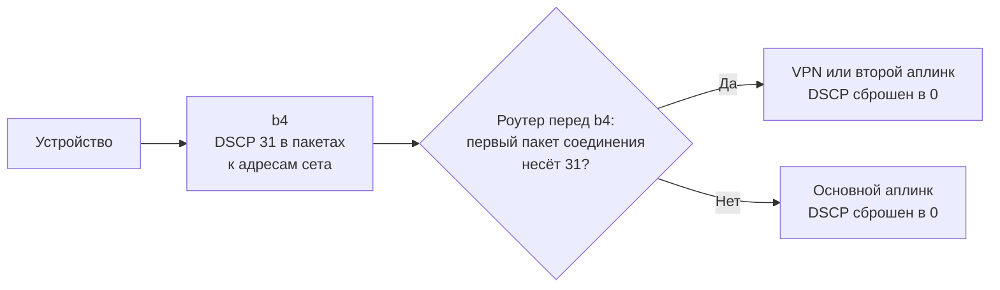

Сет может записывать собственное значение DSCP в пакеты к адресам сета. DSCP - поле заголовка IP, поэтому значение покидает хост вместе с пакетом. По нему роутер перед b4 отличает трафик сета и после обработки в b4 отправляет его своим маршрутом, например через VPN или второй аплинк. Сам b4 по этому значению не маршрутизирует.



## Требования {#requirements}

- Роутер перед b4, который умеет сравнивать DSCP и маршрутизировать по метке соединения, например Linux с nftables или RouterOS.
- b4 ставит свои правила файрвола: **Пропустить настройку IPTables/NFTables** в **Настройки > Основные > Файрвол** выключено. С iptables нужны команда `ipset` и модули ядра `xt_set` и `xt_DSCP`; на OpenWrt `xt_DSCP` ставится пакетами `kmod-ipt-ipopt` и `iptables-mod-ipopt`.
- Сет с выключенной маршрутизацией или в режиме **Сетевой интерфейс**, без исходных устройств и исходных интерфейсов. Все случаи перечислены в разделе [Когда значение не записывается](../sets/routing.md#dscp-modes).
- **Фильтрация устройств** в **Настройки > Основные > Устройства** выключена или в ней не выбрано ни одного устройства. Пока устройство выбрано, в любом из двух режимов, ни один сет не записывает своё значение; **Задать DSCP** продолжает действовать.

## Настройка {#setup}

1. Откройте **Сеты**, откройте сет, затем **DNS & Маршрутизация > Маршрутизация трафика**.
2. В блоке **DSCP** внизу включите **Включить DSCP для сета**. b4 подставит в **Значение DSCP** первое из `7`, `31`, `6` и `25`, которое не занято другим сетом и не совпадает с **Задать DSCP**.
3. Нажмите **Сохранить**.
4. При желании включите **Задать DSCP** в **Настройки > Основные > Файрвол**. Оно записывает своё значение во все остальные пакеты, и ни одно устройство, трафик которого идёт через b4, не сможет выбрать маршрут сета, записав значение сета само.

Каждому маршруту нужно своё значение. Поле описано в разделе [DSCP](../sets/routing.md#dscp).

## Выбор значения {#choosing-the-value}

Значение видит каждое устройство на пути, пока его кто-нибудь не сбросит, и некоторые на него реагируют. Драйверы Wi-Fi в Linux и точки доступа, которые следуют тому же сопоставлению, выбирают по нему очередь WMM:

| Значения | Очередь Wi-Fi |
| --- | --- |
| `7`, `31`, `6`, `25` | Best effort, как у трафика без значения |
| `8` и ряд других значений меньше `24` | Фоновая |
| `32`-`63`, а начиная с Linux 6.8 ещё `24`, `26`, `28` и `30` | Видео и голос |

`7`, `31`, `6` и `25` сохраняют обычный приоритет и в cake, и в pfifo_fast. Куда попадают остальные значения, перечисляет подсказка под **Значение DSCP**, а значения для pfSense приводит раздел [Выбор значения](../sets/routing.md#dscp-values).

## Как следующий роутер читает значение {#reading-the-value-on-the-next-router}

Роутер перед b4 должен:

1. **Решать по первому пакету соединения и сохранять решение** меткой соединения. Если маршрутизировать каждый пакет по его собственному полю, соединение переходит на другой маршрут, когда значение появляется посреди него, а за NAT это обрывает соединение. При flow offloading на хосте b4, например flowtable в nftables, `FLOWOFFLOAD` или аппаратном NAT, значение несут только первые пакеты соединения.
2. **Сравнивать поле целиком.** `ip dscp` в nftables и `dscp=` в RouterOS сравнивают все шесть бит. Селектор `tos` в `ip rule` для IPv4 сравнивает только часть из них: для него `7`, `15`, `31` и `63` неразличимы.
3. **Сбрасывать поле на выходе в интернет и на туннеле**, чтобы его не видели провайдер и другой конец туннеля. Правило сброса на пути пересылки не видит пакетов, которые FastTrack, flowtable в nftables или аппаратный NAT проводят мимо него.
4. **Принимать значение только от b4**, по его адресу или MAC-адресу. Устройства, трафик которых идёт через b4, отсекает только включённое **Задать DSCP** в b4.
5. **Пропускать ответы второго маршрута.** Строгая проверка обратного пути, `rp_filter` `1` в Linux или `rp-filter=strict` в RouterOS, их отбрасывает.

Пока b4 остановлен, перезапускается или работает без движка пакетов, новые соединения идут без значения и основным маршрутом. Роутер, который по значению **Задать DSCP** выводит трафик b4 из-под маршрута, ведущего на b4, всё это время возвращает такой трафик обратно b4; проверка по интерфейсу или MAC-адресу от работы b4 не зависит.

### Linux с nftables {#linux-with-nftables}

Значение читает одна таблица nftables. В примере роутер видит b4 через `br-lan`, основной аплинк - `wan`, второй маршрут - аплинк `wanb`, значение сета - `31`. Таблица хранится в файле, например `/etc/dscp_route.nft`, и загружается командой `nft -f /etc/dscp_route.nft`; повторная загрузка заменяет таблицу.

```text
table inet dscp_route
delete table inet dscp_route
table inet dscp_route {
    chain prerouting {
        type filter hook prerouting priority mangle; policy accept;
        iifname "br-lan" ip saddr 192.168.50.2 ct state new ct status & confirmed == 0 ip dscp 31 ct mark set ct mark | 0x01000000
        iifname "br-lan" ip6 saddr { fd50::2, fd10::/64 } ct state new ct status & confirmed == 0 ip6 dscp 31 ct mark set ct mark | 0x01000000
        iifname "br-lan" ct mark & 0x01000000 == 0x01000000 meta mark set meta mark | 0x01000000
    }
    chain postrouting {
        type filter hook postrouting priority mangle; policy accept;
        oifname { "wan", "wanb" } ip dscp != 0 ip dscp set 0
        oifname { "wan", "wanb" } ip6 dscp != 0 ip6 dscp set 0
    }
    chain srcnat {
        type nat hook postrouting priority srcnat; policy accept;
        oifname { "wan", "wanb" } masquerade
    }
}
```

Маркированные соединения идут по таблице маршрутизации `100`, маршрут по умолчанию в которой ведёт через `wanb`:

```sh
ip rule add fwmark 0x1000000/0x1000000 iif br-lan lookup 100 priority 1000
ip route add default via 100.64.2.1 dev wanb table 100
ip -6 rule add fwmark 0x1000000/0x1000000 iif br-lan lookup 100 priority 1000
ip -6 route add default via 2001:db8:b::1 dev wanb table 100
```

Апплет `ip` из busybox 1.37 принимает те же строки. Ни таблица, ни эти команды сами по себе перезагрузку не переживают: их место в скриптах запуска роутера.

| В примере | Что это |
| --- | --- |
| `br-lan` | Имя устройства ядра для интерфейса к b4, а не имя интерфейса OpenWrt |
| `192.168.50.2` | IPv4-адрес b4, лучше закреплённый статической арендой. Пересылаемый IPv4-трафик несёт его, только пока в b4 включено **Включить NAT Masquerade** ([NAT Masquerade](../settings/core.md#nat-masquerade)); без него к адресу добавляется подсеть за b4: `ip saddr { 192.168.50.2, <подсеть> }` |
| `fd50::2`, `fd10::/64` | Собственный IPv6-адрес b4 и IPv6-префикс устройств за b4. Если IPv6 через b4 не идёт, строка не нужна |
| `31` | Значение сета. Каждому следующему значению нужна своя пара строк маркировки |
| `0x01000000` | Бит метки соединения и метки пакета, который на роутере больше ничто не использует. Следующему маршруту нужны другой бит и другая таблица |
| `100`, `1000` | Таблица второго аплинка и свободный приоритет правила: меньше `32766` у основной таблицы и раньше других правил policy routing |
| `100.64.2.1`, `2001:db8:b::1` | Шлюзы второго аплинка |
| Цепочка `srcnat` | Маскарад на обоих аплинках, который, возможно, уже делает собственный файрвол роутера |

`ct status & confirmed == 0` совпадает только с пакетом, который создаёт соединение; один `ct state new` совпадает и с повторным SYN и переводит соединение посередине. nft 1.0.2 и новее показывают это условие как `ct status ! confirmed`, а nft 0.9.8 такую запись не принимает. Строки маркировки меняют только свой бит, поэтому программы, которые меняют только свои биты метки соединения, уживаются с таблицей; программа, которая перезаписывает метку соединения целиком, её ломает. Сброс сохраняет два бита ECN и обнуляет и те значения, которые устройства LAN пишут для себя.

Если b4 стоит в одном Ethernet-сегменте с роутером, вместо его адресов можно проверять MAC-адрес, для обоих семейств и с NAT Masquerade или без: `iifname "br-lan" ether saddr 02:00:00:00:00:b4 ct state new ...` в обеих строках маркировки.

При программном flow offloading соединение берёт на себя flowtable, и его пакеты проходят мимо сброса в `postrouting`. Это исправляют ещё два правила и таблица, которая сбрасывает поле на выходе из аплинков:

```sh
ip rule add oif wanb lookup 100 priority 1001
ip -6 rule add oif wanb lookup 100 priority 1001
```

```text
table netdev dscp_wash
delete table netdev dscp_wash
table netdev dscp_wash {
    chain egress {
        type filter hook egress devices = { "wan", "wanb" } priority 0; policy accept;
        ip dscp != 0 ip dscp set 0
        ip6 dscp != 0 ip6 dscp set 0
    }
}
```

Хуку `egress` нужен Linux 5.16 или новее; nft 1.0.2 и новее загружают таблицу, nft 0.9.8 - нет. Вместо таблицы поле сбрасывает cake с `wash` на обоих аплинках: `tc qdisc add dev wan root cake wash` и то же для `wanb`. Без правил `oif` каждый UDP-поток через `wanb` в offload теряет одну датаграмму, а без `iif br-lan` в правилах `fwmark` ответы IPv6 в offload уходят обратно через `wanb`, и соединения обрываются. Пример проверен вне firewall4 из OpenWrt и без аппаратного flow offloading.

Пока `net.netfilter.nf_conntrack_checksum` стоит в значении ядра по умолчанию, `1`, фейки с неверной контрольной суммой TCP, например стратегии **TCP Check**, не связываются со своим соединением: на втором маршруте они уходят через основной аплинк с адресом b4. OpenWrt ставит значение `0`, и фейки идут вместе со своим соединением.

### RouterOS

RouterOS читает значение правилами mangle. Раздел [Маршрутизация трафика сета по значению DSCP](../install/mikrotik.md#routing-by-dscp) приводит их с именами из схемы с контейнером.

## Поиск стратегии для сета {#discovery}

[Дискавери для сета](../discovery.md#запуск-для-сета) и восстановления [мониторинга](../watchdog.md) проверяют стратегии со значением сета, то есть на маршруте сета. Запуск для сайтов без сета проверяет основной маршрут, в том числе для адресов сета. Если после запуска изменение значения сета, **Задать DSCP** или его списка интерфейсов переводит трафик сета на другой путь, стратегия этого запуска не применяется, и сету нужен новый запуск.

## Проверка результата {#checking-the-result}

- Блок **DSCP** сета не показывает причину под переключателем.
- Кнопка **Информация о системе** в **Настройки > Система > Сервис** показывает в разделе **Firewall** группу `Per-set DSCP` с `applied` для сета и числом записанных для него адресов.
- Если добавить `ipinfo.io` в домены сета, `https://ipinfo.io/ip` на устройстве покажет адрес второго маршрута.

## Если не работает {#when-it-does-not-work}

- **Первое соединение к сайту идёт основным маршрутом.** b4 ещё не узнал адрес. Цели IP, CIDR, GeoIP и ASN дают значение с первого пакета. См. [Первое соединение](../sets/routing.md#dscp-first-connection).
- **Значение не доходит через туннель.** Если выходной интерфейс в b4 - WireGuard, роутер перед b4 видит только пакеты туннеля, а WireGuard пишет в их поле DSCP 0.
- **IPv4-соединения через второй аплинк не работают.** Строгая проверка обратного пути отбрасывает ответы. Ядро берёт большее из `net.ipv4.conf.all.rp_filter` и значения интерфейса, здесь `net.ipv4.conf.wanb.rp_filter`; при `2` или `0` ответы проходят.
- **Провайдер видит значение.** Flowtable или аппаратный NAT проводят пакеты мимо сброса; см. часть о flow offloading в разделе [Linux с nftables](#linux-with-nftables).
