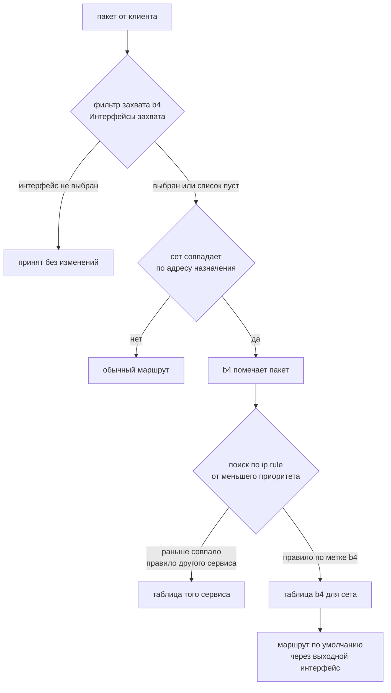

Xray с TUN-входом и сет b4 в режиме **Сетевой интерфейс** оба ставят свой маршрут перед обычным маршрутом ядра. Запущенные вместе, они пересекаются в трёх местах, и веб-интерфейс b4 показывает только одно из них. То же относится к любому сервису, который обрывает соединения за TUN-устройством: sing-box, клиенту вида `tun2socks` или Xray, запущенному вручную, а не через [XrayUI](https://daniellavrushin.github.io/asuswrt-merlin-xrayui/ru/install).

## Что делает каждый сервис

TUN-вход Xray создаёт сетевое устройство, ниже это `xray0`, и вычитывает из него пакеты. Он их не пересылает: он обрывает каждое соединение, открывает своё к тому же адресу с той же машины и переливает байты между ними.

```json
{
  "protocol": "tun",
  "tag": "ibd-tun",
  "settings": { "name": "xray0", "address": ["192.168.10.1/24"] },
  "sniffing": { "enabled": true, "routeOnly": true, "destOverride": ["http", "tls", "quic"] }
}
```

Само устройство ничего не везёт. Трафик попадает в него через `ip rule` и таблицу маршрутизации. XrayUI ставит свои, b4 ставит свои для сета в режиме **Сетевой интерфейс**. Какие сработают, решает приоритет правила, а не порядок настройки сервисов.

## Три слоя



1. **Фильтр захвата b4.** Для транзитного трафика **Интерфейсы захвата** в **Настройки > Основные > Движок пакетов** сравнивают интерфейс, через который пакет уходит. Как только что-нибудь направлено в туннель, это `xray0`, поэтому список с аплинком исключает всё, что везёт туннель. См. [Какой интерфейс за что отвечает](./interfaces.md).
2. **Маркировка b4.** Сет с включённой маршрутизацией помечает пакеты к своим адресам. Эту часть и показывает веб-интерфейс.
3. **Список `ip rule`.** Ядро идёт по правилам от меньшего номера приоритета и останавливается на первом, которое дало маршрут. У правила b4 приоритет `10000 + номер таблицы`. XrayUI в режиме TUN добавляет правило с приоритетом 51 для всей локальной подсети:

   ```text
   51:    from 192.168.1.0/24 lookup 250
   10169: from all fwmark 0x4d05/0x27fff lookup 169
   ```

   В таблице 250 есть маршрут по умолчанию, поэтому каждый пакет из локальной сети заканчивает там, и до правила b4 очередь не доходит, какую бы метку пакет ни нёс. Веб-интерфейс b4 об этом не сообщает, потому что собственные правила b4 верны.

:::warning
Два сервиса, которые оба занимаются policy-маршрутизацией, не складываются. Тот, у кого номер приоритета меньше, забирает каждый пакет, подходящий под его селектор. Реальный порядок показывает `ip rule` на роутере, а не веб-интерфейс любого из них.
:::

Все метки и правила `ip rule` b4 и значения Xray, XKeen и XrayUI перечислены на странице [Метки пакетов](./marks.md).

## Кто из сервисов маршрутизирует

Обе схемы ниже рабочие. Их смесь даёт сет, который помечает трафик и ничего не меняет.

### Xray везёт всё, b4 только обходит DPI

Правило XrayUI для подсети остаётся. Трафик всех клиентов идёт через туннель, а b4 занимается обходом DPI для того, что по-прежнему уходит напрямую.

- **Интерфейсы захвата** в **Настройки > Основные > Движок пакетов**: ничего не выбрано. Выбранный аплинк выключает b4 для всей локальной сети, потому что этот трафик через аплинк больше не уходит.
- **Включить маршрутизацию** в сетах b4: выключено. До её правила очередь всё равно не дойдёт.

### Что уходит в туннель, решает b4

Адреса выбирают сеты b4, и туннель везёт только их.

- Правило для подсети на стороне Xray убирается: в XrayUI - отключением его прозрачной маршрутизации для подсети, вручную - отказом от правила `from <подсеть> lookup <таблица>`. Оставленное на месте, оно забирает трафик всех клиентов раньше b4.
- **Интерфейсы захвата** в **Настройки > Основные > Движок пакетов**: ничего не выбрано.
- В сете, **DNS & Маршрутизация > Маршрутизация трафика**: **Выходной интерфейс** `xray0`, **Исходные интерфейсы** не выбраны, если сет не покрывает один сегмент, **Трафик самого роутера** - **Автоматически**.

Xray по-прежнему нужен маршрут до собственного сервера, не уходящий обратно в туннель: это исключение `/32`, которое XrayUI пишет в свою таблицу, и обе схемы его сохраняют.

**Автоматически** оставляет собственные соединения роутера вне туннеля: Xray открывает своё соединение к каждому адресу с роутера, и если отправить его обратно в `xray0`, возникнет петля. **Тоже маршрутизировать** безопасно, только если Xray не отправляет ни один адрес сета в outbound `freedom` или `direct`. См. [Трафик самого роутера](../sets/routing.md#трафик-самого-роутера).

## Изменение пакетов при туннельном выходе

Сет, маршрутизированный в интерфейс TUN, TAP или WireGuard, не применяет стратегию обхода: b4 изменил бы внутренний пакет, который не попадает в сеть в том виде, в каком b4 его записал. Его соединения на странице **Логи** заканчиваются пометкой `[routed->xray0]`, а на странице **Трафик** их находит фильтр `flags:routed`. Вкладки стратегии сохраняют настройки, но они не действуют, пока сет маршрутизируется в туннель.

## Правило TPROXY от XrayUI и соединения, которые перенаправляет b4

При каждом запуске xray XrayUI добавляет в начало mangle PREROUTING такое правило:

```sh
iptables -t mangle -I PREROUTING 1 -p tcp -m socket --transparent -j DIVERT
```

`DIVERT` ставит пакету метку `0x10000` и принимает его. Правило совпадает с любым пакетом к локальному прозрачному сокету, а это и соединения, которые b4 перенаправляет на свои слушатели: сеты в режимах **Upstream SOCKS5 proxy** и **Telegram через WebSocket (встроенный)** и переключатель «Telegram через WebSocket». Принятый этим правилом пакет до правила b4 не доходит и, если никакое `ip rule` не направляет метку `0x10000` на сам роутер, уходит по маршруту по умолчанию. Соединение клиента тогда так и не завершает рукопожатие со слушателем b4.

На iptables b4 держит свои переходы маршрутизации выше любого правила mangle PREROUTING, которое проверяет локальные сокеты. Если такое правило оказывается выше, следующая проверка файрвола возвращает переходы b4 наверх и пишет в лог предупреждение с именем правила. Проверка идёт с периодом **Интервал мониторинга файрвола (секунды)** в **Настройки > Основные > Файрвол**, по умолчанию раз в 10 секунд. До этого карточка «Telegram через WebSocket» показывает **Не работает** и называет правило, а **Проверить снова** на карточке возвращает переходы сразу. Пока мониторинг выключен, при интервале `0` или включённом **Пропустить настройку IPTables/NFTables**, порядок восстанавливают только **Проверить снова** и сохранение настроек.

```sh
iptables -t mangle -L PREROUTING -n --line-numbers
```

Порядок верный, когда каждая строка `b4r_*_pre` стоит раньше `DIVERT`.

## Проверка результата

Каждая команда выполняется на роутере и отвечает за свой слой:

```sh
# 3. какая таблица решает, для адреса клиента
ip rule
ip route get 1.1.1.1 from 192.168.1.100 iif br0

# 2. помечает ли b4 хоть что-то: счётчики пакетов на цепочке сета
iptables -t mangle -L -n -v | grep b4r_
nft list table inet b4_route

# 1. видит ли b4 клиентов вообще: страница «Трафик»
```

`ip route get` идёт по реальным правилам. Адрес, вернувшийся с таблицей, которую b4 не создавал, до правила b4 не доходит. Адрес вне всех сетов, который всё равно уходит в туннельное устройство, маршрутизирует другой сервис, и проверка b4 на таком адресе меряет чужую работу.
