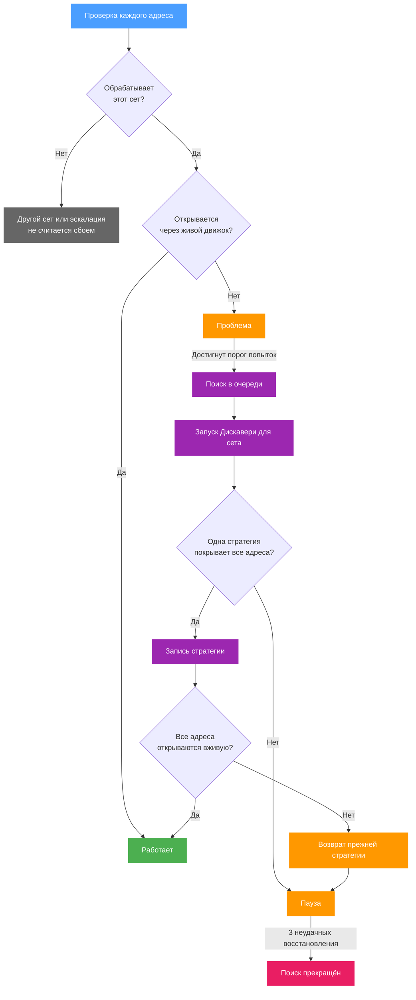

Запуск [Дискавери](../discovery.md) применяет встроенные пресеты стратегий b4 один за другим на собственной очереди захвата, запрашивает через каждый все сайты и оставляет пресеты, с которыми страница загрузилась. Настроенные сеты во время запуска продолжают работать: через проверяемую стратегию идут только запросы самого запуска. [Мониторинг](../watchdog.md) восстанавливает сет таким же запуском.

## Этапы запуска

| Этап | Что происходит |
| --- | --- |
| **DNS** | Каждый сайт разрешается, а ответы проверяются, если не выключен **Проверять подмену DNS**. Здесь же ищутся альтернативные адреса. Закреплённое имя этот этап пропускает. |
| **Без обхода** | Каждый сайт запрашивается без стратегии. Сайт, который открылся через честный ответ, в обходе не нуждается и выходит из поиска, хотя для сравнения его продолжают запрашивать через каждый пресет. Сайт, который открывается только с исправленным DNS-ответом, через альтернативный адрес или без ECH, отмечается как найденный с сетом, который не меняет пакеты. Ссылка, получившая здесь HTTP 400, тоже выходит из поиска. |
| **Стратегии** | Запомненные победители, затем сеты сообщества, если этот параметр включён, затем 18 встроенных стартовых пресетов применяются по одному, и через каждый запрашиваются все сайты. |
| **Подбор параметров** | Для каждого семейства техник, давшего рабочий пресет, параметры варьируются на сайте, который откликнулся лучше всего, а результат проверяется на всех сайтах. |
| **Комбинации** | Если сработали два семейства или больше, проверяются пресеты, которые их сочетают. |
| **Подтверждение** | Победитель каждого сайта собирается ровно в том виде, в каком был бы сохранён как сет, и запрашивается ещё три раза. Победитель, не прошедший хотя бы один из этих запросов, уступает место следующему кандидату. |

Во время поиска пресет должен пройти столько запросов подряд, сколько задано в **Подтверждать каждую стратегию**. Этап подтверждения от этого не зависит и всегда запрашивает победителя три раза. **Остановить и подтвердить** пропускает оставшиеся этапы и сразу переходит к подтверждению, поэтому результат подтверждён, но параметры для него не подбирались.

### Время и скорость

**Таймаут поиска** ограничивает один запрос сайта через один из его адресов, от соединения до конца чтения, и для каждого следующего адреса отсчёт начинается заново. На этом же значении основаны пределы этапа DNS. **Задержка распространения конфигурации** - пауза между переключением очереди запуска на новый пресет и первым запросом через него. Столько же ждут запросы подтверждения.

Каждая скорость в результатах получена одним запросом не больше 100 КБ, а время считается от начала запроса, вместе с соединением и TLS-рукопожатием. Эти цифры сравнивают стратегии на одном сайте и не измеряют пропускную способность соединения.

### Один запуск за раз

Одновременно идёт только один запуск, и мониторинг использует его вместе с ручными запусками. Восстановление, подошедшее во время ручного запуска, ждёт его окончания, а во время восстановления ручной запуск не начинается. Обновление файрвола, начатое во время запуска, ждёт его завершения. Перезапись правил DSCP в b4 не ждёт, а останавливает запуск, см. [Правила DSCP](./dscp.md#discovery). После запуска его очередь захвата и правила файрвола освобождаются, на что уходит несколько секунд.

Собственные запросы Дискавери минуют сеты, поэтому его вердикт по адресу - сырой. Сторонняя утилита на машине, где работает b4, проходит через сеты b4, и TLS-проверка, прошедшая там, измеряет обход, а не сеть. Локальные и частные адреса, а также имена и перенаправления, которые к ним ведут, не запрашиваются никогда.

## Запуск для сета

Запуск для сета проверяет не больше пяти адресов одной группой и заканчивается одним вердиктом на сет.

- **Первой идёт собственная стратегия сета.** Сразу после запроса без обхода все адреса запрашиваются через текущие настройки TCP, фрагментации и фейков сета, взятые отдельно.
- **Подтверждение совместное.** Пока включён **Остановиться на первой стратегии, которая работает для всех адресов**, стратегия, открывшая все адреса, собирается в том виде, в каком её нёс бы сет, и каждый адрес запрашивается через неё три раза в одной конфигурации. Если все запросы прошли, поиск на этом заканчивается. После трёх стратегий, не прошедших такое подтверждение, запуск больше не останавливается досрочно. При выключенном параметре запуск идёт до конца, а затем так же подтверждает до трёх стратегий. Вердикт определяет первая прошедшая.
- **Недостающая часть DNS учитывается.** Если стратегия сета открывает все адреса только с DNS-перенаправлением или закреплением, которых у сета нет, вердикт - **одна стратегия покрывает все адреса**, и применение записывает эту часть DNS в сет.
- **Значение DSCP сета идёт с запросами.** Проверочные запросы сета с собственным [значением DSCP](./dscp.md#discovery) несут его, и роутер перед b4 маршрутизирует их как трафик сета.

Имя, закреплённое в сете, проверяется через закрепления сета, если оно не указано в поле **Закреплённые адреса** запуска. Если ни один из этих адресов не принимает соединение, а проверка DNS включена, имя проверяется так, будто закреплений нет. Применение результата сохраняет закрепления сета, если запуск не нашёл для этого имени других адресов.

## Проверка DNS

Проверка DNS сравнивает адрес каждого сайта от системного резолвера с эталоном: доверенным DNS-сервером, если он задан, иначе встроенными в b4 публичными резолверами, сначала DNS поверх HTTPS, затем обычным DNS.

Доверенный DNS-сервер - единственный эталон. Его ответы считаются верными адресами, а его NXDOMAIN - признаком несуществующего имени. Перед запуском сервер опрашивается об одном из имён запуска. Если ответа нет или сервер отказывает, запуск останавливается с ошибкой. Ответ с ошибкой вроде SERVFAIL запуск не останавливает. Если сервер перестаёт отвечать позже, сайт, о котором его спрашивали, остаётся без сравнения DNS.

Если системный резолвер выдаёт сайту неверный адрес, предложенный сет получает первое сработавшее исправление DNS:

1. сам доверенный сервер, если сет может им пользоваться: публичный IP-адрес на порту 53, ответивший по UDP и не принадлежащий этому хосту, или URL `https://`;
2. встроенный сервер DNS поверх HTTPS, который возвращает верный адрес;
3. встроенный обычный DNS-сервер, который делает то же, при обычном, а затем при фрагментированном запросе;
4. адреса от DNS поверх HTTPS или доверенного сервера, закреплённые в сете. Ответ встроенных обычных DNS-серверов не закрепляется никогда, потому что его можно подделать по пути.

Доверенный сервер, которым сет пользоваться не может, например локальный прокси на другом порту, резолвер в локальной сети или сервер `tcp://`, всё равно определяет, какие адреса верные. Журнал запуска объясняет, почему он не попал в сет. Резолвер в локальной сети не подходит, потому что DNS-перенаправление сета возвращает ему его же запросы, если они пришли не с того адреса, который указан в сете.

### Когда имя не резолвится

Для вердикта **имя не резолвится** запрос без обхода должен не пройти на разрешении имени, а системный резолвер при повторном запросе должен ответить, что у имени нет адресов IPv4 и IPv6. Если повторный запрос заканчивается ошибкой, для вердикта нужны ещё включённая проверка DNS и отсутствие адреса во всех источниках этапа DNS. Имя, для которого этап DNS нашёл адрес, такого вердикта не получает.

NXDOMAIN от DNS поверх HTTPS или доверенного сервера показывается как несуществующее имя, и альтернативные адреса для него не ищутся. Для интернационализированного имени, например домена `.рф`, учитывается только ответ системного резолвера для его ASCII-формы (`xn--...`).

## Альтернативные адреса

Поиск начинается, когда все известные адреса сайта не отвечают или эталонные ответы не проходят TLS-рукопожатие. Тогда этап DNS через EDNS Client Subnet спрашивает публичный резолвер, какие адреса получают на это имя клиенты примерно из пятисот других сетей /16. Полученные адреса проверяются на TCP-соединение, а самые быстрые - на TLS-рукопожатие с именем сайта.

Адрес, завершивший рукопожатие, не попал под блокировку. Сайт запрашивается через него, а сет закрепляет за ним имя, не больше трёх адресов. Адрес, который принимает соединение, но не рукопожатие, фильтруется по имени, как и остальные. Он становится целью проверок, только если собственные адреса сайта отвергают соединения вовсе, и стратегии подбираются уже на нём.

Сет с закреплениями или собранный для сайта с заблокированными адресами получает обнаружение IP-блокировок на вкладке TCP. Закреплённый адрес, переставший отвечать, исключается из DNS-ответов, а когда не остаётся ни одного, запрос уходит резолверу. Запуск для сета ищет адреса заново, когда ни один из закреплённых адресов не принимает соединение.

## Перехват шлюзом

Этап DNS также отправляет на адреса сайта SYN с пределом в один переход, на который дальше первого узла ответить некому. Ответ значит, что соединение несёт прозрачный прокси на первом узле, и ни одна стратегия с этого хоста дальше него не проходит. Если так обслуживаются все адреса, запуск останавливается после этапа DNS, кроме случая, когда DNS-ответ другого региона даёт адрес с обычной маршрутизацией.

## ECH

После этапа DNS Дискавери запрашивает у резолвера роутера HTTPS-запись каждого сайта со ссылкой `https://`. Если в записи есть ключ ECH, каждый запрос отправляет Encrypted ClientHello. Тогда внешний ClientHello называет публичное имя из ключа, например `cloudflare-ech.com` для любого сайта Cloudflare, и каждый сет, который запуск собирает для сайта, нацелен и на это имя. Если сервер сменил ключ, запрос повторяется с ключом, который прислал сервер. Если сервер отказывается от ECH, запрос повторяется без него, как это делают браузеры. Ключ с обменом ключами не X25519 считается отсутствующим, а запуск, ограниченный TLS 1.2, ключи не запрашивает.

Если запрос без обхода с ECH не проходит, тот же запрос без ECH открывает сайт, а ещё два запроса с ECH тоже не проходят, значит DPI отбрасывает ClientHello с ECH. Результат - **Ключи ECH убраны**: сет, в котором указано и публичное имя, поэтому ключи убираются у каждого сайта, чей ключ его называет. Подтверждение запрашивает сайт без ECH, так же как подключается браузер за таким сетом.

Запрос HTTPS-записи тоже минует сеты. Если в `/etc/resolv.conf` указан локальный кеш, например dnsmasq на роутере, ответы, которые он получает от вышестоящих серверов, проходят через b4. Если сет убирает ключи ECH для всех устройств, кеш хранит ответы без ключа, и проверки отправляют обычные ClientHello, как и браузеры за роутером.

## Хранение истории

История хранит последние сто результатов, по одной записи на сайт. Запись содержит сет, собранный запуском, и сеты двенадцати самых быстрых из других сработавших стратегий. Эти сеты занимают большую часть места: сайт со множеством рабочих стратегий занимает десятки килобайт. История также хранит последний запуск каждого сета, не больше чем для 64 сетов, а журнал последнего запуска переживает перезапуск.

## Как мониторинг проверяет сет

Сначала движок сообщает, какой сет он использует для имени хоста каждого адреса с точки зрения роутера. Адрес, который обрабатывает другой сет или никакой либо который эскалация отправляет в другой сет, сбоем не считается. Затем каждый адрес этого сета запрашивается через живой движок так же, как к нему обращается устройство за роутером:

| Правило | Результат |
| --- | --- |
| Сертификат проверяется по системным корневым сертификатам и тем, что Entware ставит в `/opt/etc/ssl` | Ошибка сертификата даёт адресу статус **Непригоден**. На роутере без корневых сертификатов проверка не выполняется. |
| Сервер требует клиентский сертификат | **Непригоден**. |
| Частный или локальный адрес на любом шаге | **Непригоден**. |
| Больше 3 перенаправлений или перенаправление на известную страницу блокировки | Ошибка. |
| HTTP 400, 451 и любой 5xx | Ошибка. |
| Страница блокировки в первых 4 КБ или прочитано меньше 1 КБ | Ошибка. Читается не больше 100 КБ. |
| Тело оборвано до конца: меньше 90% объявленной длины без закрывающего `</html>` или ошибка чтения | Ошибка. |

IPv6 используется, только пока движок захвата его обрабатывает. **Таймаут проверки** ограничивает весь запрос. Адрес со статусом **Непригоден** никогда не восстанавливается.

## Как идёт восстановление

После **Макс. попыток** неудачных проверок подряд сет ставится в очередь. Восстановления идут по одному, по порядку. Сет, изменённый во время ожидания, убирается из очереди и сначала проверяется заново.

Восстановление - это запуск для сета на адресах, которые сет обрабатывает и которые можно проверить. Проверка DNS пропускается, первой идёт текущая стратегия, каждая стратегия должна пройти три запроса подряд, а поиск останавливается на первой стратегии, подтверждённой на всех адресах. Через 15 минут поиск останавливается, и найденное подтверждается. Через 20 минут запуск отменяется, а восстановление считается неудачным.

Записывается только вердикт **одна стратегия покрывает все адреса**, по правилам записи в существующий сет со страницы Дискавери. Обнаружение IP-блокировок остаётся прежним, если результат его не включает. Ничего не записывается, если сет изменили во время восстановления или трафик сета уже не идёт тем путём DSCP, которым шли проверочные запросы восстановления, см. [Правила DSCP](./dscp.md#discovery).

После записи b4 сбрасывает эскалации, которые держит для хостов сета, выжидает время из поля **Задержка распространения конфигурации** и запрашивает каждый адрес, на котором шло восстановление, до двух попыток на адрес. Если открылись все, восстановление завершено. Иначе настройки TCP, UDP, фрагментации, фейков и DNS сета возвращаются к прежним. Возврат не выполняется, если сет изменили после записи, поэтому ручная правка не перезаписывается. Другие сеты не затрагиваются.

Число запросов подряд при восстановлении (3) и число попыток на адрес после записи (2) меняются только в [файле конфигурации](../advanced/config.md). Общий переключатель срабатывает в течение 10 секунд, а его выключение отменяет идущее восстановление. Уже назначенные проверка или пауза сохраняют своё время, когда меняются интервалы.

Страницы настроек и редактор сета при каждом сохранении отправляют ревизию, которую загрузили. Если восстановление с тех пор изменило конфигурацию, сохранение отклоняется с предложением перезагрузить данные.

### Старый список доменов

Запись старого списка проверяется отдельно. После **Макс. попыток** неудачных проверок для домена запускается Дискавери без проверки DNS. Подтверждённый результат для домена, которому нужен обход, попадает в первый включённый сет без маршрутизации, в списке доменов которого есть этот домен или его родительский домен. Совпадение через GeoSite не считается. Если такого сета нет, в начале списка создаётся новый сет `watchdog-<домен>`. При совпадении через родительский домен сам домен тоже добавляется в сет, а правила файрвола обновляются, если запись меняет перехватываемые порты.

Запуск для домена несёт значение DSCP сета, который обрабатывает домен в этот момент. Домены, сеты которых несут другое значение, получают отдельный запуск сразу после этого, если всё ещё не открываются. Результат попадает в сет, только если трафик этого сета идёт тем же путём, что и проверочные запросы.

Реактивный подход мониторинга вдохновлён проектом [belotserkovtsev/ladon](https://github.com/belotserkovtsev/ladon).

## Как запрашивает сайты DPI Детектор

[DPI Детектор](../detector.md) запрашивает каждый сайт дважды: напрямую, минуя обработку b4, и через b4 с действующими сетами. Проверка только через b4 скрыла бы ту блокировку, которую должна показать. Запрос через b4 берёт адрес так же, как клиент подходящего сета: сначала закреплённый адрес, затем DoH или DNS-сервер сета при DNS-перенаправлении, затем системный резолвер. С каждой стороны пробуется до трёх адресов, потому что сайт часто заблокирован лишь на части из них.

Прямой запрос использует первые три DNS-сервера из `/etc/resolv.conf` хоста b4, а если их нет, 127.0.0.1 и ::1. При установке в контейнер это собственная настройка DNS контейнера. Имя, для которого этот резолвер не дал адреса, а DoH дал, запрашивается ещё раз, по одному. После трёх повторов подряд, закончившихся таймаутом, остальные имена сохраняют первый ответ.

В области DNS запрос идентификации к каждому резолверу по UDP показывает, какая сеть отвечает на порту 53. Перенаправление на известный публичный резолвер не помечается: роутер, заворачивающий порт 53 на AdGuard Home с Google в качестве вышестоящего, покажет Google. Если ответили хотя бы пять публичных резолверов и за всех ответила одна сеть, сводка сообщает, что порт 53 перенаправлен.
