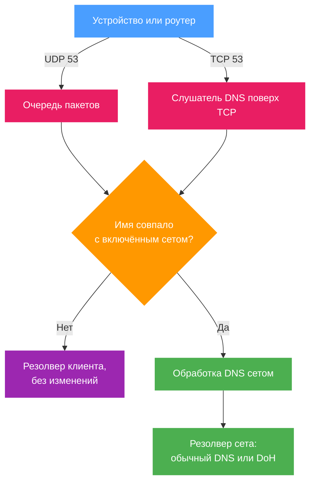

b4 перехватывает DNS на порту 53 и отвечает на имена, на которые нацелены его сеты. Настройки и проверка результата описаны в разделе [DNS для сетов](../dns.md). Ниже - механизм, который за ними стоит: для интеграторов и для отладки.

## Что перехватывает b4 {#what-b4-intercepts}

| Транспорт | Как попадает в b4 | Когда |
| --- | --- | --- |
| UDP, порт 53 | Правила очереди в `PREROUTING` и `OUTPUT`: запросы (`dport 53`) - из таблицы raw, раньше conntrack (в nftables с приоритетом -300), ответы (`sport 53`) - из таблицы mangle. Исключения описаны в разделе [Запросы и conntrack](#requests-and-conntrack) | Всегда, пока b4 запущен |
| TCP, порт 53 | `REDIRECT` в таблице `nat` на локальный слушатель, по умолчанию **Порт слушателя** 5453 | Пока хотя бы у одного включённого сета задан DNS-сервер или DoH-адрес либо включено **Убирать ключи ECH из ответов DNS**, и включено **Перехватывать DNS поверх TCP** |

Оба способа охватывают и трафик из сети, и запросы самого роутера. Запросы, которые b4 отправляет за клиента, и его запросы через резолвер сета несут [метку очереди](../guides/marks.md#метка-очереди). Правила пропускают пакеты с этой меткой, поэтому такой запрос не возвращается в очередь. Запросы, которые b4 делает через резолвер самого роутера, метки не несут.

Перехват TCP требует `REDIRECT` в таблице `nat`. Если ядро его не поддерживает, b4 пишет предупреждение в лог, и DNS поверх TCP для этого семейства адресов остаётся на резолвере клиента.

В режиме TUN запросы на порт 53 перехватываются, а ответы видны, только когда через b4 идёт весь маршрут по умолчанию. Перенаправления и закрепления работают в любом случае: эти ответы b4 формирует сам. Если b4 не может поставить правило NOTRACK, TUN захватывает только трафик самого устройства, и DNS других хостов доходит до b4, только когда его обрабатывает резолвер на этом устройстве, см. [Пересылаемый трафик и таблица raw](./capture.md#tun-forwarded).

### Запросы и conntrack {#requests-and-conntrack}

Устройство обычно запрашивает IPv4- и IPv6-адреса имени одновременно и из одного сокета. Запрос, который ждёт в очереди уже после conntrack, держит запись соединения, которую ядро ещё не подтвердило, поэтому второй запрос получает собственную запись. Ядра до 4.18, а также 4.14 до 4.14.173, отбрасывают его, когда записи сталкиваются; в таблице ниже это старые ядра. Из таблицы raw запросы попадают в conntrack по очереди, уже после того как b4 их выпустил. KeeneticOS обрабатывает свою таблицу raw после conntrack, и там b4 её не использует.

Поэтому место, где b4 забирает запросы, зависит от файрвола, ядра и прошивки:

| Файрвол и система | DNS-запросы |
| --- | --- |
| nftables | Ставятся в очередь с приоритетом raw. Если такую цепочку создать не удаётся, ставятся в очередь в `prerouting` и `output`, в лог пишется предупреждение |
| iptables вне KeeneticOS, новое ядро | Ставятся в очередь из таблицы raw. Если raw не умеет ставить пакеты в очередь, ставятся в очередь в mangle с предупреждением, а «Информация о системе» показывает **DNS-запросы в очереди раньше conntrack (raw)** недоступными |
| iptables вне KeeneticOS, старое ядро | Ставятся в очередь из таблицы raw. Если raw не умеет ставить пакеты в очередь, [копируются](#copied-requests) через NFLOG, а если не работает и это - задерживаются в mangle с предупреждением |
| iptables на KeeneticOS, новое ядро | Ставятся в очередь в mangle |
| iptables на KeeneticOS, старое ядро | Копируются через NFLOG. Если NFLOG нет, задерживаются в mangle с предупреждением |

Там, где запросы задерживаются в mangle на старом ядре, второй из двух одновременных запросов может потеряться, как описано выше.

## Как сет обрабатывает запрос {#how-a-set-handles-a-query}

Имя из запроса сверяется с целями сета так же, как SNI: запись домена покрывает его поддомены, поддерживаются записи `regexp:`. Обычные записи проверяются раньше регулярных выражений, поэтому домен, указанный в одном сете, не перехватывается заглушкой `regexp:.*` из другого.

Совпавший запрос b4 проводит по шагам в таком порядке:

1. **Блокировка.** В [сете блокировки](../sets/blocking.md) запрос получает NXDOMAIN или отбрасывается, в зависимости от действия блокировки.
2. **Закреплённые адреса.** Если для имени есть закрепление, b4 отвечает из него и на этом останавливается - независимо от того, включено ли перенаправление.
3. **Резолвер.** Если перенаправление включено и резолвер задан, b4 сам разрешает имя и отвечает клиенту напрямую. Иначе запрос уходит без изменений.
4. **Ответ.** Адреса из ответа запоминаются для клиента и записываются в IP-сет сета, если включена [маршрутизация](../sets/routing.md). Ответ, пересланный или закреплённый, который приносит адреса, не записанные b4 в сет в последнее время, задерживается, пока b4 не обновит сет, но не дольше 250 мс каждый раз, когда b4 его видит. Поэтому следующее за ним соединение обычно идёт маршрутом сета. При движке TUN ответ не задерживается. Перед тем как ответ дойдёт до устройства, b4 может его переписать: убрать [ключи ECH](#ech-keys), убрать IPv6-адреса при [откате на IPv4](../dns.md#откат-на-ipv4) и убрать или заменить недоступные адреса, если у сета в обнаружении блокировки по IP включено **Исправлять DNS-ответы**.

При [копиях запросов](#copied-requests) каждый ответ в этих шагах встаёт на место ответа резолвера, а отброшенный запрос означает отброшенный ответ.

### Резолвер сета {#the-sets-resolver}

С обычным DNS-сервером b4 сам отправляет запрос на этот IP, IP-фрагментами при включённом **Фрагментировать DNS-запросы**. С DoH-адресом он отправляет запрос HTTPS-запросом: сначала POST, а если сервер его не принимает - GET. Если заполнены оба поля, используется DoH-адрес.

Через резолверы сетов одновременно разрешается не больше 64 UDP-запросов. Следующий запрос без изменений уходит на резолвер клиента, а в лог попадает `dns-overload`.

Резолвер, который не ответил вовремя или вернул ошибку, не обрывает разрешение имени. b4 отдаёт последний удачный ответ для этого имени, а если такого нет - отправляет запрос резолверу, к которому обращался клиент. Три неудачи подряд выводят заданный резолвер из цепочки на 30 секунд, поэтому пропавший резолвер стоит одного таймаута, а не одного на каждый запрос. При включённом **Отдавать SERVFAIL, если резолвер недоступен** клиент вместо этого получает SERVFAIL, и запасного пути нет.

### Запросы от резолвера сета {#queries-from-the-sets-resolver}

Запрос с адреса собственного резолвера сета уходит без изменений, а не возвращается ему же, если b4 не блокирует этот запрос и не отвечает на него из закрепления. Так резолвер в другом месте сети может обращаться к своему вышестоящему резолверу по обычному DNS через роутер. Любой другой запрос с этого адреса тоже уходит без изменений, в том числе запросы контейнеров и VPN-клиентов за NAT на хосте резолвера. DoH-адрес сравнивается так же, если сервер в нём указан IP-адресом.

Сравнивается только адрес, указанный в сете: запрос, который резолвер отправляет с другого своего адреса, например запрос по IPv4 от резолвера, указанного в сете IPv6-адресом, всё равно возвращается к нему. Для резолвера на самом роутере сравнение не выполняется, чтобы собственные запросы роутера уходили к нему. Такой резолвер, а также резолвер роутера, когда резолвер в сети использует его как вышестоящий, должен обращаться к своему вышестоящему резолверу по протоколу, который b4 не перехватывает, например по DNS поверх HTTPS или TLS.

### Закрепления {#pins}

- Список закреплений - это весь адресный ответ для имени. Запросы A и AAAA получают закреплённые адреса своего семейства. Запрос AAAA к имени, закреплённому только за IPv4, а также запросы CNAME, SVCB, HTTPS и ANY получают пустой ответ, а не ответ резолвера, который увёл бы по CNAME сайта мимо закреплений.
- Запрос A к имени, закреплённому только за IPv6, по-прежнему уходит на резолвер, как и остальные типы записей, среди них MX, TXT и SRV.
- Закреплённые ответы отдаются с TTL 60 секунд.
- В сете без маршрутизации b4 подключается к каждому закреплённому адресу по TCP на порт 443 при запуске, при сохранении сета и с интервалом из поля **Интервал перепроверки (секунды)** обнаружения блокировки по IP, а неответившие адреса убирает из ответа. Закрепления сета с маршрутизацией не проверяются: проверка идёт напрямую с роутера, а соединения сета уходят его маршрутом.
- Если проверку не прошёл ни один адрес семейства, закрепления всё равно отдаются, так что закреплённый хост, который не слушает порт 443, своё закрепление сохраняет. Если же обнаружение блокировки по IP в сете пометило недоступными все адреса семейства, запрос уходит на резолвер.

### Ключи ECH {#ech-keys}

**Убирать ключи ECH из ответов DNS** действует на ответы HTTPS и SVCB: пересланные, полученные от собственного резолвера сета и пришедшие по DNS поверх TCP.

- Убирается только параметр `ech` вместе с его записью в `mandatory`, а сам `mandatory` - если в нём ничего не осталось. Список ALPN, подсказки адресов и TTL остаются как были.
- Записи RRSIG над изменёнными записями убираются, а флаг AD сбрасывается: изменённые записи больше не совпадают со своими подписями.
- Если в сете есть `cloudflare-ech.com`, сет совпадает по имени сервера и с ClientHello с ECH от клиентов, у которых ключ остался, и к ним применяются его настройки TCP и UDP. Сет, сделанный только для удаления ключей, пакеты не меняет, поэтому такие ClientHello проходят без изменений.

## Запросы, которые b4 делает сам {#lookups-b4-makes-itself}

Некоторые имена сета b4 разрешает и для себя. Он заранее разрешает домены сета с включённой [маршрутизацией](../sets/routing.md). Для сета, который записывает собственное [значение DSCP](../sets/routing.md#dscp-addresses), он запрашивает первые 256 записей списка доменов, кроме записей `regexp:`. Для сета в режиме прокси он ищет адрес имени, когда клиент SOCKS5-прокси b4 запрашивает это имя при выключенном **Передавать имя домена в upstream**, когда upstream отклоняет имя и когда соединение уходит в прямое. Если перенаправление включено и резолвер задан, эти запросы идут к нему, а не к резолверу роутера. После изменения настроек резолвера домены сета с маршрутизацией или с собственным значением DSCP разрешаются заново.

Ответ резолвера сета окончательный, что бы в нём ни было: имени нет, адреса нет, SERVFAIL или REFUSED. Если резолвер не ответил вовремя или недоступен, запрос уходит к резолверу роутера, а при включённом **Отдавать SERVFAIL, если резолвер недоступен** завершается ошибкой. Эти запросы учитываются в общем с перенаправлением счёте неудач: после трёх подряд резолвер пропускается на 30 секунд, запросы сразу идут к резолверу роутера, а сет с включённым SERVFAIL в это время не разрешает свои домены заранее. Последний удачный ответ для них не используется, а обычный DNS отправляется без фрагментации.

## Копии запросов {#copied-requests}

Там, где это указано в [таблице выше](#requests-and-conntrack), b4 не задерживает DNS-запросы. Правило в начале mangle `INPUT`, `FORWARD` и `OUTPUT` отдаёт b4 копию каждого запроса через NFLOG, в группу с номером первой очереди, по умолчанию 537, а сам запрос сразу уходит к своему резолверу. Копию b4 проводит через ту же обработку сетом, что и запрос из очереди, и страница «Трафик» и лог показывают те же результаты. Ответ резолвера попадает в очередь как раньше, и b4 поступает с ним по тому, что сет сделал с копией:

| Сет | Ответ резолвера |
| --- | --- |
| Блокирует имя с действием **Отклонить (быстрый отказ)** | Заменяется на NXDOMAIN |
| Блокирует имя с действием **Отбросить (молча)** | Отбрасывается |
| Закрепляет имя | Заменяется закреплённым ответом |
| Разрешает имя через резолвер сета | Задерживается, пока у b4 не будет ответа от этого резолвера или с запасного пути, и заменяется им. Ответ, задержанный на два таймаута запроса плюс 2 секунды, уходит без изменений |
| Пропускает имя без изменений или не совпадает с ним | Обрабатывается как любой другой ответ, включая удаление ключей ECH |

Если устройство спросило резолвер на самом роутере, b4 ещё и сам отправляет свой ответ, когда через 20 мс ответа резолвера всё нет, а ответ b4 уже готов. Ответ резолвера, пришедший позже, всё равно заменяется тем же ответом, и устройство получает его дважды.

- **Резолвер всё равно видит имя.** Резолвер, которого спросило устройство, получает каждый запрос и, если ответа нет у него в кеше, спрашивает свой вышестоящий резолвер, в том числе для имени, которое сет разрешает через DoH. Запрос, который резолвер роутера отправляет вышестоящему резолверу, пока b4 ещё должен устройству ответ на то же имя, уходит без изменений, и резолвер роутера кеширует настоящий ответ вместе с ключом ECH.
- **Резолвер за пределами роутера должен ответить.** Устройство, которое спрашивает резолвер за пределами роутера, получает ответ b4 только вместо ответа этого резолвера, а пока тот не отвечает, не получает ничего. Ответ такого резолвера, пришедший, когда b4 уже держит 512 ответов, проходит без изменений.
- **Правила `nat`, меняющие порт, не поддерживаются.** Если правило `nat` уводит DNS-запросы на другой порт, например `REDIRECT` на локальный резолвер на порту 5353, ответы возвращаются с этого порта, и b4 не может с ними ничего сделать. Сеты не отвечают на имена, запрошенные через такое правило, не блокируют и не перенаправляют их, а b4 пишет в лог предупреждение с этим правилом.
- **Запрос, которому NAT меняет порт источника, b4 не обрабатывает.** Ответ резолвера b4 сопоставляет с копией по порту, с которого устройство отправило запрос, а ответ доходит до b4 раньше, чем NAT возвращает этот порт. Тогда устройство получает ответ резолвера, а страница «Трафик» и лог показывают то, что сет сделал с копией. Маскарад сохраняет порт, если только его уже не занимает другое соединение с тем же резолвером. KeeneticOS до 3.5, MAP-T с общим IPv4-адресом и правила NAT с `--random` или `--random-fully` меняют порт почти каждого запроса.
- **Запросы с порта 53 b4 не обрабатывает.** Резолвер или устройство, которое отправляет запросы с UDP-порта 53, получает ответы тоже на порт 53, а такие ответы в очередь не попадают. Копии этих запросов b4 игнорирует, ответы на них проходят без изменений, а страница «Трафик» и лог о них ничего не показывают. Для резолвера на самом роутере это касается только запросов, которые он отправляет вышестоящему резолверу.
- **После потерянной копии устройство получает ответ резолвера.** Когда копии приходят быстрее, чем b4 их читает, ядро отбрасывает лишние, и ответы на эти запросы обрабатываются как любой другой ответ.

На таких роутерах «Информация о системе» показывает в разделе **Возможности ядра** строку **DNS-запросы копируются, а не задерживаются (NFLOG)**. Она доступна, пока b4 копирует запросы, и недоступна, пока часть из них он задерживает после conntrack (с недостающими модулями) или пока остановлен слушатель, который принимает копии (с его ошибкой). На KeeneticOS строки **DNS-запросы в очереди раньше conntrack (raw)** нет, а недоступная строка вместо пакетов называет компонент прошивки, который нужно включить. **Копировать JSON** в «Информации о системе» отдаёт в `firewall.dns_query_copy` число копий, потерянных и проигнорированных копий и заменённых, отброшенных и пропущенных без изменений ответов.

## Строки лога {#log-lines}

О копиях запросов b4 пишет в лог такие строки:

| Строка в логе | Значение |
| --- | --- |
| `IPTABLES[iptables]: KeeneticOS runs its raw table after conntrack (kernel ...), so b4 copies DNS queries with NFLOG (group 537) instead of holding them in its queue` | b4 копирует запросы этого бинарника, `iptables` или `ip6tables`. Вне KeeneticOS строка начинается с причины, по которой таблица raw не может поставить их в очередь. Пишется один раз |
| `IPTABLES[iptables]: b4 cannot copy DNS queries with NFLOG (...)` | Копирование не удалось по причине, указанной в скобках, и b4 задерживает запросы после conntrack. Вне KeeneticOS строка начинается с причины, по которой не подошла таблица raw, и содержит `cannot copy DNS queries with NFLOG either`. Пишется один раз |
| `DNS: the NFLOG copy of DNS queries stopped (...)` | Остановился слушатель, который принимает копии, и ответы не заменяются ответом b4, пока он снова не заработает. При следующей проверке монитор файрвола запускает его снова или задерживает запросы в очереди. Если **Интервал мониторинга файрвола (секунды)** равен `0`, таких проверок нет, и слушатель запускается снова только при перезапуске или при сохранении, которое перестраивает правила файрвола |
| `DNS: N copies of DNS queries were lost; ...` | Копии, которые отбросило ядро; такая строка пишется не чаще раза в 5 минут |
| `DNS: b4 already has 8192 DNS answers to deliver, ...` | b4 уже работал с 8192 запросами, это его предел, и ответы на запросы, скопированные после этого, не были заменены его ответом |
| `DNS: b4 already has 64 DNS answers to deliver for the A query for ... with ID ...` | b4 уже работал с 64 копиями одного запроса с тем же именем, типом и ID, но отправленными с разных сокетов или устройств, и ответы на следующие копии не были заменены. Не чаще одной такой строки в минуту |
| `IPTABLES[iptables]: the nat rule "..." moves DNS queries to port ...` | Правило `nat`, которое меняет порт, см. выше |

Решения по каждому запросу попадают в лог как результаты `dns-`, например `dns-doh->`, `dns-pin` или `dns-ipv6-stripped`. Страница «Трафик» показывает их метками, перечисленными в разделе [Проверка результата](../dns.md#как-посмотреть-результат).
