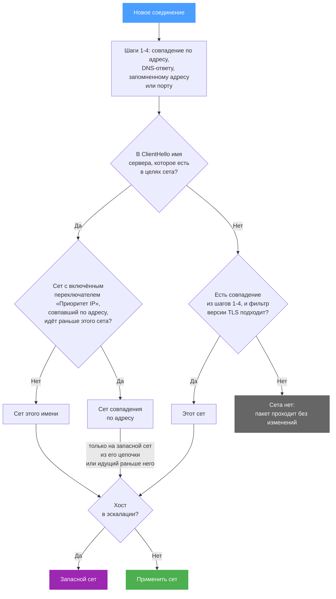

Для каждого соединения b4 решает, какой сет его получит и получит ли вообще. Проверки идут в постоянном порядке, из нескольких подходящих сетов выбирается самый точный, а в ход идут и адреса, запомненные по прежним соединениям и DNS-ответам. Цели ASN добавляют префиксы, которые b4 загружает и обновляет сам. Что именно сет выбирает, задаётся на вкладке [Цели](../sets/targets.md).

## Порядок проверок

Каждое новое TCP-соединение b4 проверяет в порядке ниже. Более поздний шаг может заменить результат более раннего, и на каждом шаге фильтр портов сета должен пропускать порт назначения.

| Шаг | Проверка | Результат |
| --- | --- | --- |
| 1 | Адрес назначения входит в IP-адреса, категории GeoIP или префиксы ASN сета | Совпадение по адресу |
| 2 | Совпадения по адресу нет, а это же устройство за последние две минуты разрешило один из доменов сета в этот адрес | Совпадение по DNS |
| 3 | Совпадения по DNS нет, а адрес запомнен по совпадению имени сервера | Совпадение по запомненному адресу. Оно заменяет совпадение по адресу, если только его не удерживает [Приоритет IP](#ip-priority) |
| 4 | Совпадений всё ещё нет, а у какого-то сета есть фильтр портов и вовсе нет целей назначения | Совпадение по порту |
| 5 | ClientHello называет сервер из целей сета | Совпадение по имени. Оно заменяет любое совпадение выше, и b4 запоминает адрес. Если совпадение по адресу удерживается переключателем [Приоритет IP](#ip-priority), соединение вместо этого получает сет этого совпадения, и b4 ничего не запоминает |
| 6 | Совпадение из шагов 1-4, у сета которого [фильтр версии TLS](../sets/targets.md#domains) не подходит к ClientHello | Совпадение отбрасывается |
| 7 | Хост в эскалации на запасной сет | Соединение получает запасной сет, см. [Эскалация](../sets/escalation.md). Соединение, которое удерживает [Приоритет IP](#ip-priority), переходит только на запасной сет из цепочки эскалации удерживающего сета или на сет, который идёт раньше него |

QUIC сопоставляется по имени сервера из пакета Initial, которое b4 читает при любом значении **Совпадение QUIC** в сете. UDP на порт 53 - это DNS, он уходит в [обработку DNS](../dns.md) b4.

TCP и UDP на частные адреса, кроме DNS, b4 не разбирает: `10.0.0.0/8`, `172.16.0.0/12`, `192.168.0.0/16`, `127.0.0.0/8`, а также уникальные локальные (`fc00::/7`), link-local (`fe80::/10`) и loopback-адреса IPv6. Исключение - TCP на такой адрес, если в **IP обхода** сета, который действует для этого устройства, есть этот адрес или диапазон внутри этих частных диапазонов, который его содержит, и этот сет берёт порт: тогда b4 обрабатывает соединение как обычно. **Любой IP-адрес** при этом не считается. К остальным таким соединениям стратегия сета не применяется, и на странице «Трафик» они не показываются. Адрес такого соединения по имени сервера b4 тоже не запоминает. Маршрутизация и собственные значения DSCP сетов по-прежнему действуют на эти адреса и узнают их из DNS-ответов. Соединение из интернета к серверу за пробросом порта - один из таких случаев. Сервер в локальной сети с публичным адресом IPv4 или IPv6 - нет, и сет, совпавший с его соединениями из интернета, применяет свою стратегию в сторону этого сервера.

## Выбор между сетами

Один и тот же домен или адрес может быть в нескольких сетах. Тогда b4 выбирает самое точное совпадение, а не первый сет в списке. Порядок в списке решает только между одинаково точными совпадениями.

**Домены.** Запись домена покрывает само имя и его поддомены, и побеждает самая точная запись: `www.example.com` в одном сете раньше `example.com` в другом. Обычные записи проверяются раньше записей `regexp:`, поэтому `regexp:.*` получает только имена, которых нет ни в одном другом сете. Из сетов с одной и той же записью b4 берёт первый подходящий:

1. сет, ограниченный исходными устройствами, среди которых есть отправитель, с подходящими фильтрами версий TLS и IP;
2. сет без исходных устройств с подходящими фильтрами версий;
3. те же два варианта ещё раз, без учёта фильтров версий.

**Адреса.** Из сетов, чьи IP-адреса, категории GeoIP или префиксы ASN покрывают адрес назначения, первым идёт сет, ограниченный исходными устройствами, среди которых есть отправитель, затем самый длинный префикс. Порядок в списке решает только между префиксами одной длины. В обоих случаях сет с включённым переключателем **Все устройства, кроме выбранных** считается ограниченным всеми устройствами, которые не выбраны.

[Маршрутизация](../sets/routing.md) выбирает иначе, потому что решают правила файрвола, см. [Как работают сеты маршрутизации](./routing.md):

| Путь | Какой сет получает соединение |
| --- | --- |
| Обход DPI | Как описано выше |
| Маршрутизация | Длина префикса роли не играет. Сеты, ограниченные выбранными устройствами или интерфейсами-источниками, проверяются раньше остальных, а среди сетов одного вида соединение забирает тот, что выше в списке |

Поэтому сет маршрутизации для одного сервиса удерживает свой трафик от сета маршрутизации на всю сеть, только если стоит выше него в списке.

## Запомненные адреса и DNS-ответы

Когда имя сервера совпадает с сетом, b4 запоминает адрес назначения вместе с именем и сетом. После этого соединение на этот адрес получает тот же сет ещё до прихода ClientHello, как и соединение вовсе без имени сервера. Запись живёт 10 минут после последнего использования. Частный адрес b4 так запоминает только по TCP и только тот, что есть в **IP обхода** сета, как описано выше. По соединению, которое удерживает [Приоритет IP](#ip-priority), b4 ничего не запоминает.

Когда через b4 проходит DNS-ответ для домена сета, b4 отмечает полученные адреса для устройства, которое спрашивало. Две минуты соединение этого устройства на такой адрес получает сет, если не совпала ни одна адресная цель.

Сет с включённым **Только по домену** не запоминает адреса и не пользуется DNS-ответами. Свои домены он сопоставляет только по имени сервера.

## Приоритет IP {#ip-priority}

**Приоритет IP** - переключатель на подвкладке [IP обхода](../sets/targets.md#ip-addresses). Он удерживает в сете соединение с одним из его адресов, даже если по имени это соединение совпадает с сетом ниже в списке. Совпадение по имени здесь - это имя сервера в ClientHello, имя в QUIC Initial или адрес, запомненный по имени сервера прежнего соединения. Адреса сета - это его IP-адреса, категории GeoIP и префиксы ASN. Переключатель применяется при сохранении, без перезапуска.

### Когда сет удерживает соединение

Сет удерживает соединение, когда выполнены все условия ниже. Иначе b4 сопоставляет соединение так же, как без переключателя.

| Условие | Подробности |
| --- | --- |
| Сет побеждает среди совпадений по адресу | Как в разделе [Выбор между сетами](#выбор-между-сетами): сначала сет, ограниченный исходными устройствами, среди которых есть отправитель, затем самый длинный префикс, затем порядок в списке. Если адрес покрывает более узкий диапазон сета с выключенным переключателем, побеждает тот сет, и соединение не удерживается |
| Не через **Любой IP-адрес** | `0.0.0.0/0` и `::/0`, которые добавляет **Любой IP-адрес**, никогда не учитываются |
| Сет идёт раньше сета, совпавшего по имени | Сет, ограниченный исходными устройствами, среди которых есть отправитель, идёт раньше любого сета без исходных устройств, где бы он ни стоял в списке. Среди сетов одного вида раньше идёт тот, что выше в списке. Сет без исходных устройств ничего не удерживает от сета выше в списке и от сета, ограниченного устройством отправителя |
| Нет фильтра версии TLS | Если в поле **Фильтр версии TLS** выбрано не **Любая**, переключатель не действует, и подвкладка его не показывает. Запись через MCP, которая сочетает переключатель с `targets.tls`, сохраняется, а ответ сообщает, что переключатель не действует |
| Фильтры подходят | Фильтр портов на вкладке TCP или UDP сета пропускает порт назначения, а **Фильтр версии IP** сета подходит к соединению |

### Одно решение на соединение

Удержанное TCP-соединение уходит в сет всеми пакетами, начиная с SYN, включая повторно отправленные ClientHello. Удержанный поток QUIC оставляет в сете свой Initial и последующие датаграммы. На странице [Трафик](../connections.md) у удержанного соединения виден домен, но нет сета, совпавшего по домену. У удержанного потока QUIC домен виден только у пакета Initial. Сет, совпавший по IP, - это сет, который обрабатывает соединение: этот сет или запасной, на который оно перешло.

Исключение - пакеты, в которых имени ещё нет, если адрес запомнен для этого сета или для сета, который идёт раньше него. SYN и первая часть ClientHello, разделённого перед именем сервера, тогда получают тот сет, как без переключателя. Если запомненный сайт в эскалации, они получают его запасной сет. Начиная с части, где есть имя, действует удержание.

[Сет блокировки](../sets/blocking.md) ниже в списке, который совпадает с именем сервера, удержанное соединение не блокирует. DNS-запросы его имён b4 по-прежнему блокирует.

### Что b4 запоминает

Пока сет удерживает соединение, b4 не запоминает по его имени сервера ничего для сета, совпавшего по имени.

Маршрутизация и собственные [значения DSCP](./dscp.md) сетов работают в файрволе по адресу назначения, без имени. Сет ниже в списке не узнаёт адреса этого сета для своей маршрутизации и записей DSCP: ни из DNS-ответов, ни из собственных запросов b4, ни из имён серверов, ни из эскалации. Какой сет удерживает адрес, решает совпадение по адресу, как описано выше, среди сетов без исходных устройств. Фильтр портов этого сета роли не играет.

| Сет | Узнаёт адреса этого сета |
| --- | --- |
| Сет ниже в списке без исходных устройств | Нет |
| Сет из цепочки эскалации этого сета: от сета в его поле **Переключаться на сет** до первого выключенного сета | Да, чтобы при эскалации сайтов этого сета их можно было маршрутизировать |
| Сет, ограниченный исходными устройствами | Да |
| Сет выше в списке | Да |

Сет с включённым переключателем, ограниченный исходными устройствами, и сет блокировки, ограниченный исходными интерфейсами, узнаванию адресов не мешают. Статические цели, то есть адреса, диапазоны, категории GeoIP и ASN из списка сета, это не затрагивает.

Включение переключателя не убирает то, что сеты ниже в списке узнали раньше. Эти адреса остаются в их маршрутизации и записях DSCP до конца срока жизни или до перезапуска b4. Сроки жизни указаны в разделах [Как сет собирает адреса](./routing.md#collecting-addresses) и [Какие пакеты получают значение](./dscp.md#dscp-addresses).

### Эскалация

[Эскалация](../sets/escalation.md) действует на сайт. Начиная с ClientHello, при эскалации своего сайта удержанное соединение переходит только на запасной сет из цепочки эскалации этого сета или на сет, который идёт раньше него. Эскалация этого сайта на любой другой запасной сет оставляет соединение в этом сете.

Если с удержанным соединением случается сбой, b4 переводит его сайт на запасной сет этого сета, если он задан. Тогда на этот запасной сет переходят и соединения с этим сайтом на других адресах. Запасной сет узнаёт адреса сайта для своей маршрутизации и записей DSCP. Они действуют по адресу и применяются ко всем соединениям с этими адресами.

Среди сетов без исходных устройств запасной сет, который стоит ниже этого сета и не входит в его цепочку, никогда не узнаёт адреса этого сета для своей маршрутизации и значения DSCP. Это верно и тогда, когда эскалация приходит от сета, который идёт раньше этого сета, или от соединения на порт, который фильтр портов этого сета не пропускает. b4 всё равно передаёт такие соединения этому запасному сету, но без его маршрутизации и значения DSCP. Если у такого запасного сета есть собственные цели и он ведёт трафик через прокси или поднятый туннельный интерфейс, b4 такие TCP-соединения не трогает. Тогда стратегия к ним не применяется вовсе. Запасные сеты тех сетов, которые идут раньше этого сета, рекомендуется ставить выше него или в его цепочку эскалации, если они маршрутизируют трафик или задают значение DSCP. Такой запасной сет забирает и удержанные соединения этого сета, когда их сайт переходит на него.

### Копии

[Общий сет](../sets/sharing.md) никогда не переносит переключатель, и в JSON вкладки **Импорт/Экспорт** его тоже нет.

| Копия | Переключатель |
| --- | --- |
| **Дублировать** на странице **Сеты** | Выключен. Копия встаёт сразу после исходного сета |
| Копия, которую AI-помощник создаёт через [MCP](../settings/mcp.md) | Выключен. Ответ предупреждает, если копия встаёт выше исходного сета, у которого переключатель действует |
| Сет из хаба сообщества, новый или заменивший локальный сет | Выключен |
| Общий сет, вставленный на вкладке **Импорт/Экспорт**, в новый или существующий сет | Выключен |
| Обычный JSON, вставленный на вкладке **Импорт/Экспорт** | Сет сохраняет своё значение |

Копия, поставленная выше исходного сета, побеждает при совпадении по адресу, а её переключатель выключен. Тогда исходный сет ничего не удерживает, пока копия снова не окажется ниже него. Если у копии включить переключатель, удерживать будет она.

## Что происходит при совпадении

Для TCP-соединения, которое получил сет, b4 задерживает пакет и вместо него отправляет изменённый, с техниками, включёнными на вкладке [TCP](../sets/tcp/index.md) сета: удаление SACK, мутация ClientHello, пакеты десинхронизации, манипуляция окном, фейковые пакеты и разделение. [Дублирование пакетов](../sets/tcp/general.md#дублирование-пакетов) заменяет их все для соединения, которое сет получил ещё до ClientHello: по адресу, DNS-ответу, запомненному адресу или порту. Для UDP решает [режим действия](../sets/udp.md#как-обрабатывать-совпавший-трафик) сета. Пакеты сета, который ведёт трафик через прокси или через поднятый туннельный интерфейс, b4 не трогает. Пакет, который не получил ни один сет, проходит без изменений.

## Цели ASN {#asn-targets}

### Откуда берутся префиксы

Префиксы b4 загружает сам из [RIPEstat](https://stat.ripe.net/), сервиса данных RIPE NCC: это префиксы, которые ASN анонсирует от своего имени по данным коллекторов маршрутов RIS, без анонсов, которые видны лишь немногим коллекторам. Частные, зарезервированные и документационные диапазоны и маршруты по умолчанию отбрасываются, префикс внутри более широкого отбрасывается, а две соседние половины большего префикса сливаются в него. Браузер к RIPEstat не обращается.

Результат хранится в `asn_cache.json` в каталоге файла конфигурации. Файл общий для всех сетов, где указан ASN, и для всех браузеров, и из него же берутся метки ASN на странице [Трафик](../connections.md). Файл, который при запуске не читается как JSON, переносится в `asn_cache.json.corrupt`, и ASN, на которые ссылаются сеты, загружаются заново.

### Обновление

| Событие | Что происходит |
| --- | --- |
| Запуск b4 | `asn_cache.json` загружается без обращения к сети, и сеты используют его префиксы, какими бы старыми они ни были. После перезагрузки без доступа в интернет сеты продолжают совпадать с последними известными префиксами |
| Сразу после запуска, затем каждый час | Фоновая проверка загружает каждый ASN, на который ссылается любой сет, включённый или нет, если записи для него нет или она старше 20 часов. ASN загружаются по одному |
| В сете появился ASN без префиксов | Проверка запускается сразу |
| Загрузка не удалась | Остаётся последняя удачная копия. Следующая попытка - через 30 секунд, и с каждой новой неудачей ожидание удваивается, но не больше часа |
| Префиксы изменились | Все сеты, которые ссылаются на ASN, разворачиваются заново, и правила файрвола обновляются |

Ответ без префиксов отклоняется. Ответ, который покрывает меньше половины прежнего адресного пространства в IPv4-адресах или в IPv6-сетях /64, придерживается. Он принимается, только если три загрузки подряд с интервалом в час вернули такое же сокращение. До тех пор используется прежний список, поэтому пробел в данных RIPEstat не опустошает сет. Кнопка **Обновить из RIPEstat** в редакторе сета подчиняется тому же правилу: она оставляет прежний список и сообщает о сокращении, а принять его может только фоновая проверка.

### До первой загрузки

ASN без префиксов в кэше не даёт ни одного адреса, и сет не совпадает с трафиком этой сети, пока не пройдёт первая загрузка. Редактор и карточка сета показывают такой ASN как не загруженный. Сет, у которого домены, адреса, категории и ASN не дают ничего, не совпадает ни с чем: он не начинает действовать на все соединения к своим портам, его MSS clamp не устанавливается, а правила маршрутизации появляются, когда разрешится хотя бы одна цель.

### Как префиксы попадают в сет

Префиксы добавляются в список адресов сета после категорий GeoIP и перед адресами, введёнными вручную. **Фильтр версии IP** сета действует на них строго: при **IPv4** загружаются только префиксы IPv4, при **IPv6** - только IPv6.

Дальше ASN ведёт себя так же, как те же префиксы, введённые как IP-адреса: их используют обход DPI, маршрутизация, блокировка, дублирование пакетов и MSS clamp, а для области действия [MSS clamp](../sets/tcp/general.md#mss-clamping) ASN считается IP-целью. Сет с целями ASN и без доменов не может отслеживаться [мониторингом](../watchdog.md): мониторинг подтверждает, какой сет обрабатывает сайт, по имени хоста.

### Размер

Ограничения на размер нет. Большая сеть разворачивается в тысячи префиксов. Каждый префикс - элемент наборов файрвола, которые строят маршрутизация, дублирование пакетов и MSS clamp, и запись в сопоставителе адресов b4. На слабом роутере это стоит памяти и времени загрузки. Панель **Сети (ASN)** на подвкладке **IP обхода** предупреждает, когда префиксов больше 2000 или IPv4-адресов больше 16 777 216.

## Раннее изменение окна {#wssize}

[wssize](../sets/tcp/general.md#окно-реальных-tcp-пакетов-wssize) закрепляет сет до SNI, по шагам 1-4 выше. Позднее решение по SNI не отменяет изменение SYN. Явные IP дают наиболее предсказуемый выбор. DNS-подсказки и изученные адреса требуют заранее известной связи с доменом. На общем хостинге она может быть неоднозначной. SYN неизвестного домена без такой связи проходит без изменений.

Исходящий SYN создаёт запись в общей ограниченной таблице. Повторный SYN сохраняет её; другой ISN или SYN после установления соединения создаёт новую запись. При пустом cutoff первый исходящий пакет с данными изменяется до остановки, включая данные Fast Open. В этом режиме последующие повторы данных проходят без изменений. Наблюдаемые FIN/RST удаляют запись; без них неактивная запись истекает через две минуты. Таблица содержит не более 20000 записей. При заполнении новые изменения не начинаются. Трафик без наблюдаемого открытия не изменяется. После сохранения конфигурации прежние записи сбрасываются при следующем обращении. Это состояние не переиспользует сокеты и не сохраняет удалённое состояние DPI между соединениями.

При `tcp.wssize.cutoff: "client_hello"` граница определяется по исходному потоку клиента от SYN ISN+1. Заголовки TLS records и длина handshake задают конец ClientHello, в том числе при разделении между TLS records. Карта покрытия учитывает перестановку сегментов, пропуски и совпадающие перекрытия. Завершение требует всех предшествующих байтов. Созданные B4 фрагменты и fake-пакеты в подсчёт не входят. Пакет, замыкающий покрытие, изменяется целиком, включая другие данные внутри него. Более поздние пакеты проходят без изменений. Повторы, пересекающие диапазон исходного ClientHello, ещё могут изменяться до общего срока завершения. Буфер самого сообщения для этого не сохраняется.

| Лимит отслеживания ClientHello | Значение |
| --- | --- |
| Общий срок от SYN | 5 секунд |
| Исходные данные на проводе, включая заголовки TLS records | 64 КБ на поток |
| Исходные пакеты с данными и TLS records | По 128 |
| Общий бюджет действующих буферов данных и покрытия | 4 МБ |

Некорректные данные, другой протокол, конфликтующие перекрытия и превышение лимитов завершают отслеживание после изменения вызвавшего их пакета. Пакет, пришедший по истечении срока, проходит без изменений. Ожидание заголовков и пропусков ограничено теми же пределами. Буферы освобождаются при завершении, fallback, закрытии, смене конфигурации/открытия и очистке. Существующий цикл очистки также удаляет буферы неактивного просроченного отслеживания. Новый таймер или worker не создаётся. Бюджет 4 МБ относится к действующим буферам, а не ко всей Go heap. Этот cutoff расширяет B4 и не равен стандартному cutoff Zapret2 или его именованному `forced_cutoff`.

Обычный IPv4 и IPv6 TCP возвращается через замену пакета NFQUEUE с пересчитанной TCP checksum и прежней меткой. Существующие методы split/fake получают изменённый пакет. Отложенные пакеты ClientHello сохраняют замену. Фрагменты IPv4, TCP с extension headers IPv6 и усечённые пакеты исключены. Валидация запрещает сочетания с TUN, маршрутизацией/bypass и дублированием. NFQUEUE не запрашивает GSO-пакеты: ядро сегментирует их перед очередью. Изменение целого GSO-пакета не реализовано.

Захват должен включать SYN и нужные исходящие данные: первый пакет по умолчанию или все исходные части ClientHello в дополнительном режиме. Существующий лимит числа захватываемых пакетов сохраняется. Многочисленные повторы могут исчерпать его до данных. Потоки, обходящие захват через offload, не обрабатываются. Для проверки выбранные потоки должны обходить flow offload. Метод не меняет системные настройки offload.

Поведение по умолчанию соответствует Zapret2 `221d7dff24bfec0cd5ac0a5070b8acef2008af3d` с исходящим направлением и cutoff на любых данных. Именованные payload в `forced_cutoff`, другие направления, пропуск параметров Window/scale и постоянный транслятор не входят в эту версию. Импортёр теряет сведения о scale/cutoff, поэтому его приближение с fake ACK не является точным переводом.

[RFC 7323, раздел 2](https://www.rfc-editor.org/rfc/rfc7323.html#section-2) фиксирует Window Scale при открытии; само окно SYN не масштабируется. Изменение масштаба 7 на 1 оставляет 64-кратное расхождение интерпретации последующих окон без трансляции. Cutoff его не исправляет. [RFC 9293, раздел 3.8.6](https://www.rfc-editor.org/rfc/rfc9293.html#section-3.8.6) также ограничивает объявляемое окно и его правый край. Успешный короткий TLS-обмен не подтверждает соответствие всей последовательности стандартам.

Постоянному транслятору нужны захват последующих ACK и обновлений окна, учёт согласования, порядка правого края и насыщения на 65535. Формула `min(65535, window * 2^(original_scale - wire_scale))` не представляет произвольно большие исходные окна. Трансляция ACK в пространстве sequence numbers не выполняется. Постоянный userspace-захват требует CPU и ресурсов очереди. Гарантий скорости или обхода блокировок нет.
