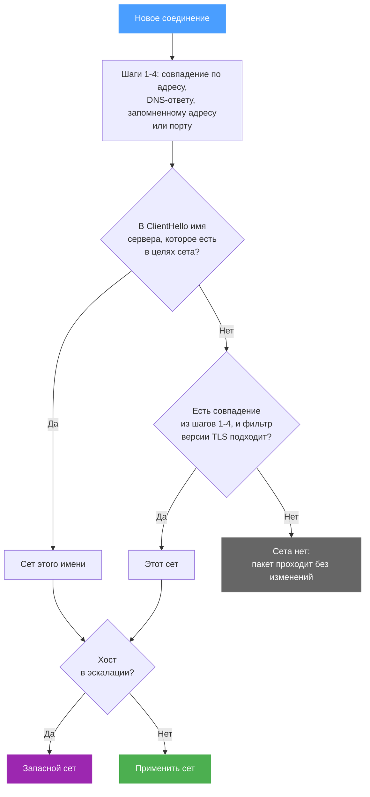

Для каждого соединения b4 решает, какой сет его получит и получит ли вообще. Проверки идут в постоянном порядке, из нескольких подходящих сетов выбирается самый точный, а в ход идут и адреса, запомненные по прежним соединениям и DNS-ответам. Цели ASN добавляют префиксы, которые b4 загружает и обновляет сам. Что именно сет выбирает, задаётся на вкладке [Цели](../sets/targets.md).

## Порядок проверок

Каждое новое TCP-соединение b4 проверяет в порядке ниже. Более поздний шаг может заменить результат более раннего, и на каждом шаге фильтр портов сета должен пропускать порт назначения.

| Шаг | Проверка | Результат |
| --- | --- | --- |
| 1 | Адрес назначения входит в IP-адреса, категории GeoIP или префиксы ASN сета | Совпадение по адресу |
| 2 | Совпадения по адресу нет, а это же устройство за последние две минуты разрешило один из доменов сета в этот адрес | Совпадение по DNS |
| 3 | Совпадения по DNS нет, а адрес запомнен по совпадению имени сервера | Совпадение по запомненному адресу. Оно заменяет совпадение по адресу |
| 4 | Совпадений всё ещё нет, а у какого-то сета есть фильтр портов и вовсе нет целей назначения | Совпадение по порту |
| 5 | ClientHello называет сервер из целей сета | Совпадение по имени. Оно заменяет любое совпадение выше, и b4 запоминает адрес |
| 6 | Совпадение из шагов 1-4, у сета которого [фильтр версии TLS](../sets/targets.md#domains) не подходит к ClientHello | Совпадение отбрасывается |
| 7 | Хост в эскалации на запасной сет | Соединение получает запасной сет, см. [Эскалация](../sets/escalation.md) |

QUIC сопоставляется по имени сервера из пакета Initial, которое b4 читает при любом значении **Совпадение QUIC** в сете. UDP на порт 53 - это DNS, он уходит в [обработку DNS](../dns.md) b4.

TCP и UDP на частные адреса, кроме DNS, b4 не разбирает: `10.0.0.0/8`, `172.16.0.0/12`, `192.168.0.0/16`, `127.0.0.0/8`, а также уникальные локальные (`fc00::/7`), link-local (`fe80::/10`) и loopback-адреса IPv6. Исключение - TCP на такой адрес, если его покрывают **IP обхода** сета и сет берёт этот порт: такое соединение сет обрабатывает как обычно. К остальным таким соединениям стратегия сета не применяется, и на странице «Трафик» они не показываются. Адрес такого соединения по имени сервера b4 тоже не запоминает. Маршрутизация и собственные значения DSCP сетов по-прежнему действуют на эти адреса и узнают их из DNS-ответов. Соединение из интернета к серверу за пробросом порта - один из таких случаев. Сервер в локальной сети с публичным адресом IPv4 или IPv6 - нет, и сет, совпавший с его соединениями из интернета, применяет свою стратегию в сторону этого сервера.

## Выбор между сетами

Один и тот же домен или адрес может быть в нескольких сетах. Тогда b4 выбирает самое точное совпадение, а не первый сет в списке. Порядок в списке решает только между одинаково точными совпадениями.

**Домены.** Запись домена покрывает само имя и его поддомены, и побеждает самая точная запись: `www.example.com` в одном сете раньше `example.com` в другом. Обычные записи проверяются раньше записей `regexp:`, поэтому `regexp:.*` получает только имена, которых нет ни в одном другом сете. Из сетов с одной и той же записью b4 берёт первый подходящий:

1. сет, ограниченный исходными устройствами, среди которых есть отправитель, с подходящими фильтрами версий TLS и IP;
2. сет без исходных устройств с подходящими фильтрами версий;
3. те же два варианта ещё раз, без учёта фильтров версий.

**Адреса.** Из сетов, чьи IP-адреса, категории GeoIP или префиксы ASN покрывают адрес назначения, первым идёт сет, ограниченный исходными устройствами, среди которых есть отправитель, затем самый длинный префикс. Порядок в списке решает только между префиксами одной длины.

[Маршрутизация](../sets/routing.md) выбирает иначе, потому что решают правила файрвола, см. [Как работают сеты маршрутизации](./routing.md):

| Путь | Какой сет получает соединение |
| --- | --- |
| Обход DPI | Как описано выше |
| Маршрутизация | Длина префикса роли не играет. Сеты, ограниченные выбранными устройствами или интерфейсами-источниками, проверяются раньше остальных, а среди сетов одного вида соединение забирает тот, что выше в списке |

Поэтому сет маршрутизации для одного сервиса удерживает свой трафик от сета маршрутизации на всю сеть, только если стоит выше него в списке.

## Запомненные адреса и DNS-ответы

Когда имя сервера совпадает с сетом, b4 запоминает адрес назначения вместе с именем и сетом. После этого соединение на этот адрес получает тот же сет ещё до прихода ClientHello, как и соединение вовсе без имени сервера. Запись живёт 10 минут после последнего использования. Частные адреса b4 так не запоминает.

Когда через b4 проходит DNS-ответ для домена сета, b4 отмечает полученные адреса для устройства, которое спрашивало. Две минуты соединение этого устройства на такой адрес получает сет, если не совпала ни одна адресная цель.

Сет с включённым **Только по домену** не запоминает адреса и не пользуется DNS-ответами. Свои домены он сопоставляет только по имени сервера.

## Что происходит при совпадении

Для TCP-соединения, которое получил сет, b4 задерживает пакет и вместо него отправляет изменённый, с техниками, включёнными на вкладке [TCP](../sets/tcp/index.md) сета: удаление SACK, мутация ClientHello, пакеты десинхронизации, манипуляция окном, фейковые пакеты и разделение. [Дублирование пакетов](../sets/tcp/general.md#дублирование-пакетов) заменяет их все для соединения, которое сет получил ещё до ClientHello: по адресу, DNS-ответу, запомненному адресу или порту. Для UDP решает [режим действия](../sets/udp.md#как-обрабатывать-совпавший-трафик) сета. Пакеты сета, который ведёт трафик через прокси или через поднятый туннельный интерфейс, b4 не трогает. Пакет, который не получил ни один сет, проходит без изменений.

## Цели ASN {#asn-targets}

### Откуда берутся префиксы

Префиксы b4 загружает сам из [RIPEstat](https://stat.ripe.net/), сервиса данных RIPE NCC: это префиксы, которые ASN анонсирует от своего имени по данным коллекторов маршрутов RIS, без анонсов, которые видны лишь немногим коллекторам. Частные, зарезервированные и документационные диапазоны и маршруты по умолчанию отбрасываются, префикс внутри более широкого отбрасывается, а две соседние половины большего префикса сливаются в него. Браузер к RIPEstat не обращается.

Результат хранится в `asn_cache.json` в каталоге файла конфигурации. Файл общий для всех сетов, где указан ASN, и для всех браузеров, и из него же берутся метки ASN на странице [Трафик](../connections.md). Файл, который при запуске не читается как JSON, переносится в `asn_cache.json.corrupt`, и ASN, на которые ссылаются сеты, загружаются заново.

### Обновление

| Событие | Что происходит |
| --- | --- |
| Запуск b4 | `asn_cache.json` загружается без обращения к сети, и сеты используют его префиксы, какими бы старыми они ни были. После перезагрузки без доступа в интернет сеты продолжают совпадать с последними известными префиксами |
| Сразу после запуска, затем каждый час | Фоновая проверка загружает каждый ASN, на который ссылается любой сет, включённый или нет, если записи для него нет или она старше 20 часов. ASN загружаются по одному |
| В сете появился ASN без префиксов | Проверка запускается сразу |
| Загрузка не удалась | Остаётся последняя удачная копия. Следующая попытка - через 30 секунд, и с каждой новой неудачей ожидание удваивается, но не больше часа |
| Префиксы изменились | Все сеты, которые ссылаются на ASN, разворачиваются заново, и правила файрвола обновляются |

Ответ без префиксов отклоняется. Ответ, который покрывает меньше половины прежнего адресного пространства в IPv4-адресах или в IPv6-сетях /64, придерживается. Он принимается, только если три загрузки подряд с интервалом в час вернули такое же сокращение. До тех пор используется прежний список, поэтому пробел в данных RIPEstat не опустошает сет. Кнопка **Обновить из RIPEstat** в редакторе сета подчиняется тому же правилу: она оставляет прежний список и сообщает о сокращении, а принять его может только фоновая проверка.

### До первой загрузки

ASN без префиксов в кэше не даёт ни одного адреса, и сет не совпадает с трафиком этой сети, пока не пройдёт первая загрузка. Редактор и карточка сета показывают такой ASN как не загруженный. Сет, у которого домены, адреса, категории и ASN не дают ничего, не совпадает ни с чем: он не начинает действовать на все соединения к своим портам, его MSS clamp не устанавливается, а правила маршрутизации появляются, когда разрешится хотя бы одна цель.

### Как префиксы попадают в сет

Префиксы добавляются в список адресов сета после категорий GeoIP и перед адресами, введёнными вручную. **Фильтр версии IP** сета действует на них строго: при **IPv4** загружаются только префиксы IPv4, при **IPv6** - только IPv6.

Дальше ASN ведёт себя так же, как те же префиксы, введённые как IP-адреса: их используют обход DPI, маршрутизация, блокировка, дублирование пакетов и MSS clamp, а для области действия [MSS clamp](../sets/tcp/general.md#mss-clamping) ASN считается IP-целью. Сет с целями ASN и без доменов не может отслеживаться [мониторингом](../watchdog.md): мониторинг подтверждает, какой сет обрабатывает сайт, по имени хоста.

### Размер

Ограничения на размер нет. Большая сеть разворачивается в тысячи префиксов. Каждый префикс - элемент наборов файрвола, которые строят маршрутизация, дублирование пакетов и MSS clamp, и запись в сопоставителе адресов b4. На слабом роутере это стоит памяти и времени загрузки. Вкладка **ASN** предупреждает, когда префиксов больше 2000 или IPv4-адресов больше 16 777 216.
