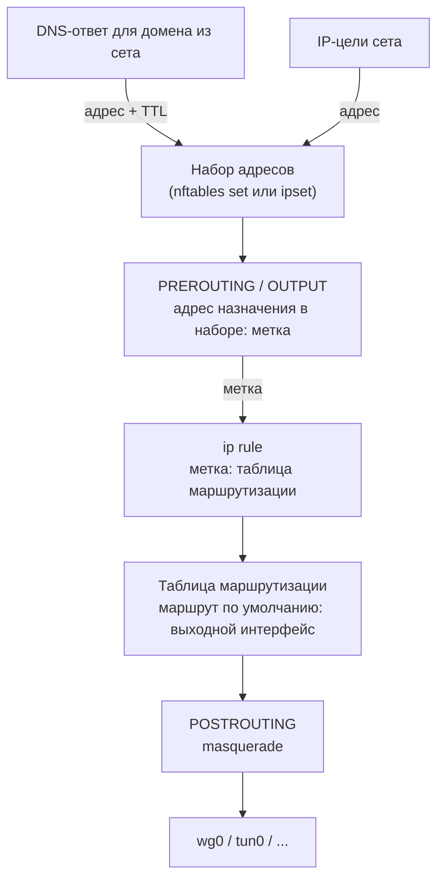

Сет с включённой маршрутизацией (**Включить маршрутизацию**) уводит свой трафик правилами файрвола, метками пакетов и policy routing. Поля описаны на странице [DNS & Маршрутизация](../sets/routing.md). Все биты меток, приоритеты `ip rule` и таблицы b4 перечислены на странице [Метки пакетов](../guides/marks.md).



## Как сет собирает адреса {#collecting-addresses}

Каждое правило, которое b4 ставит для сета, сопоставляет адрес назначения. Исходные интерфейсы и исходные устройства лишь сужают, чей трафик доходит до правила, поэтому сет без доменов и IP-целей правила не получает, и об этом пишется в лог.

| Источник | Как адрес попадает в сет |
| --- | --- |
| Цели IP, CIDR, GeoIP и ASN | Записываются при каждой синхронизации конфигурации и удаляются, когда их убирают из целей |
| DNS-ответы для доменов сета | Пересланные и закреплённые ответы, которые видит b4, и ответы DNS-перенаправления сета. Хранятся **TTL разрешённых IP (секунды)** |
| Собственные запросы b4 | Домены сета разрешаются при включении маршрутизации, через резолвер сета, если он задан. См. [Запросы, которые b4 делает сам](../dns.md#запросы-которые-b4-делает-сам) |
| Имена в TLS и QUIC | Адрес назначения соединения, ClientHello или QUIC Initial которого называет домен сета, если это не [частный адрес](./matching.md#порядок-проверок), которого нет в **IP обхода** ни одного сета; по QUIC частный адрес не запоминается вовсе. Само это соединение уже ушло обычным маршрутом, следующие идут маршрутом сета. Поддомен, совпавший так, разрешается целиком. Кроме режима **Блокировка (чёрная дыра)**: он вместо этого блокирует такое соединение по имени |

При движке NFQUEUE пересланный или закреплённый ответ с новыми адресами задерживается, пока они не записаны в сет, не дольше 250 мс каждый раз, когда b4 его видит, поэтому следующее соединение обычно идёт маршрутом сета. Ответ DNS-перенаправления сета уходит после записи адресов, без этого ограничения. При движке TUN ответ не задерживается, и первое соединение к новому адресу может уйти раньше, чем адрес окажется в сете.

## Режим «Сетевой интерфейс» {#interface-mode}

1. **Маркировка.** Цепочка сета в **PREROUTING**, `b4r_<set>_pre`, маркирует транзитный трафик к адресам сета, а при исходных интерфейсах - только пришедший через них. Цепочка в **OUTPUT**, `b4r_<set>_out`, ставит метку пакетам, которые b4 отправляет сам к адресам сета (иначе они ушли бы через обычный аплинк), и трафику роутера, если **Трафик самого роутера** этого не запрещает.
2. **Policy routing.** `ip rule` отправляет метку в таблицу сета, где маршрут по умолчанию ведёт на выходной интерфейс или на [шлюз](#gateway) сета в его сети.
3. **Masquerade.** **POSTROUTING** применяет masquerade к трафику сета, уходящему через выходной интерфейс, чтобы ответы возвращались через него же. Egress IP заменяет его на SNAT.

### Метки и таблицы маршрутизации {#marks-and-tables}

Каждый сет получает метку из хеша в диапазоне `0x100`-`0x7EFF`, а если все такие значения заняты - перебором начиная с `0x66`, и таблицу из диапазона `100`-`249`. Оба значения вычисляются из имени интерфейса, egress IP, шлюза и аварийного отключения и не меняются между перезапусками. Сеты, у которых совпадают все четыре, делят метку и таблицу.

b4 пропускает таблицу, в которой есть маршруты, добавленные не им, - в этом диапазоне лежат таблицы VPN-клиентов Asuswrt-Merlin, - таблицу, названную в файле `rt_tables` (`/etc/iproute2/rt_tables`, `rt_tables.d/*.conf` и такие же файлы в `/opt/etc/iproute2`, `/usr/share/iproute2` и `/usr/lib/iproute2`), и таблицу, которую использует `ip rule` другого сервиса. О переходе к следующему кандидату b4 пишет в лог.

`routing.fwmark` и `routing.table` в файле конфигурации закрепляют оба значения, если заданы оба, метка лежит внутри `0x27FFF`, не равна `0x24BAB` (Telegram через WebSocket), не содержит всех битов [метки очереди](../guides/marks.md#метка-очереди) и не равна её битам под `0x27FFF`.

### Туннели и стратегия обхода {#tunnel-hand-off}

Если выходной интерфейс - поднятый туннель, устройство TUN или TAP или WireGuard, b4 не трогает пакеты сета, так же как в режиме прокси: ни подделок, ни фрагментации, ни рассинхронизации, ни проверки SYN, ни эскалации по мёртвым IP, ни определения блокировки по IP, ни дублирования TCP. Изменялся бы внутренний пакет, который роутер заворачивает или обрывает. Соединение пишется в лог с пометкой `routed-><iface>`.

Стратегию сохраняют сет, маршрутизированный в обычный интерфейс, сет, выходной интерфейс которого есть, но не поднят, и сет «только по домену» без IP-целей. Сет, ограниченный исходными интерфейсами или устройствами, отдаёт пакеты так же, как любой другой: движок пакетов сопоставляет только адрес назначения.

### Трафик самого роутера {#router-traffic}

Прокси с TUN-входом, например Xray, sing-box или клиент вида `tun2socks`, обрывает каждое соединение и открывает своё к адресу назначения с роутера. Если трафик роутера маршрутизируется, b4 помечает это соединение и отправляет его обратно в TUN, который читает прокси. Каждый виток идёт с нового исходного порта, поэтому ядро не видит повтора, и каждый виток стоит прокси ещё одного сокета, пока не кончится память.

Поэтому **Автоматически** оставляет трафик роутера на обычном маршруте, если выходной интерфейс - устройство TUN или TAP. b4 узнаёт его по `/sys/class/net/<iface>/tun_flags` - этот файл ядро создаёт для каждого устройства, открытого через `/dev/net/tun`. WireGuard, PPP, VLAN и физические интерфейсы не могут открыть соединение заново, и **Автоматически** маршрутизирует в них трафик роутера. Прокси, который ходит к части адресов сета напрямую (outbound `freedom` или `direct`, правило обхода, собственный DNS), зацикливается так же.

**Тоже маршрутизировать** на TUN-устройстве пишет предупреждение в лог и ставит перед маркировкой ограничение скорости: 200 новых соединений роутера в секунду на каждый список адресов, и считаются только соединения к адресам сета. Ограничение ставится на устройства TUN и TAP и на интерфейсы, которых ещё нет, когда строятся правила, но никогда на обычный интерфейс или WireGuard. На iptables ему нужен модуль `xt_hashlimit`: b4 загружает его сам и предупреждает, если его нет.

Сет с исходным интерфейсом или включающим списком исходных устройств трафик роутера не маршрутизирует никогда. Исключающий список так сет не ограничивает.

### Аварийное отключение {#kill-switch}

Когда выходной интерфейс пропадает, ядро убирает маршрут по умолчанию из таблицы сета. Правило по метке находит пустую таблицу, поиск проваливается в основную таблицу, и трафик сета уходит через обычный аплинк. Правила при этом выглядят верными.

Аварийное отключение добавляет за настоящим маршрутом `blackhole default metric 4096`. Когда интерфейс пропадает, blackhole отбрасывает трафик сета; когда возвращается, b4 возвращает настоящий маршрут. Сет со включённым аварийным отключением получает собственную таблицу, чтобы не отбрасывать трафик соседей. Два сета, вручную закреплённых за одной `routing.table`, её по-прежнему делят, и тогда отключение действует для обоих, если включено хотя бы у одного.

### Egress IP {#egress-ip}

Egress IP заменяет masquerade сета на `SNAT --to-source`, привязанный к выходному интерфейсу, чтобы при переключении на второй WAN пакеты с этим источником не ушли в другой аплинк. Маршрут выбирает устройство выше по сети по адресу источника; хосту b4 не нужны ни туннель, ни отдельная таблица.

- b4 добавляет адрес на выходной интерфейс, возвращает его, если интерфейс его потерял, например при обновлении аренды DHCP, и убирает, когда его не использует ни один сет. Сначала b4 отправляет ARP-пробу. Если отвечает другой хост или адрес не удаётся добавить, b4 пишет предупреждение и остаётся на masquerade. Адрес, настроенный вручную, используется как есть и не удаляется.
- Вышестоящее устройство маршрутизирует этот источник, например `ip rule add from 192.168.1.51 lookup 100` в Linux или правилом `mangle` с `src-address` и `action=mark-routing` в RouterOS.
- Роутер выше по сети со строгим `rp_filter` и без маршрута обратно для этого адреса отбрасывает пакеты раньше любого правила политики. Это обычная причина, по которой внешне верная настройка не пропускает трафик.

IPv4-адрес подменяет только IPv4. Если включена **Поддержка IPv6**, IPv6-трафик сета по-прежнему уходит через выходной интерфейс с masquerade; IPv6-адрес на месте IPv4 переносит подмену на IPv6. При выключенной поддержке у сета нет IPv6-правил, и его IPv6-трафик идёт обычным маршрутом. При движке TUN, захватывающем весь маршрут по умолчанию, настройка не действует.

### Шлюз {#gateway}

**Шлюз (необязательно)** даёт таблице сета маршрут `default via <шлюз> dev <интерфейс>` в семействе адресов шлюза. Без шлюза маршрут по умолчанию идёт через шлюз, который b4 находит на интерфейсе, а если его нет, это `default dev <интерфейс>`. Второе семейство сохраняет этот маршрут: при IPv4-шлюзе IPv6-маршрут сета такой же, как без шлюза, и наоборот. Шлюз в семействе, поддержка которого выключена, не действует, и b4 пишет об этом предупреждение.

При сохранении b4 проверяет только запись адреса. Не принимаются:

- всё, кроме одного IPv4- или IPv6-адреса, например адрес в квадратных скобках или с длиной префикса;
- `%зона` у IPv4-адреса и `%зона` с интерфейсом, отличным от выходного интерфейса сета;
- неуказанный адрес, loopback- и multicast-адреса, а также `255.255.255.255`;
- собственный egress IP сета.

При установке правил сета b4 сверяет шлюз с адресами роутера и его основной таблицей маршрутизации:

| Шлюз отвергается, если он | Причина в логе |
| --- | --- |
| Один из адресов самого роутера. Link-local шлюз сравнивается только с адресами выходного интерфейса | `is one of this router's own addresses` |
| Не лежит в сети, которую выходной интерфейс достигает напрямую | `is not on a network <interface> reaches directly` |
| Адрес сети или широковещательный адрес IPv4-сети с префиксом до /30 либо адрес сети IPv6 с префиксом короче /127 | `is the network address of <prefix>`, `is the broadcast address of <prefix>` |

Интерфейс достигает шлюза напрямую, если шлюз лежит в префиксе адреса на интерфейсе или под маршрутом таблицы main через этот интерфейс без собственного шлюза, в том числе под маршрутом к отдельному хосту. Префикс адреса, добавленного с `noprefixroute`, учитывается только через такой маршрут. Link-local IPv6-шлюз достижим и с интерфейса, у которого есть свой link-local адрес.

Отвергнутый шлюз в своём семействе считается отсутствующим, и для маршрута, и для защиты ниже. Пока интерфейс поднят и у него есть линк, b4 один раз пишет в лог предупреждение с именем сета, адресом шлюза, интерфейсом и причиной. Когда шлюз становится пригодным, b4 пишет в лог, что сет теперь его использует. b4 проверяет шлюз при запуске, при каждом сохранении, когда выходной интерфейс поднимается и когда монитор файрвола замечает смену адреса интерфейса.

Сет без шлюза не ставит метку ни на один пакет, пришедший с его выходного интерфейса: устройства сети этого интерфейса за сетом не идут никогда. Пригодный IPv4-шлюз меняет это для IPv4, если выходной интерфейс относится к типу Ethernet, как порты Ethernet, мосты, VLAN, Wi-Fi и устройства TAP (`/sys/class/net/<интерфейс>/type` равен `1`). Такой сет оставляет без метки пакеты, адресованные самому роутеру, и IPv4-пакеты от шлюза, а IPv4-трафик остальных устройств этой сети маркирует. Если таких сетов на интерфейсе несколько, каждый оставляет без метки и IPv4-трафик шлюзов других сетов. IPv6-трафик, пришедший с выходного интерфейса, за сетом не идёт никогда, в том числе при IPv6-шлюзе. На интерфейсах других типов, например на устройствах TUN, WireGuard и PPP, шлюз задаёт только маршрут. Правила перечислены в разделе [Сеты с выходным интерфейсом](../guides/marks.md#сеты-с-выходным-интерфейсом).

Сет с пригодным IPv4-шлюзом на интерфейсе типа Ethernet также отбрасывает IPv4-сообщения ICMP redirect, которые роутер отправляет через этот интерфейс. Redirect направил бы устройства этой сети прямо на шлюз, в обход b4.

Сеты, которые отличаются только шлюзом, получают разные метки и таблицы. Два сета, закреплённые за одной `routing.table` с разными шлюзами, перезаписывают маршрут по умолчанию друг друга, и b4 пишет предупреждение.

Шлюз, который прошёл проверку, но не пересылает трафик, например адрес другого устройства сети, введённый по ошибке, ломает сет: пакеты уходят, ответа нет, а правила выглядят верными.

## Режим «Upstream SOCKS5 proxy» {#proxy-mode}

1. **Слушатель.** b4 открывает прозрачный слушатель на порту, вычисленном из метки сета.
2. **Перехват.** Правила TPROXY в **PREROUTING** направляют на слушатель TCP к адресам сета, а при включённом **Маршрутизировать UDP через upstream** и UDP; `ip rule` и локальный маршрут доставляют пакет локально. Адреса самого роутера, широковещательные и групповые адреса не перехватываются никогда, поэтому сет, совпадающий с любым адресом, оставляет доступными DNS, DHCP и веб-интерфейс роутера. Если ядро отклоняет сопоставление по типу адреса, b4 перечисляет адреса роутера явно и пишет об этом в лог. Пока работает монитор файрвола, b4 пересобирает правила с новым списком, когда эти адреса меняются.
3. **Ретрансляция.** Для каждого соединения b4 открывает SOCKS5 CONNECT к upstream и передаёт байты в обе стороны.

Собственные соединения роутера попадают на слушатель через петлю через `lo`, если сет не ограничен исходными устройствами или интерфейсами. Метки, правила и порты перечислены в разделе [Прокси-сеты и Telegram через WebSocket](../guides/marks.md#прокси-сеты-и-telegram-через-websocket).

При выключенном **Маршрутизировать UDP через upstream** b4 отвечает на UDP сета к порту 443 сообщением ICMP port unreachable, и браузеры переходят на TCP. Иначе сайт, объявляющий HTTP/3 в `alt-svc`, открывался бы по QUIC напрямую, и браузер помнил бы это весь срок жизни заголовка. При включённой опции тот же отказ получает сет с включённым **Блокировать QUIC (форсировать TCP)** на вкладке [UDP](../sets/udp.md#блокировка-quic): UDP к порту 443 в перехват не попадает, а остальной UDP сета по-прежнему идёт на слушатель. Отказ ставится для каждого семейства адресов отдельно, IPv6-половина - только если включена **Поддержка IPv6**. Он действует и на собственные соединения роутера, если сет не ограничен исходными устройствами или исходными интерфейсами. Если опция включена, а upstream не поддерживает UDP ASSOCIATE, UDP сета отбрасывается, и b4 пишет предупреждение.

### Имя назначения {#destination-names}

При включённом **Передавать имя домена в upstream** CONNECT несёт имя хоста всякий раз, когда b4 может связать его с соединением:

- SNI или `Host` из самого соединения передаётся, только если его подтверждает DNS-ответ для этого адреса, который b4 видел за последние 30 минут, или список доменов сета. VLESS Reality, ShadowTLS и fake-TLS прокси Telegram предъявляют имя постороннего сайта, и передача такого имени увела бы туда.
- Соединение без читаемого имени, где первым говорит сервер (SMTP, IMAP, FTP), берёт DNS-ответ, по которому само устройство получило этот адрес, затем имя, выученное по совпавшему ClientHello, затем имя, которое b4 разрешил для сета. Сначала оно ждёт ClientHello 250 мс, если только устройство не получило для адреса ровно одно имя или имя нечем подтвердить.
- Имя, закреплённое в сете, передаётся адресом. Имя, которое upstream отклонил, как делает выходной узел Tor, повторяется с адресом. UDP всегда передаёт адрес.

Пока хотя бы один proxy-сет передаёт имена, b4 запоминает имя из вопроса каждого ответа A и AAAA на UDP-порту 53, который видит, и ответов DNS-перенаправления сета. Строка `[proxy]` в логе несёт имя в любом случае; `tls=` появляется, только если b4 прочитал ClientHello.

С `SafeSocks 1` Tor отклоняет соединения по адресу и пишет `Your application (using socks5 to port 443) is giving Tor only an IP address`. Соединения, которые b4 не может назвать, например с устройства с шифрованным DNS, открывающего адрес из IP-целей сета, по-прежнему приходят по адресу. SOCKS-порт Tor не поддерживает UDP ASSOCIATE.

### Встроенный SOCKS5-прокси {#the-built-in-socks5-proxy}

Клиент [SOCKS5-прокси](../settings/core.md#socks5-proxy) b4, который запрашивает имя хоста из proxy-сета, передаётся в upstream этого сета без правил файрвола. Имя передаётся по правилам выше; при выключенном **Передавать имя домена в upstream** b4 разрешает его через резолвер сета или роутера и передаёт адрес. Имя `.onion` никогда не разрешается локально и никогда не уходит напрямую. **Прямое подключение при недоступности upstream** срабатывает, когда upstream недоступен, а не когда он отклоняет назначение.

Это работает без DNS-ответа, поэтому и в режиме TUN, и для имён, которые существуют только за upstream. Решает первый сет, совпавший с именем. Он должен быть в режиме прокси с работающим слушателем, принимать трафик роутера (без исходных интерфейсов и включающего списка исходных устройств) и не использовать сопоставление только по домену. Запрос по адресу и имя, которое решающий сет не покрывает, открывает сам роутер, как любое своё соединение.

### Сет, который захватывает собственный upstream {#own-upstream}

Upstream, работающий на роутере, подключается к своему серверу с роутера, поэтому сет, в цели которого попадает этот сервер, например `0.0.0.0/0` или широкая категория GeoIP, зациклился бы. b4 узнаёт такое соединение по процессу, который слушает порт upstream, и отправляет его напрямую. Хост upstream, заданный именем, для этой проверки разрешается, а `0.0.0.0` считается самим роутером.

Для upstream на другом устройстве соединение с этого устройства уходит напрямую, если сет нацелен на `0.0.0.0/0` или `::/0` или если b4 в этот момент ведёт через этот upstream соединение к тому же назначению. Адрес сервера внутри широкого GeoIP-сета не распознаётся; если исключить устройство из исходных устройств сета, его трафик останется нетронутым. В первый раз лог называет сет и процесс или устройство.

Метка на исходящих сокетах upstream с любым битом под `0x27FFF`, например `sockopt.mark` со значением `255` в Xray, полностью выводит его трафик из-под перехвата. См. [Рядом с другими сервисами](../guides/marks.md#рядом-с-другими-сервисами).

### Когда upstream недоступен {#upstream-down}

Каждое перехваченное соединение принимается, удерживается всё время ожидания подключения и закрывается. b4 пишет об этом в лог не чаще раза в минуту и ещё раз, когда upstream снова отвечает (`reached its upstream ... again after N failed attempts`):

```text
tproxy: set "TMDB" cannot reach its upstream 10.8.0.1:1080 (1 consecutive failures), traffic matched by this set is not getting through: dial upstream: dial tcp 10.8.0.1:1080: i/o timeout
```

**Копировать JSON** в окне **Информация о системе** копирует то же состояние в разделе `upstreams`, с полями `reachable`, `consecutive_failures` и `last_error`.

## Bridge netfilter {#bridge-netfilter}

Когда `net.bridge.bridge-nf-call-iptables` равен `1`, ядро прогоняет правила IPv4 из PREROUTING для трафика, входящего через сетевой мост, например `br-lan` или `docker0`, прямо в коде моста и не прогоняет их снова на уровне IP. Правило TPROXY привязывает соединение к слушателю b4 именно в этом проходе, а уровень IP сбрасывает привязку. Пакет всё равно доставляется локально, но его не принимает ни один сокет: соединения устройств за мостом зависают, и строк о соединениях в логе нет. Собственные соединения роутера перехватываются как обычно. `net.bridge.bridge-nf-call-ip6tables` делает то же для IPv6. Атрибуты моста `nf_call_iptables` и `nf_call_ip6tables` в `/sys/class/net/<bridge>/bridge/` тоже включают этот проход: он идёт, если `1` стоит либо в глобальной настройке, либо в атрибуте.

Это ломает режим прокси, режим «Telegram через WebSocket» и переключатель «Telegram через WebSocket». Пока один из них активен, а bridge netfilter включён для моста с портами, b4 пишет предупреждение с именем моста, **Информация о системе** показывает это в строке **Bridge netfilter**, а карточка «Telegram через WebSocket» предупреждает.

На OpenWrt обе настройки включает при загрузке пакет `dockerd` через `/etc/sysctl.d/12-br-netfilter-ip.conf`. Выключаются они без перезагрузки, а те же строки в `/etc/sysctl.conf`, который применяется после `/etc/sysctl.d`, сохраняют это после перезагрузки:

```sh
sysctl -w net.bridge.bridge-nf-call-iptables=0
sysctl -w net.bridge.bridge-nf-call-ip6tables=0
printf 'net.bridge.bridge-nf-call-iptables=0\nnet.bridge.bridge-nf-call-ip6tables=0\n' >> /etc/sysctl.conf
```

На bridge netfilter полагаются две конфигурации Docker: сеть, созданная с `icc=false`, контейнеры которой без него перестают быть изолированы, и отключённый userland proxy, при котором без него контейнер не достаёт до портов, опубликованных другими контейнерами его сети. Конфигурация Docker в OpenWrt по умолчанию не использует ни то, ни другое. В любой из этих двух dockerd возвращает настройки в `1` всякий раз, когда настраивает затронутую сеть, в том числе при каждом запуске, поэтому выключенными они не остаются.

## Firewall backend {#firewall-backend}

| Backend | Что нужно | Что создаёт b4 |
| --- | --- | --- |
| **nftables** | `nft` | Таблицу `b4_route` с цепочками `prerouting`, `output` и `postrouting` и наборы адресов с `interval` и `timeout` |
| **iptables + ipset** | `iptables`, `ipset` | Правила в таблицах `mangle` и `nat` и ipset типа `hash:net` на каждый сет; проверяется и `iptables-legacy` |

Маршрутизация работает на backend из настройки [Движок файрвола](../settings/core.md#firewall-rules), а при **Автоопределении** - на том, который b4 выбрал для остальных правил. Без `ipset` или `iptables` маршрутизация переходит на nftables, если есть `nft`. Если нет ни одного backend или команды `ip`, b4 пишет предупреждение при каждом запуске и сохранении и ничего не ставит. Наличие этих команд проверяется один раз за запуск, поэтому установленная позже утилита начинает действовать после перезапуска. В Docker-образе b4 есть `nft`, `iptables` и `ipset`.

Пока ни у одного включённого сета не включена маршрутизация и выключен переключатель «Telegram через WebSocket», для маршрутизации не создаётся ничего, даже таблица `b4_route`.

## Если правила не ставятся {#install-failures}

b4 ставит правила маршрутизации при запуске, при каждом сохранении и когда монитор файрвола не находит их на месте. Если backend отвергает основу правил, например таблицу `b4_route`, не ставится ни один сет:

```text
[ERROR] Routing: failed to ensure base during sync (nftables): ensure table: ..., it will be retried
```

Если не ставятся только некоторые сеты, о каждом пишется отдельная строка, `Routing: failed to ensure rule for set '<name>' during sync: ...`, а остальные ставятся.

b4 повторяет попытку через 10, 20, 40, 80, 160 и 320 секунд, затем каждые 10 минут. Повторы пишут в лог на уровне trace. На уровне `info` от цикла остаются три строки:

| Строка | Уровень | Когда |
| --- | --- | --- |
| `Routing: failed to ensure base during sync ...` или `Routing: failed to ensure rule for set ...` | ERROR | Первая ошибка для этой конфигурации |
| `Routing: the routing sync keeps failing; b4 retries it every 10m0s ...` | WARN | Не удался шестой повтор, через 10 минут 30 секунд после первой ошибки |
| `Routing: the routing sync that failed has been retried successfully` | INFO | Повтор удался |

Сохранение или перезапуск начинают цикл заново. Пока после ошибки на основе правил ждёт повтор, монитор файрвола не трогает правила маршрутизации. Если в ядре нет того, что нужно backend, например семейства `inet` у nftables или модуля `ip_set` для iptables, каждый повтор заканчивается той же ошибкой, пока не сменится ядро или backend.

Строка **Сеты маршрутизации** раздела **Firewall** в окне [Информация о системе](../settings/system.md#system-info) показывает, сколько сетов маршрутизации установлено, и backend. Пока правила не ставятся, строки под ней дают ошибку основы или каждого сета, время начала сбоя и следующей попытки, а также недостающую утилиту, обычно `ipset`, если из-за неё маршрутизация идёт через nftables.

## Очистка {#cleanup}

При отключении маршрутизации или удалении сета b4 убирает его `ip rule`, маршруты, переходы из базовых цепочек и созданные цепочки и наборы адресов. При остановке b4 очищает оба backend от оставшихся правил.

## Собственное значение DSCP сета {#dscp}

Как записывается собственное значение DSCP сета, какие пакеты его получают и какие правила за этим стоят, описано на странице [Правила DSCP](./dscp.md).
