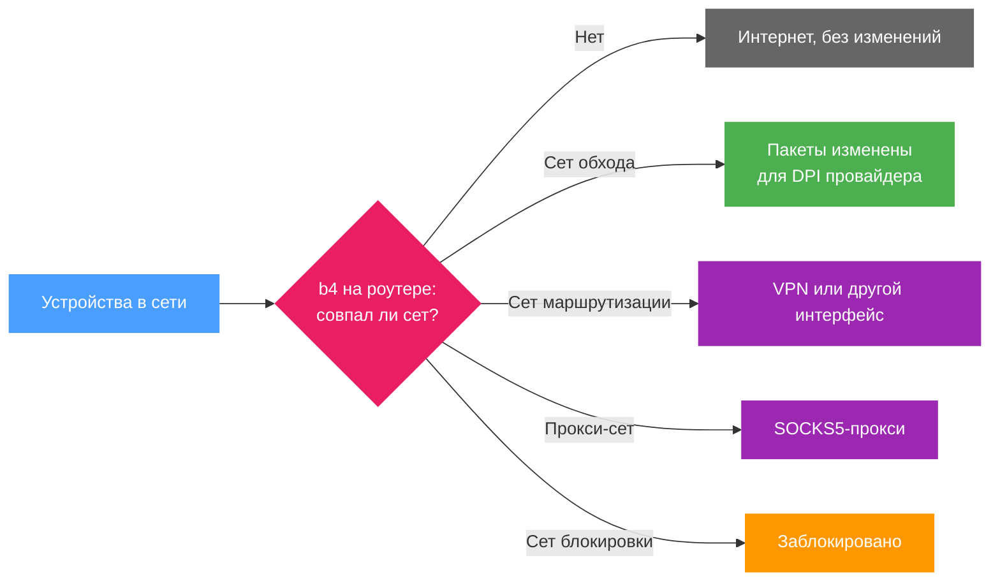

b4 (Bye Bye Big Bro) - сервис для роутеров и компьютеров с Linux. Он помогает открывать сайты, которые провайдер блокирует с помощью DPI (Deep Packet Inspection), и умеет направлять выбранные сайты через VPN или прокси. Управление - через веб-интерфейс в браузере.

Если b4 установлен на роутер, он работает для всех устройств в сети, и на самих устройствах ничего настраивать не нужно.

## Что делает b4

- **Помогает открыть заблокированные сайты.** Сет меняет то, как пакеты выбранных сайтов выглядят для DPI провайдера. Сайт получает те же данные. См. [Обход блокировки сайта](guides/unblock.md).
- **Направляет выбранные сайты через VPN** или другой интерфейс. См. [Маршрутизация сайтов через VPN или другой интерфейс](guides/vpn.md).
- **Передаёт выбранные сайты SOCKS5-прокси**, например Xray или sing-box. См. [Отправка сайтов через прокси SOCKS5](guides/proxy.md).
- **Блокирует рекламу и нежелательные сайты** для всей сети. См. [Блокировка рекламы и сайтов](sets/blocking.md).
- **Направляет DNS-запросы** выбранных доменов на другой резолвер. См. [DNS](dns.md).
- **Пропускает трафик Telegram** через собственный прокси или мост. См. [Telegram](telegram/index.md).
- **Ограничивает всё это выбранными устройствами.** См. [b4 только для выбранных устройств](guides/devices.md).

## Чего b4 не делает

- Пока ни один сет не нацелен на сайты, b4 ничего не меняет.
- b4 не предоставляет VPN или вышестоящий прокси. Сеты маршрутизации используют уже существующий VPN-интерфейс, а режим **Upstream SOCKS5 proxy** - уже работающий прокси.
- Если провайдер блокирует адреса сайта, изменение пакетов не поможет. Дискавери в этом случае показывает **адрес заблокирован**, и открыть сайт может только сет маршрутизации или прокси-сет.
- b4 не видит DNS, который устройство шифрует само, например защищённый DNS в браузере или частный DNS в Android. DNS-настройки сетов к таким запросам не применяются.
- Соединения по IPv6 обходят сеты, пока не включена **Поддержка IPv6** в разделе **Настройки > Основные > Движок пакетов**.

## Как это работает

b4 сверяет первые пакеты каждого соединения с сетами. Соединение, которому не соответствует ни один сет, проходит без изменений. Совпавшее соединение обрабатывается в зависимости от вида сета:

Сеты, стратегии и виды сетов описаны на странице [Основные понятия](concepts.md).

## Основные разделы

Страницы веб-интерфейса в порядке меню:

| Страница | Для чего |
| --- | --- |
| [Главная](dashboard.md) | Работает ли b4, какие сеты совпадают с трафиком и что требует внимания |
| [Сеты](sets/index.md) | Список сетов и редактор сета |
| [Дискавери](discovery.md) | Подбирает стратегию для сайтов, которые не открываются, и превращает её в сет |
| [Сообщество](community/index.md) | Сеты, опубликованные другими пользователями b4, применяются в один шаг |
| [Мониторинг](watchdog.md) | По расписанию проверяет сайты выбранных сетов и ищет новую стратегию, когда они перестают открываться |
| [DPI Детектор](detector.md) | Показывает, что и как блокирует провайдер |
| [Трафик](connections.md) | Соединения, которые видит b4, в реальном времени, и сет каждого из них |
| [Логи](logs.md) | Лог b4 в реальном времени |
| [Настройки](settings/index.md) | Движок пакетов, устройства, файрвол, веб-интерфейс и бэкапы |

## Требования {#requirements}

| Требование | Значение |
| --- | --- |
| Система | Linux на роутере, компьютере или сервере либо Docker. Поддерживаемые платформы перечислены в разделе [Установка](install/index.md) |
| Ядро | 3.13 или новее с поддержкой NFQUEUE (`nfnetlink_queue`). Без неё можно использовать движок TUN, ему нужны `/dev/net/tun` и `iptables` |
| Память | 64 МБ свободной памяти |
| Диск | Около 30 МБ для бинарника, плюс конфигурация и базы GeoSite и GeoIP |
| Права | root |
| Архитектуры | `amd64`, `386`, `arm64`, `armv5`, `armv6`, `armv7`, `mips`, `mipsle`, `mips_softfloat`, `mipsle_softfloat`, `mips64`, `mips64le`, `loong64`, `ppc64`, `ppc64le`, `riscv64`, `s390x` |
