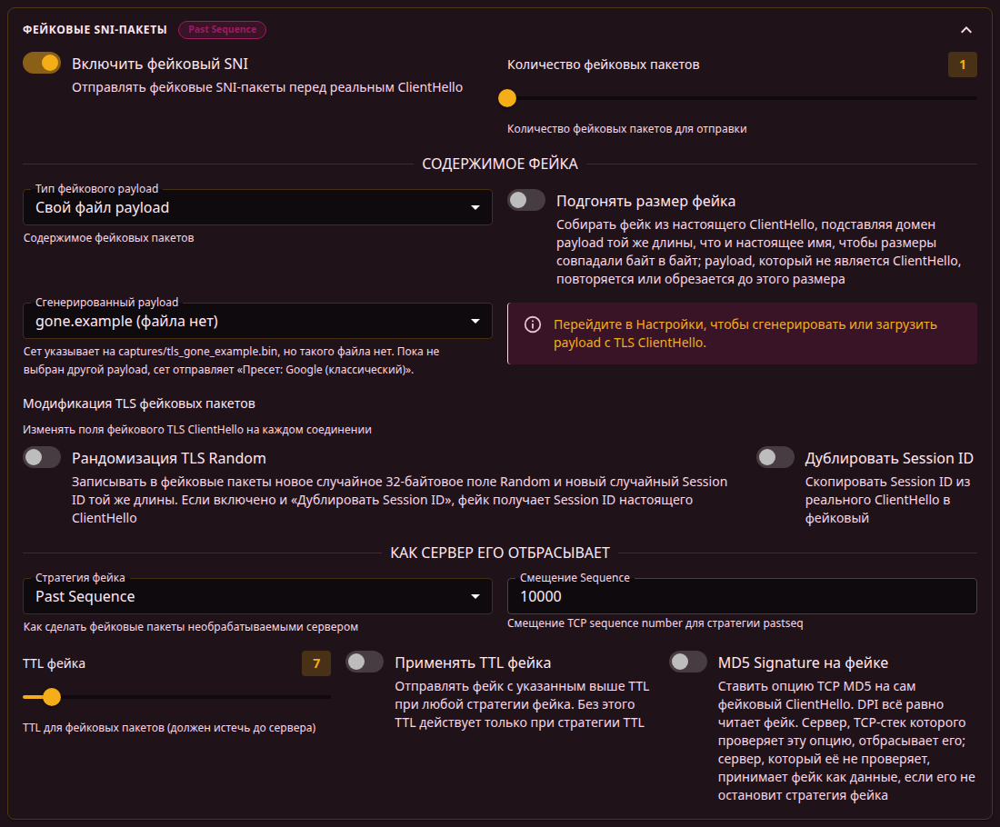
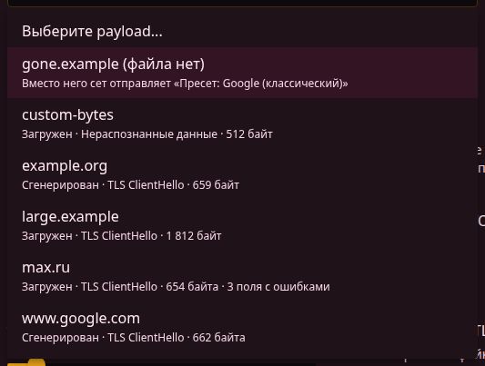

Подвкладка **Фейкинг** отправляет фейковые пакеты, которые DPI читает, а сервер отбрасывает, и может менять настоящий ClientHello. [Дискавери](../../discovery.md) подбирает настройки фейков, включая TTL, для найденных стратегий, а ручные изменения нужны для доводки. Фейковые payload генерируются и загружаются в [Настройки > Payloads](../../settings/payloads.md).

## Фейковые SNI-пакеты

Фейковые ClientHello, которые отправляются перед настоящим. DPI читает фейк, а настоящий ClientHello проходит незамеченным.

| Поле | Что делает | По умолчанию |
| --- | --- | --- |
| **Включить фейковый SNI** | Отправляет фейковые пакеты перед настоящим ClientHello. | Вкл. |
| **Количество фейковых пакетов** | Сколько фейков отправлять, от 1 до 20. | `1` |

### Содержимое фейка {#fake-payload}

| Поле | Что делает | По умолчанию |
| --- | --- | --- |
| **Тип фейкового payload** | Что несёт фейк, см. таблицу ниже. | **Пресет: Google (классический)** |
| **Подгонять размер фейка** | Собирает фейк из настоящего ClientHello, подставляя домен payload той же длины, что и настоящее имя, чтобы размеры совпадали. Если payload - не ClientHello, он повторяется или обрезается до этого размера. На канале с MTU 1500 файл payload больше 1448 байт (столько несёт один пакет с TCP timestamps) без этого переключателя не отправляется, и редактор показывает для него предупреждение. | Выкл. |
| **Рандомизация TLS Random** | Заменяет 32-байтовое поле Random и Session ID каждого фейка случайными значениями. | Выкл. |
| **Дублировать Session ID** | Копирует Session ID настоящего ClientHello в фейк. Имеет приоритет над случайным Session ID от **Рандомизация TLS Random**. | Выкл. |

| Тип payload | Что несёт фейк |
| --- | --- |
| **Случайное** | Случайные байты. |
| **Пресет: Google (классический)**, **Пресет: VK** | ClientHello для этого сайта. |
| **Пресет: STUN** | Запрос STUN. |
| **Свой файл payload** | TLS-payload из [Настройки > Payloads](../../settings/payloads.md), выбранный в поле **Сгенерированный payload**, см. ниже. |
| **Все нули** | Нулевые байты. |
| **Инвертированный оригинал** | Настоящий ClientHello с инвертированными битами. |
| **Сгенерированный из домена** | ClientHello, сгенерированный для домена из поля **Домен**. |
| **Пользовательский** | Текст из поля **Пользовательский payload**, байт в байт. Есть в списке только у сета, где такой текст уже задан. |

С типом **Свой файл payload** список **Сгенерированный payload** предлагает TLS-payload из **Настройки > Payloads**, у которых есть непустой файл, по алфавиту. Под каждым именем строка с происхождением, типом и размером, а если в payload есть поля с ошибками, то и с их числом. QUIC-payload предназначены для вкладки [UDP](../udp.md) и в этот список не входят.

Файл, на который указывает сет, но которого на роутере больше нет, остаётся выбранным с пометкой (файла нет) после имени, а пустой файл - с пометкой (файл пуст). Текст под списком тогда сообщает, что сет отправляет **Пресет: Google (классический)**, пока не выбран другой payload. QUIC-payload, который сет уже использует, тоже остаётся выбранным, с подсказкой выбрать TLS ClientHello. Если сет отправляет фейки, а payload не выбран или у типа **Сгенерированный из домена** не указан домен, предупреждение сообщает, что сет отправляет **Пресет: Google (классический)**.

**Рандомизация TLS Random** и **Дублировать Session ID** находятся в блоке **Модификация TLS фейковых пакетов**. Он виден, только когда фейк - TLS ClientHello, который эти переключатели могут изменить:

- с типами **Пресет: Google (классический)**, **Пресет: VK** и **Сгенерированный из домена**;
- с типом **Свой файл payload**, если выбранный payload - TLS ClientHello или сет вместо него отправляет **Пресет: Google (классический)**;
- с типом **Инвертированный оригинал** - только пока сет ещё отправляет **Фейковые SYN-пакеты** с **Длина payload SYN-фейка** больше `0` или обманку разбиения **Combo** или **Hybrid** (переключатель **Включить обманку**).

Для типов **Случайное**, **Пресет: STUN**, **Все нули** и **Пользовательский** блок скрыт.

### Стратегия фейка

Раздел **Как сервер его отбрасывает** определяет, почему сервер отбрасывает фейк, хотя DPI его читает.

| Поле | Что делает | По умолчанию |
| --- | --- | --- |
| **Стратегия фейка** | Как фейк становится непригодным для сервера, см. таблицу ниже. | **Past Sequence** |
| **Смещение Sequence** | На сколько сдвигается sequence number, для **Random Sequence** и **Past Sequence**. | `10000` |
| **Уменьшение Timestamp** | На сколько уменьшается TCP timestamp, для **TCP Timestamp**. | `600000` |
| **TTL фейка** | TTL фейков, от 1 до 64. Фейк должен дойти до DPI и истечь до сервера. Его используют и **SYN MD5 Signature**, OOB, UDP-фейки, пакет-обманка Combo, «Длина перекрытия» и **Post-ClientHello RST**, в том числе при выключенных **Фейковых SNI-пакетах**. | `7` |
| **Применять TTL фейка** | Применяет **TTL фейка** при любой стратегии. Без этого TTL действует только со стратегией **TTL**. | Выкл. |
| **MD5 Signature на фейке** | Ставит на фейк опцию TCP MD5. DPI его всё равно читает. Сервер, который проверяет эту опцию, отбрасывает фейк. Сервер, который её не проверяет, принимает фейк как данные, если его не остановит стратегия фейка. | Выкл. |

| Стратегия | Почему сервер отбрасывает фейк |
| --- | --- |
| **TTL** | Фейк истекает по дороге и до сервера не доходит. |
| **Random Sequence** | У него случайный TCP sequence number. |
| **Past Sequence** | У него sequence number, который сервер уже обработал. |
| **TCP Check** | У него неверная контрольная сумма TCP, и он подтверждает данные, которые сервер не отправлял. |
| **MD5 Sum** | В нём опция TCP MD5. Сервер, который эту опцию не проверяет, принимает фейк как данные. |
| **TCP Timestamp** | У него слишком старый TCP timestamp. На соединении без TCP timestamp, как у Windows по умолчанию или с сервером, который их отклоняет, фейк вместо этого уходит как с **TCP Check**, а в логе появляется предупреждение с названием сета и устройства. |

Подходящий TTL зависит от того, сколько узлов до DPI. Дискавери находит его сама, а для ручной настройки отправная точка - `3`.

## Фейковые SYN-пакеты

Фейковые SYN во время TCP-рукопожатия, до начала настоящего соединения. Агрессивная техника: фейковые SYN могут мешать части сетевого оборудования.

| Поле | Что делает | По умолчанию |
| --- | --- | --- |
| **Фейковые SYN-пакеты** | Отправляет фейковые SYN во время рукопожатия. | Выкл. |
| **SYN MD5 Signature** | Перед настоящим рукопожатием отправляет фейковый SYN с опцией TCP MD5, с **TTL фейка** из **Фейковых SNI-пакетов**. | Выкл. |
| **Длина payload SYN-фейка** | `0` - только заголовок, большее значение добавляет фейковый TLS payload, до 1200 байт. | `0` |
| **TTL SYN-фейка** | TTL фейковых SYN от **Фейковых SYN-пакетов**, от 1 до 100. | `7` |

## TCP Desync Attack

Фейковые управляющие TCP-пакеты с испорченной контрольной суммой и низким TTL. Они сбивают DPI, который отслеживает соединения, а сервер их отбрасывает.

| Поле | Что делает | По умолчанию |
| --- | --- | --- |
| **Режим Desync** | Какие пакеты отправлять, см. таблицу ниже. | **Отключён** |
| **TTL Desync** | От 1 до 50, достаточно низкий, чтобы пакеты истекли до сервера. | `7` |
| **Количество пакетов Desync** | Фейковых пакетов на одну десинхронизацию в режимах **RST-пакеты**, **FIN-пакеты** и **ACK-пакеты**, от 1 до 20. Два комбинированных режима отправляют фиксированный набор. | `3` |
| **Post-ClientHello RST** | Отправляет фейковый RST после ClientHello, чтобы убрать соединение из таблицы отслеживания DPI. | Выкл. |

| Режим | Что отправляет |
| --- | --- |
| **RST-пакеты** | Фейковые RST, и DPI считает соединение разорванным. |
| **FIN-пакеты** | Фейковые FIN со старыми sequence number, и DPI считает соединение завершённым. |
| **ACK-пакеты** | Фейковые ACK со случайными будущими sequence и acknowledgment number. |
| **Combo (RST + FIN)** | Пакеты RST, FIN и ACK друг за другом. |
| **Full (RST + FIN + ACK)** | Фейковый SYN, затем пакеты RST, PSH и URG. |

## Манипуляция окном

Фейковые ACK с изменённым размером TCP-окна, которые отправляются с низким TTL перед настоящим пакетом. Окно собственных пакетов соединения изменяет отдельная настройка, [Окно реальных TCP-пакетов (wssize)](./general.md#wssize).

| Поле | Что делает | По умолчанию |
| --- | --- | --- |
| **Режим окна** | **Отключён**. **Нулевое окно** отправляет окно 0, затем 65535. **Случайное окно** отправляет 3-5 фейков с размерами из списка. **Осцилляция** перебирает список по порядку. **Эскалация** увеличивает окно ступенями от 0 до 65535. | **Отключён** |
| **Пользовательские значения окна** | Список для режимов **Случайное окно** и **Осцилляция**, значения от 0 до 65535. Пустой список - значения по умолчанию. | `0`, `1460`, `8192`, `65535` |

## Обход входящих ответов

Для DPI, который замедляет соединение, когда от сервера пришло около 15-20 КБ. b4 отправляет к серверу фейковые пакеты, которые DPI видит, а до сервера они не доходят.

| Поле | Что делает | По умолчанию |
| --- | --- | --- |
| **Режим входящих** | **Отключён**. **Фейковые пакеты** отправляют испорченный ACK на каждый входящий пакет данных. **Внедрение Reset**, **Внедрение FIN** и **Desync Combo** отправляют фейковый RST, FIN или RST, FIN и ACK, когда входящие данные достигают порога. | **Отключён** |
| **Стратегия повреждения** | Как делаются непригодными фейки режима **Фейковые пакеты**: **Bad Checksum**, **Bad Sequence**, **Bad ACK**, **Random** для каждого пакета или **All Corruptions**. Остальные режимы защищены только **TTL фейка**. | **Bad Checksum** |
| **TTL фейка** | От 1 до 20. | `7` |
| **Количество фейков** | Фейковых пакетов на одну инжекцию, от 1 до 10. | `3` |
| **Порог мин.**, **Порог макс.** | Объём входящих данных в КБ, после которого срабатывает инжекция. Каждое соединение выбирает значение между ними. В режиме **Фейковые пакеты** не используется. | `14`, `14` |

В режиме NFQUEUE, пока хотя бы у одного включённого сета **Режим входящих** не **Отключён**, первые пакеты сервера попадают в b4 в каждом соединении, в которое b4 отправляет фейки или сегменты после разделения, какой бы сет ни получил соединение. Пока такого сета нет, в b4 попадают только SYN-ACK и сбросы этих соединений. См. [Метки пакетов](../../guides/marks.md#connections-b4-sends-packets-into).

## Мутация ClientHello

Меняет настоящий ClientHello, а не фейк, чтобы он не совпадал с известными сигнатурами DPI.

:::warning
Мутация меняет ClientHello, который доходит до сервера. Если после её включения сайт перестал открываться, первым делом стоит её выключить.
:::

| Поле | Что делает | По умолчанию |
| --- | --- | --- |
| **Режим мутации** | **Отключён**, **Случайный** (случайный порядок расширений и шум), **GREASE Extensions**, **Padding**, **Fake Extensions** (неизвестные TLS-расширения), **Fake SNIs** (дополнительные имена серверов) или **Advanced (All)**, который сочетает их все со всеми настройками. | **Отключён** |
| **Количество GREASE-расширений** | От 1 до 10. | `3` |
| **Размер Padding** | Размер ClientHello с padding, от 256 до 16384 байт. | `2048` |
| **Количество Fake Extensions** | От 1 до 15. | `5` |
| **Добавить Fake SNI** | Дополнительные имена серверов, которые добавляются в ClientHello рядом с настоящим. | `ya.ru`, `vk.com`, `max.ru` |
