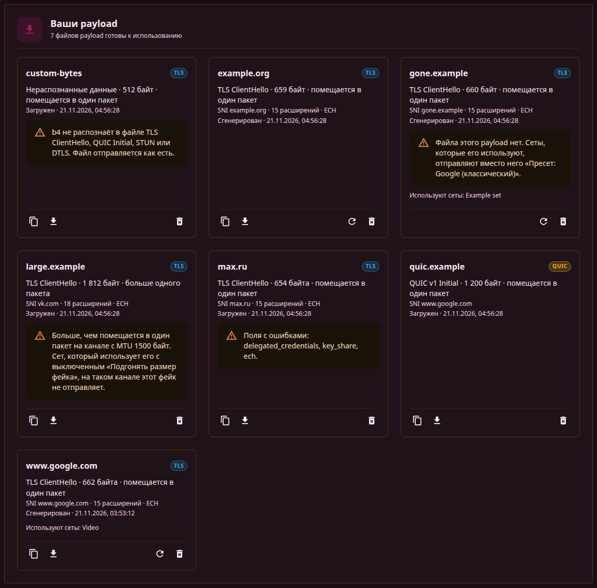
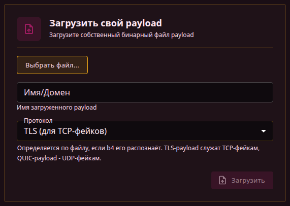
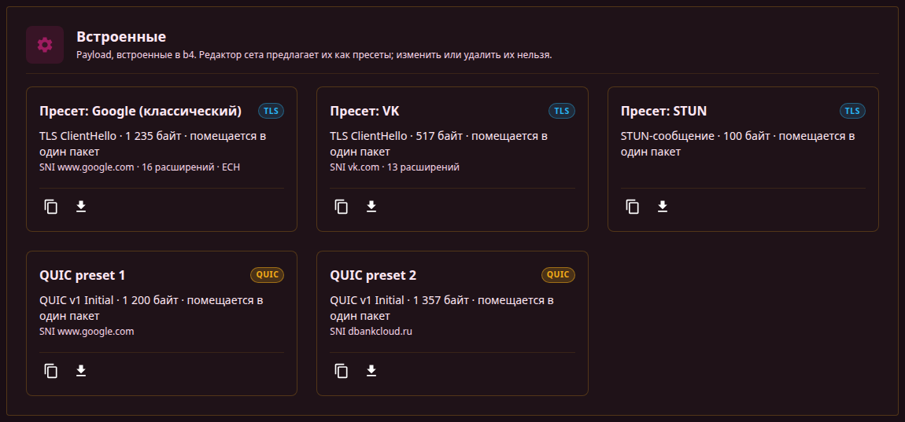

Вкладка **Payloads** хранит файлы, которые фейковые пакеты могут нести вместо встроенного payload, и показывает встроенные payload. Payload генерируется по доменному имени или загружается из файла. Ещё payload приходят вместе с сетами: при [импорте](../sets/import.md) командной строки zapret или byedpi с фейковыми данными и из [общего сета](../sets/sharing.md). Генерация, загрузка, повторная генерация и удаление выполняются на роутере сразу, без кнопки **Сохранить**, и сеты, которые используют payload, получают изменение тоже сразу.

## Зачем нужен payload {#why-payloads-exist}

Некоторые стратегии отправляют перед настоящим пакетом фейковый. DPI разбирает фейк, а **Стратегия фейка** сета не даёт серверу его принять, см. [Фейкинг](../sets/tcp/faking.md). Данные, которые несёт фейк, и есть payload. TLS-payload предназначены для фейков, которые сет отправляет по TCP, QUIC-payload - для фейков по UDP.

## Типы payload {#payload-types}

Поле **Тип фейкового payload** сета (**TCP > Фейкинг > Фейковые SNI-пакеты**) выбирает, что несёт фейк:

| Тип | Содержимое |
| --- | --- |
| **Случайное** | 1200 случайных байт, новых для каждого соединения |
| **Пресет: Google (классический)** | Записанный TLS ClientHello для `www.google.com`. С этого типа начинает новый сет |
| **Пресет: VK** | TLS ClientHello для `vk.com` размером 517 байт |
| **Пресет: STUN** | STUN Binding Request, без TLS |
| **Свой файл payload** | Payload с этой вкладки, выбранный в поле **Сгенерированный payload** |
| **Все нули** | 1200 нулевых байт |
| **Инвертированный оригинал** | Содержимое настоящего пакета, в котором инвертирован каждый бит |
| **Сгенерированный из домена** | ClientHello, собранный так же, как payload на этой вкладке, для имени из поля **Домен** сета |
| **Пользовательский** | Текст из поля **Пользовательский payload** сета, байт в байт. Есть в списке только у сета, где такой текст уже задан |

Пока у типа **Свой файл payload** не выбран payload или его файл пропал или пуст, а у типа **Сгенерированный из домена** не указано имя, фейк несёт **Пресет: Google (классический)**, и редактор сета об этом предупреждает. Отправная точка - тип payload из результата [Дискавери](../discovery.md).

## Сгенерировать payload {#generating-a-payload}

Карточка собирает TLS ClientHello, в котором имя сервера - имя из поля **Домен**. Имя, например `youtube.com`, и кнопка **Сгенерировать** или клавиша Enter добавляют payload в раздел **Ваши payload**.

ClientHello собирается на самом роутере. Соединение не устанавливается, имя не резолвится. Схема вроде `https://`, путь и порт отбрасываются, имя приводится к нижнему регистру. Интернациональное имя записывается в punycode: `пример.рф` превращается в `xn--e1afmkfd.xn--p1ai`. IP-адрес и текст, который не похож на имя хоста, отклоняются.

У каждого имени один TLS-payload. Если у имени он уже есть, вкладка оставляет его и сообщает, что он уже существует. Сгенерированный ClientHello помещается в один пакет. Его случайные значения выбираются при генерации и не меняются, пока его не пересоберёт **Сгенерировать заново**.

## Загрузить свой payload {#uploading-a-payload}

Карточка добавляет payload из файла размером до 64 КБ. b4 проверяет выбранный файл до загрузки и показывает, что в нём найдено: тип, имя сервера и размер.

| Поле | Что делает |
| --- | --- |
| **Выбрать файл...** | Открывает окно выбора файла. Выбранный файл сразу проверяется |
| **Имя/Домен** | Имя, под которым payload виден в сетах и в Дискавери, до 200 символов. Пока имя не введено вручную, при выборе файла сюда подставляется имя сервера из файла, а если его там нет - имя файла без расширения |
| **Протокол** | **TLS (для TCP-фейков)** или **QUIC (для UDP-фейков)**. Определяется по файлу, если b4 его распознаёт |
| **Загрузить** | Сохраняет payload. Доступна, когда проверка закончена и имя задано |

Предупреждения проверки загрузку не останавливают. Это те же предупреждения, что на карточках payload, см. [Ваши payload](#management). Пустой файл и файл больше 64 КБ загрузить нельзя, и карточка называет причину.

Если payload с таким именем и протоколом уже есть, загрузка спрашивает, заменить ли его, и называет сеты, которые его используют. После **Заменить** эти сеты сразу отправляют новый файл.

## Ваши payload {#management}

Раздел перечисляет payload, сохранённые на роутере. Каждая карточка описывает один payload:

| Часть | Что показывает |
| --- | --- |
| Имя и метка | Имя payload и **TLS** или **QUIC** - протокол, под которым он сохранён |
| Первая строка | Что это за файл (TLS ClientHello, QUIC Initial, STUN-сообщение, DTLS ClientHello или нераспознанные данные), его размер и помещается ли он в один пакет |
| Вторая строка | Имя сервера (SNI), если оно есть в файле. Для TLS ClientHello ещё число расширений и **ECH**, если в нём есть расширение ECH |
| Третья строка | Откуда payload, **Сгенерирован**, **Загружен** или **Импортирован с сетом**, и когда он сохранён |
| **Используют сеты** | Сеты, которые используют этот payload |

Предупреждение на карточке называет проблему payload:

| Предупреждение | Что означает |
| --- | --- |
| Файла нет | Файл пропал с роутера. Сеты, которые используют payload, отправляют **Пресет: Google (классический)** по TCP и нули по UDP, пока не выбран другой payload |
| Файл пуст | То же, что при пропавшем файле |
| Больше одного пакета | По TCP сет с выключенным **Подгонять размер фейка** не отправляет этот фейк на канале с MTU 1500 байт. По UDP уходит только начало файла |
| Не распознан | Файл не TLS ClientHello, не QUIC Initial, не STUN и не DTLS. Он отправляется как есть |
| Поля с ошибками | Поля ClientHello, которые строгий парсер отвергает, перечислены по имени. В сгенерированном payload их исправляет **Сгенерировать заново** |
| Тип не совпадает с протоколом | QUIC Initial, STUN или DTLS, сохранённый как TLS, или TLS ClientHello, сохранённый как QUIC |

Кнопки на карточке - иконки, ниже указаны их подсказки:

| Кнопка | Что делает |
| --- | --- |
| **Просмотр/Копирование hex** | Открывает **Hex-данные payload** с байтами payload в hex. **Копировать и закрыть** копирует их в буфер обмена |
| **Скачать .bin** | Сохраняет payload в файл |
| **Сгенерировать заново** | Есть только у сгенерированных payload. После подтверждения собирает новый ClientHello под тем же именем и в тот же файл, с новыми случайными значениями и исправленными полями с ошибками. Сгенерированному payload с пропавшим файлом возвращает файл |
| **Удалить** | Удаляет payload. Если его используют сеты, сначала спрашивает подтверждение и называет их |

У карточки с пропавшим файлом нет **Просмотр/Копирование hex** и **Скачать .bin**. Ещё две иконки находятся рядом с кнопкой **Сгенерировать**: **Обновить список** заново загружает список, а **Удалить все payload** удаляет все payload этого раздела после подтверждения, в котором названы сеты, которые их используют. Встроенные payload остаются.

Удаление, замена и повторная генерация сразу доходят до сетов, которые используют payload. После удаления эти сеты отправляют **Пресет: Google (классический)** по TCP и нули по UDP, после замены или **Сгенерировать заново** - новые байты. Если b4 не удаётся перезагрузить эти сеты, появляется сообщение.

## Встроенные {#built-in}

Раздел перечисляет payload, встроенные в b4, с теми же сведениями, что на карточках выше. Изменить или удалить их нельзя. **Просмотр/Копирование hex** и **Скачать .bin** работают как на остальных карточках.

| Payload | Что это |
| --- | --- |
| **Пресет: Google (классический)** | TLS ClientHello для `www.google.com`, 1235 байт |
| **Пресет: VK** | TLS ClientHello для `vk.com`, 517 байт |
| **Пресет: STUN** | STUN-сообщение, 100 байт |
| **QUIC preset 1** | QUIC v1 Initial для `www.google.com`, 1200 байт |
| **QUIC preset 2** | QUIC v1 Initial для `dbankcloud.ru`, 1357 байт |

Варианты UDP **(авто: QUIC Initial)** и **(авто: STUN-запрос)** собирают новый payload для каждого фейка и в этом списке не показываются.

## Payload в сете {#using-in-sets}

**TCP-фейки.** На вкладке **TCP** сета, подвкладка **Фейкинг**, тип **Свой файл payload** в поле **Тип фейкового payload** показывает список **Сгенерированный payload**. В нём TLS-payload этой вкладки, у которых есть непустой файл, по алфавиту, у каждого строка с происхождением, типом, размером и числом полей с ошибками. Список и его предупреждения описаны на странице [Фейкинг](../sets/tcp/faking.md#fake-payload).

**UDP-фейки.** На вкладке **UDP** сета, когда **Режим действия** - **Fake & Fragment**, поле **Payload фейкового пакета** предлагает payload этой вкладки рядом со встроенными вариантами, QUIC-payload первыми. Фейк несёт столько байт payload, сколько задано в **Размер фейкового пакета**: длинный payload обрезается, короткий дополняется нулями. Если размер меньше payload, вкладка сообщает, сколько байт уходит, и предлагает **Взять размер файла**. Варианты описаны на странице [UDP](../sets/udp.md#fake-settings).

## Payload в Дискавери {#using-in-discovery}

Поле **Сгенерированный или загруженный ClientHello как содержимое фейков** в панели **Параметры** страницы [Дискавери](../discovery.md) предлагает TLS-payload этой вкладки, у которых есть файл. Дискавери пробует выбранные payload раньше встроенных, а стратегия, найденная с одним из них, использует **Свой файл payload** с этим payload. Если со встроенными payload запуск ничего не находит, его можно повторить с payload, сгенерированными для нескольких имён.

## Где хранятся payload {#where-payloads-are-stored}

Payload - это файлы в папке `captures` рядом с [конфигурационным файлом](../advanced/config.md#расположение-по-платформам). Вкладка показывает только payload, которые сохранил сам b4: файл, скопированный в эту папку вручную, на ней не появляется. Добавить его можно загрузкой.
