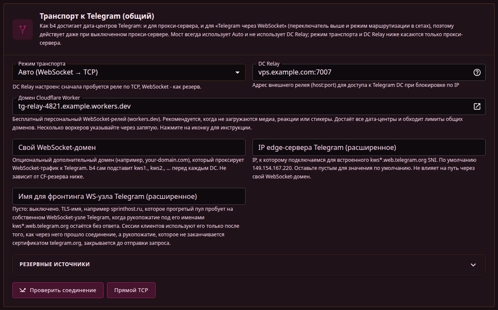

Карточка **Транспорт к Telegram (общий)** определяет, как сам b4 доходит до дата-центров Telegram. Её используют и [MTProto-прокси](./mtproto-proxy.md), и [Telegram через WebSocket](./websocket-bridge.md), поэтому она действует даже при выключенном прокси-сервере. По умолчанию выбран режим **Авто (WebSocket → TCP)** и включён **CF-резерв**.

## Требования

- Аккаунт Cloudflare - только для [Cloudflare Worker](./cloudflare-worker.md).
- VPS за пределами блокировки - только для [DC Relay](./dc-relay.md).

## Настройка

1. Откройте **Настройки > Telegram** и найдите карточку **Транспорт к Telegram (общий)**.
2. Выберите **Режим транспорта** для MTProto-прокси. **Прямой TCP** подходит для хоста, который напрямую достаёт до адресов Telegram, например для VPS за пределами блокировки. Для сети с блокировками рекомендуется **Авто (WebSocket → TCP)**.
3. Если не загружаются медиа, стикеры или реакции, укажите **Домен Cloudflare Worker**, см. [Релей на Cloudflare Worker](./cloudflare-worker.md).
4. Оставьте включённым **CF-резерв** в разделе **Резервные источники**.
5. Нажмите **Сохранить**. Смена режима транспорта, своего WebSocket-домена, IP edge-сервера, имени для фронтинга или настроек CF-резерва перезапускает MTProto-прокси.

| Режим транспорта | Что делает |
| --- | --- |
| **Прямой TCP** | Подключается к дата-центрам напрямую или через DC Relay, если он задан. |
| **Авто (WebSocket → TCP)** | Сначала пробует маршруты WebSocket, затем прямой TCP. |
| **Только WebSocket** | Использует только маршруты WebSocket, без прямого TCP и без DC Relay. |

Telegram через WebSocket всегда использует **Авто (WebSocket → TCP)** и никогда не использует DC Relay, что бы ни было выбрано на карточке.

## Проверка результата

- **Проверить соединение** пробует каждый настроенный маршрут к дата-центру 2 и показывает результат каждого, как только маршрут проверен: задержку или этап, на котором маршрут не прошёл. Маршруты, до которых проверка не успела дойти, отмечены как непроверенные.
- Кнопка **Прямой TCP** пробует дата-центр 2 по прямому TCP в обход DC Relay. Сравнение двух проверок отделяет проблему маршрута от проблемы самого Telegram.

## Если не работает

| Симптом | Что поможет |
| --- | --- |
| Не загружаются медиа, стикеры или реакции | [Домен Cloudflare Worker](./cloudflare-worker.md), **CF-резерв** включён |
| Рукопожатие с узлом Telegram под его именами обрывается, хотя сам адрес доступен | [Имя для фронтинга](#имя-для-фронтинга-ws-узла) |
| Узел Telegram не отвечает на адресе по умолчанию | Другой адрес в поле [IP edge-сервера Telegram](#ip-edge-сервера-telegram) |
| Заблокированы и прямой TCP, и маршруты WebSocket | [DC Relay](./dc-relay.md) |
| Домены CF-резерва заблокированы, а стратегия сета пропускает другие сайты | [Сет для Telegram](#сет-для-telegram) с этой стратегией; в режиме TUN - **Обрабатывать соединения с CF-доменами сетами**, а этот сет покрывает Cloudflare |

Строки лога, по которым опознаётся каждый случай, приведены на странице [Проблемы с Telegram](./troubleshooting.md).

## Другие настройки карточки

### Сет для Telegram

**Сет для Telegram** задаёт сет, который обрабатывает собственные соединения b4 с Telegram:
соединения MTProto-прокси и Telegram через WebSocket по всем маршрутам, включая
пул CF-доменов, свой WebSocket-домен и Cloudflare Worker, проверку соединения на этой
карточке и загрузку списков адресов Telegram. Другие сеты эти соединения не обрабатывают,
какие бы цели у них ни были. Соединения, которые Telegram через WebSocket передаёт дальше,
уходят в прокси-сет, в целях которого они есть; те, что он отправляет напрямую, идут через сет
для Telegram. По умолчанию выбрано **Без сета**: тогда они обрабатываются так, как
описано в разделе [Обработка DPI](./websocket-bridge.md#обработка-dpi).

Сет без маршрутизации применяет к этим соединениям свою стратегию на портах, которые
обрабатывает b4: 443 и порты из фильтров TCP-портов сетов, а если у сета есть свой фильтр
TCP-портов, то только в его пределах. Поэтому DC Relay на других портах стратегию не получает.
Остальные фильтры целей сета, например фильтр версии TLS, к этим соединениям не применяются. К соединениям с Worker стратегия применяется только при
включённом **Обрабатывать соединения с Worker сетами**. Сет с маршрутом через
интерфейс ведёт их этим маршрутом, а прокси-сет - через свой upstream; стратегию к ним ни тот,
ни другой не применяет. При включённом **Передавать имя домена в upstream**, как по умолчанию,
upstream получает имена хостов, а иначе и для имени, закреплённого в сете, - адрес по настройкам
DNS сета. Маршрут
выбранного сета ставится, даже если своих целей у сета нет. **Проверить соединение**
использует сет после сохранения выбора. Выбор другого сета для Telegram или изменение
маршрутизации выбранного сета закрывает открытые сессии MTProto-прокси и Telegram через WebSocket, и клиенты
переподключаются уже по новому пути.

**Создать сет для Telegram** добавляет включённый сет с именем Telegram, без целей и без
маршрутизации, и выбирает его. Оба изменения сохраняются кнопкой **Сохранить**. Стратегия
сета настраивается на странице **Сеты**, как у любого сета.

На странице **Сеты** у карточки выбранного сета есть значок **Сет для Telegram**, который
открывает эту карточку. Пока сет действует, у сета для Telegram без целей вместо списка целей
написано **Собственные соединения b4 с Telegram**, а за этим идут его фильтры портов, если они
есть. Вкладка **Цели** сета повторяет это в заметке. Цели
необязательны: домены и адреса, добавленные в сет, позволяют ему обрабатывать и соединения
устройств с ними, как любому сету, и не меняют обработку собственных соединений b4. Фильтр
TCP-портов у сета без целей также заставляет его обрабатывать TCP-соединения устройств на этих
портах, которые не взял другой сет.

Сет действует, пока он включён, его маршрутизация настроена до конца и b4 работает в режиме
NFQUEUE. Блокирующий сет и сет Telegram через WebSocket выбрать нельзя. Если одно из этих
условий не выполнено, карточка показывает причину, значок на странице **Сеты** называет её, а
соединения идут так же, как без сета.
Так же они идут, пока маршрут сета не установлен, например сразу после изменения. Без сета и
в режиме TUN маршруты через Cloudflare следуют переключателям **Обрабатывать соединения с
CF-доменами сетами** и **Обрабатывать соединения с Worker сетами**, см.
[Обработка DPI](./websocket-bridge.md#обработка-dpi). Если
маршрут перестаёт работать позже, решают настройки самого сета: **Аварийное отключение**
сета с интерфейсом, **Прямое подключение при недоступности upstream** у прокси-сета.
Соединения с сайтом fake SNI остаются вне сета.

При включённом **Telegram через WebSocket** соединения, которые upstream прокси-сета,
работающий на роутере, сам открывает к Telegram, вернулись бы в этот же upstream. Мост вместо
этого отправляет их напрямую и пишет предупреждение в журнал. Upstream не попадает в мост,
если помечает свой трафик, см. [Рядом с другими сервисами](../guides/marks.md#рядом-с-другими-сервисами).

### Свой WebSocket-домен

Домен, который передаёт WebSocket-трафик к Telegram, - для собственного релея рядом с общим пулом CF-доменов. b4 сам подставляет `kws1.`, `kws2.` и так далее по дата-центрам, поэтому имена должны резолвиться для каждого используемого дата-центра.

### IP edge-сервера Telegram

Собственный WebSocket-узел Telegram доступен по одному адресу, `149.154.167.220`, для всех дата-центров, которые он обслуживает. Поле **IP edge-сервера Telegram** в разделе **Дополнительно** карточки заменяет этот адрес для сети, где на адрес по умолчанию никто не отвечает. Принимается хост или IP-адрес без порта. На свой WebSocket-домен поле не влияет.

### Имя для фронтинга WS-узла

Если DPI обрывает рукопожатие для имён узла Telegram, а сам адрес узла остаётся доступным, b4 может передать в TLS-рукопожатии другое имя. Его задаёт поле **Имя для фронтинга WS-узла Telegram** в разделе **Дополнительно**, например `sprinthost.ru` - имя, которое использует tg-ws-proxy. По умолчанию поле пустое и фронтинг выключен. b4 пробует это имя только после того, как рукопожатие под собственными именами Telegram осталось без ответа, и оставляет соединение, только если оно заканчивается сертификатом `telegram.org`.

Фронтинг не помогает, если сеть блокирует адрес узла целиком или её DPI пересылает соединение по увиденному имени.

### Резервные источники

- **CF-резерв** использует ротируемый пул доменов за Cloudflare для дата-центров, которые не обслуживает собственный узел Telegram. **URL списка CF-доменов** - откуда раз в час обновляется пул. По умолчанию это список tg-ws-proxy на GitHub.
- **Резервное зеркало списка DC** берёт список дата-центров Telegram с зеркала, когда собственный эндпоинт Telegram недоступен. Зеркало по умолчанию размещено автором b4 и получает IP-адрес запрашивающего, и ничего кроме. **URL зеркала списка DC** задаёт другое зеркало, а выключение переключателя убирает резерв.

## Как это устроено

Для каждого дата-центра b4 составляет список маршрутов и пробует их в таком порядке:

1. Прямой TCP первым, если выбран режим **Прямой TCP** или режим **Авто (WebSocket → TCP)** с заданным DC Relay.
2. Собственный WebSocket-узел Telegram. Он обслуживает только дата-центры 2 и 4.
3. Свой WebSocket-домен.
4. Пул CF-доменов, пока включён **CF-резерв**.
5. Домены Cloudflare Worker.
6. Прямой TCP последним, в режиме **Авто (WebSocket → TCP)**, если он не стоит первым.

Маршруты пробуются внахлёст, и сессию несёт первый подключившийся. Маршрут, который раз за разом не срабатывает, следующие сессии какое-то время обходят.

Для дата-центров 1, 3, 5 и 203 WebSocket означает свой домен, пул CF-доменов или Worker. Поэтому медиа в зарубежных каналах первыми перестают загружаться, когда ничего из этого не доступно.

Для прямого TCP нужен хост, который достаёт до адресов Telegram. Большинство из них в `149.154.0.0/16`, дата-центр 203 находится на `91.105.192.100`, а дата-центры 4 и 5 доступны в `91.108.4.0/24` и `91.108.56.0/24`. Эти адреса встроены в b4. Обновление списка дата-центров меняет то, как b4 сопоставляет адрес с дата-центром, но не то, куда он подключается.
